# 实战交易系统：周线定潮 · 日线扣扳机

> 基于 Alexander Elder《以交易为生》I/II 全部精读笔记提炼。
> 定位：以三重滤网为主干的**波段交易系统**（持仓 2–10 个交易日），适用流动性好的股票 / ETF / 期货主力合约。
> 上手顺序：先只做多头，模拟或最小仓位跑 3 个月；连续两个月无计划外交易、交易等级均值上升后，才允许加仓和解锁空头模块。
>
> 配图说明：文中插图均摘自《以交易为生》I/II 原书对应章节，图注保留原图号，仅供个人学习使用。

---

## 0. 核心理念（一页总纲）

1. 交易是**负和游戏**：佣金 + 滑点持续抽水，"只比一般人强一点"不足以盈利。
2. 长期盈利靠三个 M 同时到位：**Mind 心理、Method 方法、Money 资金管理**。
3. 信条是"**处理，而不是预测**"：不猜市场，按预案应对。
4. 系统的目标不是高胜率，而是：
   - 周线过滤 → 只站在涨潮一侧；
   - 2% / 6% 规则 → 永远能玩下一局；
   - 记录评分 → 每个月都比上个月强一点。
5. 终极提醒：**目标是自由，不是赚不尽的钱；先活下来，让经验有时间复利。**

---

## 模块 0：开户与硬件准备

1. 选**佣金最低、滑点最小**的通道（负和游戏里这是纯利润）；只用限价单 / 停止单，不用市价单追价。
2. 行情软件三张图：**周线图、日线图**（必须），60 分钟图（可选）。
3. 每图固定指标（≤5 个，"五颗子弹"规则）：
   - 周线：13 EMA、26 EMA、MACD(12/26/9)、价格通道
   - 日线：13 EMA、价格通道、KDJ(5,3)、Elder-ray 或 Force Index(2)、成交量
4. 记录工具：交易计划单、逐笔记录表、周 / 月汇总表（见模块 7 与附录模板）。

---

## 模块 1：市场状态判定（每周做一次，结论必须写下来）

**大盘周线三色灯（以指数或宽基 ETF 为准）：**

| 状态 | 判定标准 | 本周允许动作 |
|---|---|---|
| 🟢 绿灯 | 价格在 13 周 EMA 之上；13 EMA > 26 EMA；MACD 柱在零轴上方且上升 | 只做多，可正常开仓 |
| 🔵 蓝灯 | 均线多头排列但 MACD 柱下降（动力减弱），或刚发生死叉 | 只持有 / 减仓，不开新多 |
| 🔴 红灯 | 13 周 EMA 下穿 26 周 EMA（死叉），或 MACD 柱在零轴下方且下降 | **不得持多、不得开多**；进阶者只做空 |


*图1-1｜周线 MACD 柱定潮流：柱体在零轴上方且抬升＝绿灯，掉头向下＝蓝灯，下穿零轴＝红灯。这正是三重滤网的第一层（《以交易为生》图 9-1，黄金周线）。*

辅助确认（选 1–2 个即可，不要求全部满足）：
- 周线 NH-NL：与指数顶背离 → 降档（绿→蓝）；底背离且跌破 −4000 后回升 → 重点关注做多。
- 情绪指标：看空 >55%（底部区）/ 看多 >65%（顶部区）、擦鞋童式新闻 → 只作警报，不单独择时。


*图1-2｜新高—新低指数：指数在 G、H 处再创新高，NH-NL 却只有微弱高点（顶背离），随后是 1987 年暴跌（《以交易为生》图 6-1）。*


*图1-3｜好友指数是反向指标：多头共识冲到通道上沿（如 38、41、44 点）往往对应顶部区，跌到下沿对应底部区（《以交易为生》图 7-1）。*

> 蓝灯 / 红灯纪律：宁可错过，不可做错。

---

## 模块 2：选股（绿灯下，每周筛一次）

只保留同时满足以下全部条件的标的：

1. **周线向上**：价格在 13 周 EMA 上方，周线 MACD 柱上升或底背离成立。
2. **流动性充足**：日均成交额足够大（参考标准：股票 ≥ 日均 5000 万元成交额），保证滑点小。
3. **日线回调到价值区**：价格回到 13 日 EMA 附近，或 EMA 与通道下轨之间。**绝不追在通道上轨之外。**
4. **无近期事件**：未来 5 个交易日内有财报 / 重大事件的，新手一律剔除。

建立 10–20 只的观察清单，**只在清单内交易**。


*图2-1｜价格围绕 13 天 EMA 摆动：回到 EMA 附近（价值区）是低风险买点，涨离 EMA 过远则进入兑现区（《以交易为生》图 4-2，黄金日线）。*

---

## 模块 3：入场（三重滤网逐层通过才扣扳机）

**做多条件——以下全部满足：**

- **第一层｜周线潮流**：本周大盘灯为绿，且个股周线向上（模块 2 第 1 条）。
- **第二层｜日线波浪（回调企稳）**，至少出现一个：
  - KDJ 的 K 值从 30 以下勾头向上；
  - Elder-ray 空方势力柱（负值）下探后明显收浅 / 由负转正，多方势力为正；
  - Force Index 2 日 EMA 跌到零轴下方后重新上穿零轴；
  - **加分项**：日线 MACD 柱底背离（含假突破前低后迅速收复）——最高质量信号。

**第二层总览：** 周线 MACD 翻多后，等日线劲道指数回落到买入区才动手。


*图3-1｜三重滤网第二层：方框为周线 MACD 的买/卖许可，日线劲道指数 2 日 EMA 给出具体触发位置（《以交易为生》图 9-2）。*

三种等价的日线企稳信号（任选其一，不要等全部出现）：


*图3-2｜KDJ（慢速随机指标）：超卖区勾头向上＝买入，超买区勾头向下＝卖出（《以交易为生》图 4-16）。*


*图3-3｜Elder-ray 透视指标：空方势力柱（下图）下探后收浅、甚至底背离，多方势力为正，说明抛压衰竭（《以交易为生》图 8-2）。*


*图3-4｜劲道指数 2 日 EMA：跌入买入区（零轴下方）再勾头，是回调结束的短线信号（《以交易为生》图 8-4）。*


*图3-5｜最高质量的加分项：A–B、F–G 处价格创新低而 MACD 柱抬高（牛背离），随后都出现强劲反弹（《以交易为生》图 4-5）。*

- **第三层｜扣扳机**：不预判，挂**买入停止单**于前一交易日高点上方 1 档；触发才入场。挂单一周未触发则取消，重新评估。


*图3-6｜第三层：周线翻多（方框区）后，把停止买单挂在近期小高点上方（a、d、f、h…），让市场自己向上突破来"扣扳机"（《以交易为生》图 9-3）。*

> 逻辑：周线保证只在涨潮里做多 → 日线保证买在回调结束而非追高 → 停止单让市场自己证明反转成立。


*图3-7｜三重滤网指令表：周线上升＋日线下跌＝观望并挂追踪型停止买单；两个周期同向才行动（原书小结表）。*

---

## 模块 4：仓位计算（铁三角，开仓前必须算完）

```
单笔最大风险额 = 账户总权益 × 2%        （新手建议用 1%）
每股风险       = 入场价 − 初始止损价      （另加佣金 + 预估滑点）
买入股数       = 单笔最大风险额 ÷ 每股风险  （向下取整）
```

额外约束：
- 同一行业总风险 ≤ 4%；全部持仓风险合计 ≤ 6%。
- 任何时候算出来的股数让你心跳加速、忍不住盯盘 → **减半**。
- 仓位以"能安然入睡"为上限：小头寸 → 低度恐惧 → 好决策。

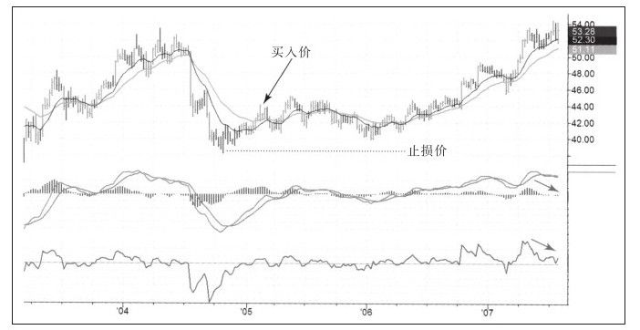

*图4-1｜先定价、再定量：KO 案例中买入价与止损价相距约 3 美元，按账户风险额反推"最多交易近 600 股"——股数是算出来的，不是拍脑袋拍出来的（《以交易为生 II》图 5-14）。*

---

## 模块 5：止损与止盈（三个价格，下单同时挂出）

买入前必须先写下：**入场价、止损价、目标价**。缺一个价格，不进场。

### 初始止损（做多）

- 默认：入场 K 线与前一 K 线两者低点中更低者，再往下留 1 档滑点空间（尼克止损法）。
- 止损只能**顺方向单移**（做多只上移），永不下移。

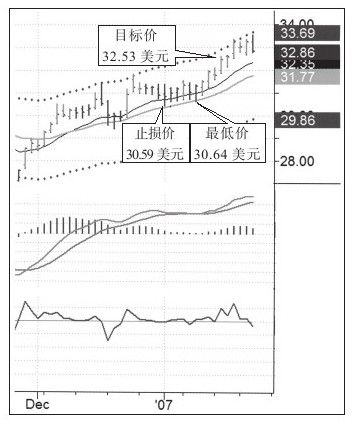

*图5-1｜尼克止损法实例：入场同时标好三个价格——目标 32.53、止损 30.59；随后最低下探 30.64，触而不破，多头继续持有（《以交易为生 II》图 5-7）。*

### 止损移动路线

1. 价格上涨约 1 倍初始风险 → 止损移到**保本价**（含手续费）。
2. 之后用吊灯止损（进场后最高点 − 2～3 倍 ATR）或抛物线 SAR 逐日跟升。
3. 盈利较厚时启用"50% 浮盈保护"：回撤不超过最大浮盈的一半。


*图5-2｜止损只上移、不下移：黄金交易中止损从 646.20 一路抬到 670 上方，回撤到均线附近也不松口（《以交易为生 II》图 5-8 系列）。*


*图5-3｜抛物线 SAR：点状止损线逐日跟升，反转触及即离场；阴影区为 SAR 失效、不可用的震荡段（《以交易为生》图 9-4）。*

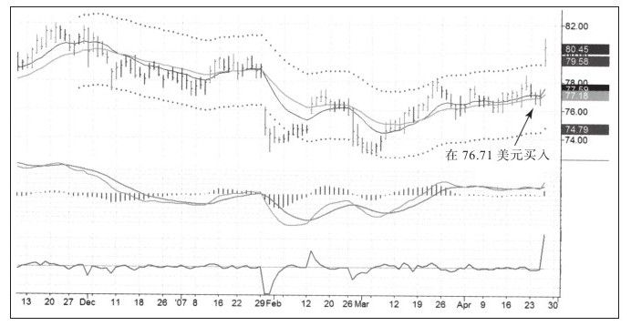

*图5-4｜吊灯思路的波幅减少追踪止损：76.71 买入后，止损按真实波幅逐日上移，让利润奔跑但把回吐锁死（《以交易为生 II》图 5-17）。*

### 止盈目标（开仓时写明，到达即执行）

1. 首选：日线**通道上轨**（覆盖 90–95% 价格）→ 平掉 1/2～2/3。
2. 次选：前期明确压力位 / 缺口下沿。
3. 剩余仓位用追踪止损吃延伸段。
4. **噪音出场**（不受目标价限制）：日线 MACD 柱顶背离、Force Index 顶背离、放量滞涨、大盘灯绿变蓝 → 不等目标直接走。
5. **时间止损**：买入后 5–8 个交易日仍不按预期运动 → 平仓释放资金。


*图5-5｜通道就是止盈目标：13 日 EMA ± 2% 通道覆盖约 90–95% 的价格，下轨附近买、上轨附近分批兑现，配合 MACD 柱背离加减仓（《以交易为生》图 9-5）。*

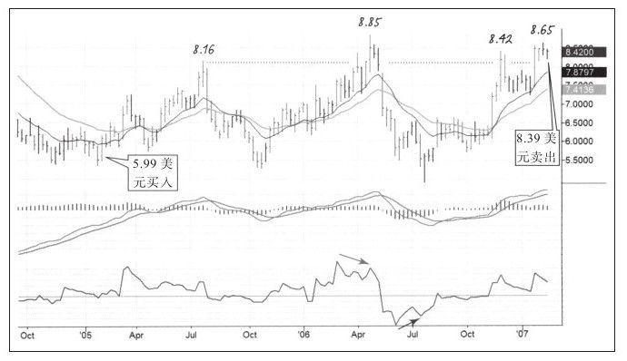

*图5-6｜噪音出场：8.99 买入、8.39 卖出——价格尚在高位但劲道指数顶背离（斜箭头）+ 见顶组合出现，不等目标价先走（《以交易为生 II》图 4-26）。*

### 盈亏比硬门槛

```
(目标价 − 入场价) ÷ (入场价 − 止损价) ≥ 2
```

达不到 2:1，放弃这笔交易。

---

## 模块 6：熔断规则（无条件执行）

1. **单笔**：风险 ≤ 2%；触发止损当天不得反向再开仓。
2. **单月（6% 规则）**：当月已实现亏损 + 在场浮亏合计达权益 6% → 全部平仓，当月停止交易，写完复盘后下月再进场。
3. **连续止损 3 笔**：强制停手 3 个交易日，只复盘不交易；区分是市场状态变了还是执行变形。
4. **状态黑名单**（当天不交易）：生病、失眠、情绪剧烈波动、醉酒、刚大亏或大赚之后。

---

## 模块 7：记录与复盘（系统中最重要的模块）

> Elder 原书："成功与否的唯一最重要因素是交易记录的质量。"

**三张表，每笔必填：**

1. **逐笔记录表**：日期、标的、方向、理由（周线灯 / 日线信号）、三个价格、股数、实际出入场价、佣金滑点。
2. **图文日记**：出入场两张截图标七色箭头（白=信号、红=止损、绿=止盈等），一句话记录心理状态。
3. **周 / 月汇总**：周末记录权益曲线、胜率、平均盈亏比、最大回撤。

原书记录表样张——入场前把 A–U 各项逐条填完，填不上来就说明计划没想清楚：


*图7-1｜交易者的基础表格（《以交易为生 II》图 3-1）。*

图文日记的三种形式：Outlook 日历每天一格记结论；软件截图用固定颜色标记买卖点与错误；再配一盒实体记号笔在打印件上复盘。


*图7-2｜日历式交易日记（《以交易为生 II》图 3-2）。*

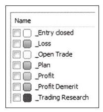

*图7-3｜颜色约定图例：同一种颜色永远只表示同一种含义（《以交易为生 II》图 3-2 图例）。*


*图7-4｜原书作者用的记号笔——"七色箭头"是真的用笔标出来的（《以交易为生 II》第 3 章）。*

同一次交易的入场页与出场页：周线图截图 + 一句心理点评 + 当天的买入 / 卖出评分。

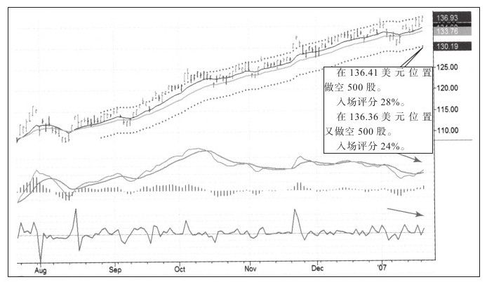

*图7-5｜入场页：136.41 与 136.36 两次做空，入场评分 28%、24%——买点并不漂亮，靠的是出场（《以交易为生 II》图 3-4）。*


*图7-6｜出场页：3 月以 127.9 平仓，出场评分 45%、交易总评 11%、净利润 9,273 美元（《以交易为生 II》图 3-7）。*

**每笔出场后量化打分：**

```
买入评分 = (当日高 − 买价) / (当日高 − 当日低)       目标 > 50%
卖出评分 = (卖价 − 当日低) / (当日高 − 当日低)       目标 > 50%
交易等级 = (出场价 − 入场价) / (通道上轨 − 通道下轨)
         A ≥ 30%｜B 20–30%｜C 10–20%｜C− <10%｜D < 0
```

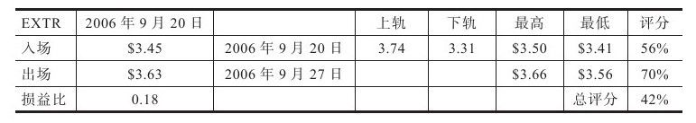

*图7-7｜评分表实例（EXTR）：买入评分 56%、卖出评分 70%、交易等级 42%（A 级），并单列损益比——三个分数把"感觉不错"变成可逐月比较的数字（《以交易为生 II》图 4-4）。*

**月度复盘三问：**

1. A / B 级交易占比是否在提升？
2. 亏损单是否全部符合止损规则？（亏，也要亏得"正确"）
3. 有没有计划外交易？

> 毕业标准：连续两个月无计划外交易，且交易等级均值上升 → 系统跑通，可加仓 / 上模块 8。

---

## 模块 8：进阶模块（主系统跑通后逐个解锁）

- **做空股票**：大盘红灯（周线死叉）+ 个股反弹到价值区 + 日线顶背离 / 向上假突破时做空；止损设前高上方；通道下轨平空；持仓 3–7 天，周末前评估。空头持仓比率 >50%、平空天数 >20 天的标的不碰。
- **熊市波段（MACD 反转系统）**：日线 MACD 柱下穿零轴做空、通道下轨平，反复做；不硬扛逼空（熊市两月反弹 50%–100% 很常见）。
- **期权备兑卖出**：持股后涨势乏力、价格靠近上轨时卖虚值认购，赚时间价值；只卖愿意以行权价接正股的合约。裸卖需 ≥10 万美元账户。
- **外汇 / 期货**：只用交易所透明品种（CME 外汇期货等）；远离"经纪商做对手盘 + 超高杠杆 + 订单不进市场"的平台。

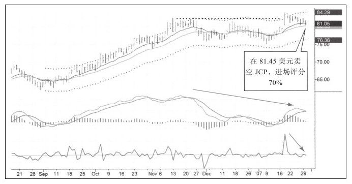

*图8-1｜顶部做空：JCP 在 81.45 美元出现向上假突破（长上影）后做空，进场评分 70%——做空也要等市场自己证明涨不动（《以交易为生 II》图 7-10）。*

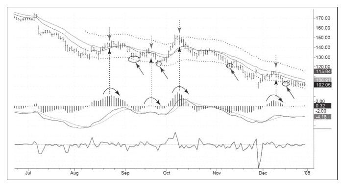

*图8-2｜熊市 MACD 反转系统：日线 MACD 柱下穿零轴做空、到通道下轨平仓，机械重复（《以交易为生 II》图 9-9）。*

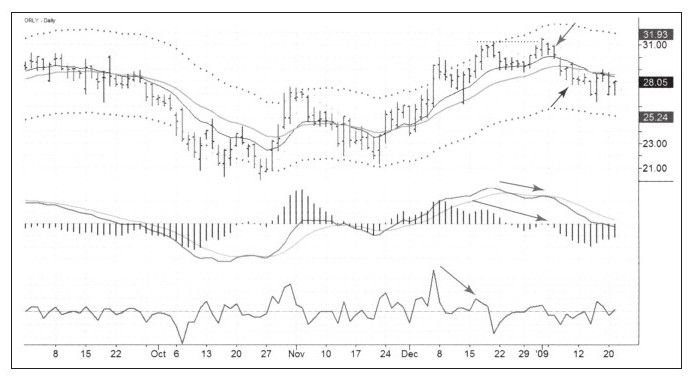

*图8-3｜别硬扛逼空：ORLY 在熊市里一波反弹幅度可观，过程中不断出现顶背离——反弹是用来重新找空点的，不是用来扛单的（《以交易为生 II》图 9-17）。*


*图8-4｜原书期权卖出案例：44.5 美元的股票、6 月执行价 45 的期权卖 4.8 美元——注意这是卖出看跌期权（裸卖），原则与备兑相同：只在你愿意以行权价接正股、且账户够大时才做（《以交易为生 II》图 8-8）。*

---

## 附录 A：交易计划单（每笔开仓前填完才允许下单）

| 项目 | 内容 |
|---|---|
| 日期 | |
| 标的 / 代码 | |
| 方向 | 多 / 空 |
| 大盘周线灯 | 🟢 / 🔵 / 🔴 |
| 周线依据 | 价格与 13 周 EMA 关系；MACD 柱状态；背离情况 |
| 日线信号 | □ KDJ ＜30 勾头　□ Elder-ray　□ Force Index　□ MACD 柱底背离 |
| 入场价 | |
| 初始止损价 | |
| 目标价 | |
| 每股风险（含佣金滑点） | |
| 账户权益 | |
| 单笔风险额（权益×2%） | |
| 买入股数（风险额÷每股风险） | |
| 盈亏比（≥2） | |
| 计划持仓天数 | |
| 一句话交易理由 | |

填好的计划单实例——入场价、止损价、目标价之外，还要写清市场分类、成交额与周 / 日线依据：

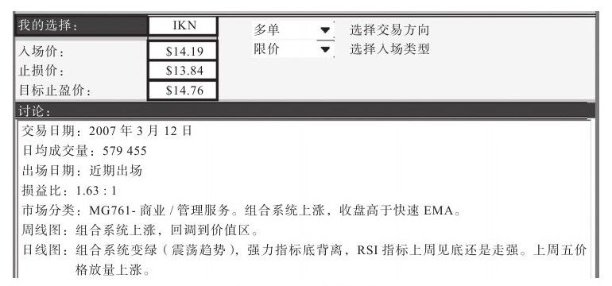

*图A-1｜IKN 做多计划单：入场 14.19、止损 13.84、目标 14.76，损益比 1.63:1，并附周线"组合系统变蓝、收盘高于快速 EMA"与日线"强力指标底背驰"的讨论（《以交易为生 II》图 6-2）。*

---

## 附录 B：逐笔记录表

| # | 开仓日 | 平仓日 | 标的 | 方向 | 股数 | 入场价 | 止损价 | 目标价 | 出场价 | 盈亏额 | 佣金滑点 | 买入评分 | 卖出评分 | 交易等级 | 是否按计划 | 备注 / 心理 |
|---|---|---|---|---|---|---|---|---|---|---|---|---|---|---|---|---|
| 1 | | | | | | | | | | | | | | | □是 □否 | |
| 2 | | | | | | | | | | | | | | | □是 □否 | |
| 3 | | | | | | | | | | | | | | | □是 □否 | |

---

## 附录 C：周 / 月汇总表

| 周次 / 月份 | 周末权益 | 本周/月盈亏 | 交易笔数 | 胜率 | 平均盈亏比 | A/B 级占比 | 计划外交易数 | 最大回撤 | 复盘要点 / 下周改进 |
|---|---|---|---|---|---|---|---|---|---|
| | | | | | | | | | |
| | | | | | | | | | |

**月度复盘三问：**

1. A / B 级交易占比是否在提升？→
2. 亏损单是否全部符合止损规则？→
3. 有没有计划外交易？原因是什么？→

---

## 附录 D：一页纸速查（可打印贴在屏幕边）

> **周末**：看周线灯 → 绿才找股，红只看戏。
>
> **选股**：周线向上 + 日线回到价值区。
>
> **入场**：周线允许 + 日线企稳信号 + 挂前日高点上方停止单。
>
> **下单前**：三价格写好、盈亏比 ≥2、股数 = 2% 风险额 ÷ 每股风险。
>
> **持仓**：止损只上移 → 保本 → 吊灯 / SAR；到通道上轨分批止盈；见背离先走。
>
> **熔断**：单笔 2%、当月 6%、连亏 3 笔停 3 天。
>
> **每天**：记日记、打三分；卖早可以，计划外交易不可以。

---

## 四条铁律（任何情况下不违反）

1. 不摊平亏损。
2. 不追缴保证金。
3. 减仓先减最差的仓位。
4. 错了立即认。
