# 《以交易为生》第3章：传统图形分析

> 亚历山大·埃尔德（Alexander Elder）著，《以交易为生》（机械工业出版社修订版）第3章"传统图形分析"精读笔记。

## 一、章节主旨

本章系统讲解西方经典图形分析工具：柱形图/蜡烛图的含义、支撑与压力、趋势与区间振荡、趋势线与通道、缺口、以及头肩形、矩形、三角形、双重顶底等经典形态。作者的核心立场是：**图形不是神秘的预测图纸，而是多空群体行为（贪婪、恐惧、痛苦、后悔、记忆）留下的痕迹**；图形分析最大的敌人是交易者的主观意愿——"大多数交易者看待价格图形就好比是一个巨大的罗夏测试"。因此，所有形态信号都必须配合成交量、技术指标、多时间周期验证与严格的资金管理来使用。

## 二、核心内容逐节梳理

### 3.1 图形

图形分析师研究市场行为，识别反复出现的价格形态，目标是形态再现时交易获利。多数人看含最高价、最低价、收盘价和成交量的柱形图；点数图分析师只跟踪价格变化。手工画图能培养对走势的感觉，计算机加快了速度却丢掉了某些感觉。**最大问题在于人的主观意愿性思维：交易者对形态的判断往往取决于他想买还是想卖。**

**历史概况**：查尔斯·道提出"平均指数反映了一切"；汉密尔顿著《股市晴雨表》，雷亚1932年出版《道氏理论》；20世纪30年代是图形分析黄金时代（夏巴克、雷亚、艾略特、范可夫、江恩）；1948年爱德华与梅吉出版《股市趋势技术分析》，使三角形、矩形、头肩形、支撑压力、趋势线广为人知。市场已变：40年代日成交活跃股票仅数百股，90年代常超100万股；早期"顶部尖、底部长"，50年代后反过来——**现在底部形成时间很短，顶部形成时间很长**。

**柱形图的含义（图3-1）**：
- 每一笔成交价都是所有市场参与者当时达成的**价值共识的货币表现**。
- 开盘价由业余投资者开出（单子经一夜积累早盘涌入）；收盘价主要由市场专业玩家开出（整天交易、收盘前积极获利了结）。开盘价与收盘价往往在柱子两端。
- 开盘价常位于日线高点或低点附近：早盘情绪化极点之后价格趋于理性。牛市中周一/周二创低点、周四/周五创新高；熊市相反。
- 收盘价高于开盘价，说明专业玩家比业余人士更乐观；反之更悲观。**跟随专业玩家的判断是有好处的。**
- 柱内高点＝该周期多方力量最强处；低点＝空方力量最强处；收盘价揭示多空战斗结果（接近日高多方胜，接近日低空方胜；期货市场收盘价决定每日"盯市"账面资产）。
- 高低点之差＝冲突激烈程度：平均长度一半的线反映市况沉闷；两倍平均长度表明市场热烈、多空无处不争。线短或正常时买入有利，线长时有利于获利；"在市场狂奔时建仓就好比跳上一列前行的火车"。

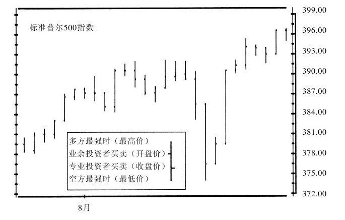

*一根价格柱就是一场多空博弈的缩影：图3-1 柱形图的含义（《以交易为生》原图）。*

**日本蜡烛图**：日本大米交易员最早使用，比美国早约200年。实体代表开盘价与收盘价之差：收盘高于开盘实体为白（空心），低于为黑（实心）；上下影线为最高、最低价。日本人更关注收盘与开盘的关系及多根蜡烛组合。优势是聚焦业余人士（主导开盘）与专业玩家（主导收盘）的较量；传统蜡烛图分析师忽视成交量、趋势线和技术指标，现代分析师（如格雷格·莫里斯）已将西方指标融入。

**市场轮廓**：J.彼得·史泰米亚提出，跟踪每一交易时段内的吸货与出货，要求实时数据；每半小时标一个字母，成交价格以该字母标注，字母积累形成钟形曲线，趋势突破时轮廓随之反映；可与流动性数据结合，跟踪场内交易员、套利者、场外交易员等群体的即时交易量。

**有效市场、随机游走与自然法则**：
- 有效市场理论认为任一价位反映所有信息、无人能跑赢市场。巴菲特比喻："在人们所认为的有效市场上投资就好比跟人玩桥牌，那人却被告知看牌没有一点好处一样。"其逻辑缺陷是**把知识等同于行动**——人有知识，仍会被群体情绪感染而做非理性操作。
- 随机游走理论认为价格变化随机。市场确有噪音，但聪明的观察者能识别群体反复出现的行为模式；人有记忆，记忆影响买卖，记忆为市场设立支撑和压力。
- 弗里德曼指出价格包含潜在供给与需求信息：低价买家进入，高价抑制需求，供应短缺导致恐慌性买入。
- 自然法则是一小撮神秘主义者的论调（艾略特甚至以《自然法则》为书名），相信市场如钟表按完美秩序运行、可提前很久预测顶底，并借占星术式营销推销课程和系统。神秘主义、随机游走、有效市场理论的共同点是"都不顾市场的实际情况"。

### 3.2 支撑与压力

- **支撑**：买盘强势到足以中断一轮下跌，或让下跌反转向上；图形上是连接几个低点的水平线或近似水平线。**压力**：卖盘强势到足以中断一轮上涨，或让上涨反转向下；是连接几个高点的水平线或近似水平线。
- 支撑与压力常常相互转化；价格每次触及前期支撑/压力位，就进一步强化其作用。
- 作者建议：**用K线实体边线画支撑/压力线比用高低点更好**，因为实体边线表明许多交易者已改变看法，高低点只反映最弱势交易者的恐慌心理。
- 小支撑/压力让趋势停顿，主要支撑/压力让趋势反转。

**记忆、痛苦与后悔**：支撑压力之所以存在，是因为人们有记忆，记忆促使人在特定价位买卖。例：1966～1982年道琼斯工业指数所有主要反弹都在950～1050点区域结束，被戏称"一道空中屏障"，一旦突破即转为重要支撑区域。
- 上升趋势回调中的支撑：痛苦的空头（等着再给机会平仓/买入）与后悔买太少的多头都准备买入。
- 下跌反弹中的压力：被套多方等反弹平推，空方后悔仓位太少等反弹加大放空。支撑压力强度取决于广大交易者感受的强烈程度。

**支撑与压力的强度**——取决于三方面因素（振荡区的长度、宽度、深度）：
1. **长度（时间/触及次数）**：两周区间微弱，两月为中度，两年成为广为接受的价值标准、重要支撑/压力位。"支撑和压力就像美酒，年代越久味越浓。"但随价位变老强度逐渐变弱——亏钱的人被清洗出局，新人对旧价位没有感情认同。
2. **高度（区域高度）**：相当于市价1%为弱（如标普400点时1%＝4点）；3%为中度；7%或更高就能磨光一轮主要趋势。
3. **成交量**：高成交量表明感情强烈认同，强度大；低成交量是弱支撑/弱压力信号。

**交易法则**：
1. 趋势接近支撑位或压力位时，**收窄保护性止损位**。趋势若足够强势突破并加速，止损不会被触及；触及即反转则趋势较弱，收窄止损可保住较好利润。
2. **长期走势图上的支撑压力比短期图上更重要，周线比日线重要**。同时看好几种时间周期，尽量参照长周期；周线趋势触及支撑/压力时应更积极行动。
3. 支撑压力对设置止损单和保盈利卖单很有用：买入后把止损设在振荡区底部之下，留出较大上行空间；更谨慎者在向上突破后买入、止损设在振荡区中位。真突破不应回抽确认，"就像火箭一旦发射就不可能再回挫一样"。止损位不必刻意避开整数位，关键是设在合理价位。

**真突破与假突破**：市场横盘时间远长于趋势运行时间，大多数对原有区域的突破是假突破——在价格返回前吸引趋势跟随者。**假突破是业余投资者的祸根，专业玩家却很高兴**：他们等突破停止创新高/新低后反向操作，止损单设在最新极点处，止损很窄、风险低而重返区域后获利空间大，收益/风险比高到只做对一半也能获利。真突破被成交量放大确认，假突破量往往不大；指标顺趋势创新高/新低确认真突破，价格与指标背离往往是假突破。最佳买入时机：周线图显示新上升趋势正在形成时的日线向上突破。

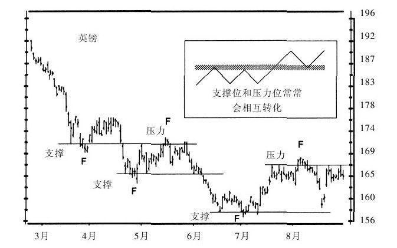

*突破后又跌回区间的F点正是专业玩家喜爱的假突破：图3-2 支撑与压力（《以交易为生》原图）。*

### 3.3 趋势与区间振荡

- **定义**：上升趋势中每次上涨突破前期高点、每次下跌低点高于前期低点；下跌趋势中每次下跌跌破前期低点、每次反弹高点低于前期高点；区间振荡时高点基本接近、低点基本接近。
- 技巧差异：趋势中操作要对趋势抱适当怀疑又防被轻易震出，趋势持续时系好安全带持仓；振荡区间中必须反应敏捷，轻微反转信号就清仓。
- **强弱处理相反**：趋势持续时追随强势方——上升趋势买入、下跌趋势卖出；区间振荡时反过来——**买弱卖强**。

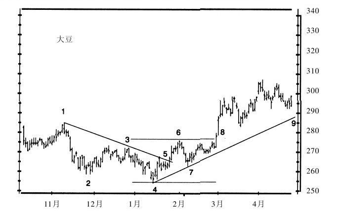

*趋势中顺势持仓、区间里高抛低吸：图3-3 趋势与区间振荡（《以交易为生》原图）。*

**群体心理**：多方强于空方则买盘推动上涨，空方打压会招来更猛反击；空方强则沽售推动下跌。势均力敌时区间振荡，像两群势力相当的帮派在街角互相推搡、谁也无法占领地盘；趋势是强势帮派赶走弱势帮派。群体漫无目的瞎转是常态，故区间振荡时间远长于趋势；群体激动时价格跳跃成趋势，但很难长久保持兴奋。

**难以决策的右边**：历史图形中趋势与区间一目了然，但决策只能在"图形最右边"做出；等你认出趋势，它已走了一大半；趋势演化为振荡时没有人会敲铃通知。右边许多形态与指标互相矛盾，必须在不确定性中按概率判断。"想在市场上判断正确代价是十分昂贵的。职业投资家总是快速止损。"

**识别方法（结合使用、互相认证）**：
1. 分析高低点形态：新高+底部抬升＝上升趋势；高低点均走低＝下跌趋势；不规则高低点＝区间振荡。
2. 画趋势线：连接近期重要低点的上升趋势线、连接近期重要高点的下降趋势线；**最重要的信息是倾斜方向**——向上倾斜做多，向下倾斜放空。日线重要高低点指至少近一周内的极值。
3. 画13天或更长周期移动平均线：线的倾斜方向代表趋势；若均线一个月内未创新高/新低，则属区间振荡。
4. 用MACD、趋向系统等指标识别趋势；趋向系统对抓住新趋势早期阶段特别管用。

**交易或等待**：急买能赶上趋势但止损宽、风险大；等回调风险降低，但有4种人在等回调（想补仓的多头、想平仓的空头、未建仓者、卖太早者），**深度回调往往意味着趋势反转**——趋势聚集力量时等待回调是业余做法。分仓法：预期突破时买1/3、突破时买1/3、回调时买1/3。铁律：买入点与保护性止损位的距离对应的亏损不要超过资金总量的2%；止损超限则放弃。趋势中仓位低一些、止损宽一些（防被震出）；振荡中仓位高一些、止损窄一些。"不要把牛市弄混了。"不能肯定时先站在一边。场外交易者的最佳策略是抓住趋势、减少操作频率以节省佣金与价差。

**多时间周期冲突**：同一市场同一时刻可既顺趋势又区间振荡——日线买入信号在周线可能是卖出信号。欧元案例：周线A到B完美上升趋势，同时日线X到Y下跌刚开始。**原则：对趋势有怀疑时，退一步看长一个级别的时间周期；专业玩家没把握时看长周期，业余人士关注短周期。**更快的数据或场内交易都救不了输方（超半数场内交易员第一年被淘汰）。

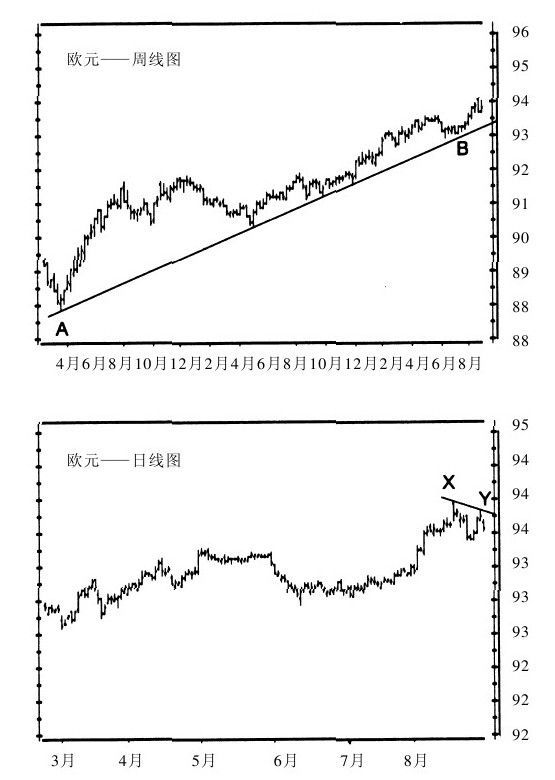

*周线向上而日线向下时，听大周期的：图3-5 不同时间周期的图形互相冲突（《以交易为生》原图）。*

### 3.4 趋势线

- 下跌底部表明空方力量耗尽、多方重新掌控；上涨顶部表明多方耗尽、空方重新掌控。**连接相邻两个低点的线是多方能量的底线；连接相邻两个高点的线是空方能量的底线。**
- 最重要特征是倾斜方向：向上＝多方主导，买入并把止损设在趋势线下方；向下＝空方主导，放空并把止损设在线上方。

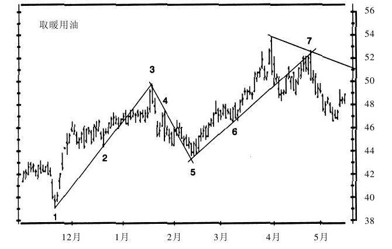

*触及次数越多的趋势线越有分量，跌破它就是空头信号：图3-4 趋势线标识趋势（《以交易为生》原图）。*

**怎样画趋势线**：作者主张**通过K线实体边缘画，不通过极限价格（影线）画**——边缘代表大多数交易者改变看法，影线只反映恐慌程度而非群体心理。影线跑到振荡区之外又折返，提供反向交易机会；识别出长影线即采取相反策略，止损设在影线中位；市场开始"吃掉影线"就该出局。

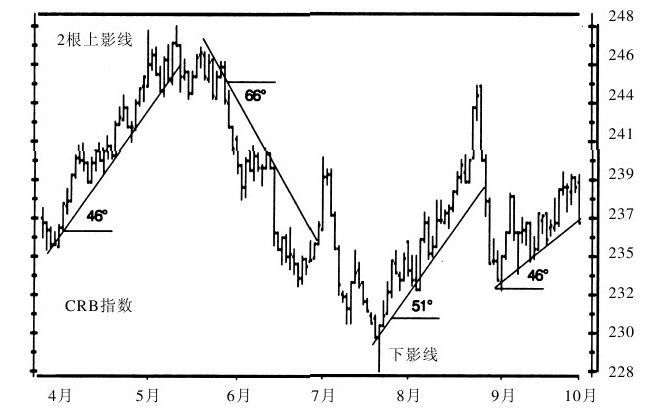

*长影线是恐慌情绪戳出的尖，戳完即折返：图3-6 趋势线与"影线"（《以交易为生》原图）。*

- **斯波朗迪1-2-3反转法**（《专业投机原理》）：下跌趋势中，连接最高点A与最低点C之前的高点B画线（线不触及A、B之间任何价格）。趋势线在点（1）被突破＝第一个信号；点（2）考验近期低点失败折返＝第二个信号（好买点）；价格突破高点（3）＝确认反转。下跌趋势反过来分析。此法抓主要反转而非短期波动。

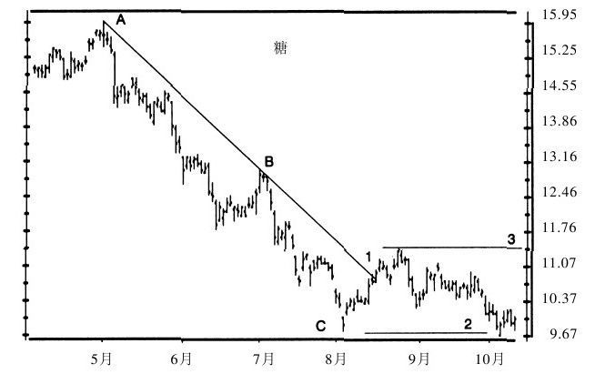

*破线、试底失败、越过前高，反转由三个客观条件共同确认：图3-7 1-2-3反转法（《以交易为生》原图）。*

**趋势线评级（5因素）**：
1. **时间周期**：周线趋势线比日线重要，日线比小时线重要。
2. **长度**：越长越有效，惯性越大，大牛市可沿趋势线持续数年。
3. **触及次数**：次数越多越有效。两点是初始趋势线，三点更有效，四点五点表明主导方牢牢掌控。
4. **角度**：夹角反映主导方情绪激烈程度；陡峭＝行动迅速，平缓＝缓慢但持续更久（"龟兔赛跑"）。应测量并记录每条线角度；同一市场同一角度往往反复出现。价格加速时画更陡的新线，要收紧止损到新线之下并每日调整；陡线被突破常伴随急剧反转。
5. **成交量**：顺势运行放量、折返缩量均确认趋势；回抽趋势线时放量警告可能突破；远离趋势线时缩量警告趋势难继。

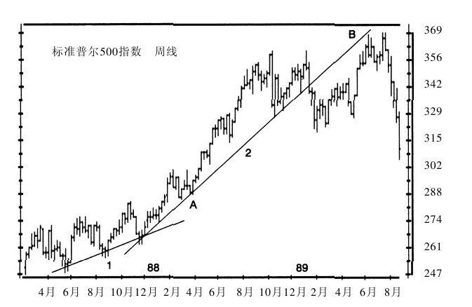

*走势加速时换上更陡的新线，止损也要跟着收紧：图3-8 趋势加速（《以交易为生》原图）。*

**趋势线突破**：趋势线不是碎了就完的玻璃地板，更像牛熊都能倚靠、拱动的篱笆——**只有价格接近趋势线另一侧时才算有效突破**。有人坚持跌破两三个百分点才算（400美元/盎司黄金时即8～12美元）。陡的上升趋势线被跌破后，价格常重新上涨考验前期高点并从线下方接近趋势线——构成近乎完美的放空机会（双重顶＋回抽原线＋可能的熊背离）。

**交易法则**：
1. **沿趋势线倾斜方向操作**：向上只找买点不放空，向下只放空避免做多。
2. **趋势线提供支撑或压力**：上涨中价格触及趋势线时买入、止损设在线下方；下降趋势相反。
3. **陡峭趋势线预示急剧下挫**：坡度超过45°，就把止损位设在趋势线上，并每天随线调整。
4. **突破陡线后常重新考验近期极点**：回抽前期高点若缩量且指标背离，是极佳放空机会；下降趋势线突破后回撤前期低点，是低风险买点。
5. **画一条与趋势线平行的通道线，用通道线设定盈利目标位。**

**趋势线通道（图3-9）**：通道由两条平行线组成，从下降低点画上升趋势线后，可通过上涨高点画平行通道线（下降趋势同理）。最佳放空点在下降通道上半部，最佳买点在上升通道下半部。通道线同样通过振荡区边缘画；通道线出现强化趋势线有效性；通道越宽趋势越强。上升通道中线以下买入、中线以上卖出，下降通道相反。趋势反转时可用通道反推**初始趋势线**：突破下降趋势后，先连接最近两个上涨高点作为新通道线，再过最近低点画平行线即为初始上升趋势线。

**初始趋势线**：一个"只通过一点画出趋势线"的技巧。价格突破下跌趋势并反弹到线上方后，连接最近两个高点作为通道线，过最近低点画平行线——即初始上升趋势线，用以判断未来低点，往往指出极好买点；**用在底部比顶部有效**。

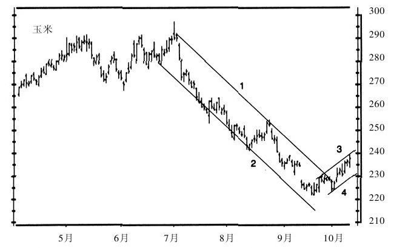

*玉米价格沿平行通道上下滑行，初始趋势线就藏在通道的反推里：图3-9 趋势线通道和初始趋势线（《以交易为生》原图）。*

**其他**：跌破上升趋势线后，量高点到趋势线的垂直距离，预计价格还将自趋势线下跌同等幅度（新走势最小目标位，实际常超出）。趋势线也可用于成交量与指标；上升的成交量趋势线确认价格趋势；RSI特别适于趋势线分析，往往先于价格突破其趋势线，提供早期信号。

### 3.5 缺口

缺口由相邻两根K线组成：一根的低点比另一根的高点还高（向上缺口），表明某一价位没有成交。突发买卖失衡、惊慌新闻常诱发缺口。缺口表明交易群体受到刺激、赔钱者受伤，可据此估计其下一步行动。
- **真/假缺口**：市场突破某价位产生的是有效缺口；所分析市场已收市、海外市场仍在交易造成的是假缺口（如芝加哥外汇期货日线缺口只反映东京、伦敦的最新价格）。
- 四大类：**普通缺口、突破缺口、中继缺口、衰竭缺口**，含义与策略不同，须提前识别。
- 图3-10的逐标注示例（原文用纸逐步遮盖法演示）：
  - A：跳空缺口——放空，止损设在缺口上沿几个点处。
  - B：衰竭缺口，第二天即回补、下降趋势结束——立即回补空头。
  - C：又一个衰竭缺口，缺口后未创新高，振荡几天后放空、止损设高点之上。
  - D：下跌趋势中的中继缺口——放空，止损设缺口上沿几个点处。
  - E：衰竭缺口，两天后回补——立即回补空头。
  - F：振荡区中部的普通缺口，第二天补上——不采取行动。
  - G：突破缺口——做多，止损设缺口下沿几个点处。
  - H：中继缺口——继续加仓做多；最右侧缺口性质待定，成交量温和则偏中继。

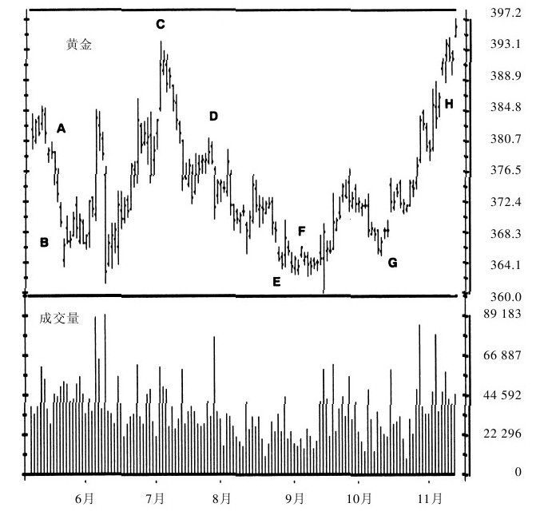

*同样是跳空，普通、突破、中继、衰竭四种缺口的含义截然不同：图3-10 缺口（《以交易为生》原图）。*

**普通缺口（common gap）**：几天之内很快回补；常出现在交易平淡市况、远期合约、清淡股票、地量超卖底部。上升缺口后不创新高、下降缺口后不创新低，表明后继乏力；当日量可能略放大但随后回到平均水平。**操作价值最小、出现次数最多。**除息缺口也是普通缺口（分红50美分则每股价值少50美分）。

**突破缺口（breakaway gap）**：价格**带量**跳出振荡区开始新趋势；可几周、几月甚至几年不回补。缺口前振荡区越长，随后趋势越久；向上突破后连创新高，当日及随后几天量能急剧放大，**缺口当天量可能是之前几天平均量的两倍**。标志群体心理重大变化，越早搭上收益越好。机械地等缺口回补会在突破缺口上输得很惨。

**中继缺口（continuation gap）**：出现在强势趋势中部，不回补，之后继续顺趋势创新高/新低；表明主导群体获得新的强势盟友。**测算法**：算出趋势起点到缺口的距离，自缺口起顺趋势画等距线即为趋势目标位，达标应获利了结。量能确认：成交量较缺口前几天均量**放大至少50%**；缺口后几天不创新高/新低，则可能是伪装的衰竭缺口。

**衰竭缺口（exhaustion gap）**：出现在趋势末端，之后不创新高/新低，振荡后重新回补缺口。初看像中继缺口（带量顺趋势跳空），但只有**价格反转回补缺口时才能确认**；像疲惫运动员最后一搏，突然爆发却难以持久。

**交易法则**：
1. **普通缺口**不是好机会，若一定要做则反向操作：缺口向上，在市场不再创新高时放空，止损设近期高点之上、缺口下沿平仓；缺口向下，在不再创新低时做多，止损设近期低点之下、缺口上沿了结。
2. **突破缺口**：带量突破前期长时间盘整且之后继续创新高/新低即可认定。向上跳空高开则买入、止损设在缺口下沿；**有效突破缺口几乎从不回补**，新趋势开始时等回抽可能错失良机；向下则反向。
3. **中继缺口**：操作类似突破缺口，尽早买入、止损设在缺口下沿（下跌反向）；趋势接近测算目标位时收紧止损。
4. 有效突破/中继缺口**必须得到一系列新高或新低确认**，否则可能是衰竭缺口；市场拒绝沿缺口方向创新高/新低时，平仓观望、重新评估。
5. **衰竭缺口**提供好机会（随后常剧烈反转）：识别出向上衰竭缺口就卖空、止损设近期高点之上；价格下滑时不坚定多头会抛售，价格持续创新低就持空至不再创新低时平仓；下跌反向。用期权做衰竭缺口更容易，尤其顶部买入看跌期权。

**其他**：**岛形反转**＝一个中继缺口＋反方向突破缺口，中间紧凑振荡并放量，形似孤岛；很少出现，一旦出现标志重大反转，沿岛形之前趋势的反方向操作。相关市场缺口有提示作用（黄金突破而白银、铂金未动，可提前埋单）。缺口可作支撑/压力：缺口后放量则支撑强，量在缺口前则弱。劲道指数可辅助分类。标普500期货开盘缺口几乎总被回补（高开回落至前天高点、低开反弹至前天低点），但不可机械操作，须指标显示推动力弱化时才反向入场。

### 3.6 图形形态

形态分两类：**趋势持续形态**（旗形、三角旗形，沿现有趋势方向操作）与**趋势反转形态**（头肩顶、头肩底、双重底、双重顶，清空现有仓位）。三角形和矩形既可作持续也可作反转。多个形态指向同一方向则信号强化；互相矛盾则抵消，最好不操作。

**头肩顶（图3-11）**：
- 特征：健康上升趋势高点一轮高过一轮、低点抬升；"头"是被两个低一些的"肩"围在中间的价格峰值；**颈线**连接左肩之后与头部之后两个下跌低点，可水平、上倾或下倾，**向下倾斜的颈线最空**。
- 成交量形态典型：到头部时量缩小（警告收紧多头止损）；自头部下跌跌破上升趋势线表明上升趋势结束；头部下跌中放量乃不祥之兆；右肩比左肩小、量低，表明趋势走弱；跌破颈线形态完成；跌破后有时缩量回抽颈线，是绝好放空点。
- **目标位**：自颈线开始的下跌空间（B）与头部到颈线的距离（A）大致相当。
- 群体心理：多方先占优，至头部已推不动价格；右肩反弹无力显示主导权移交空方；缩量回抽是被套者最后挣扎。

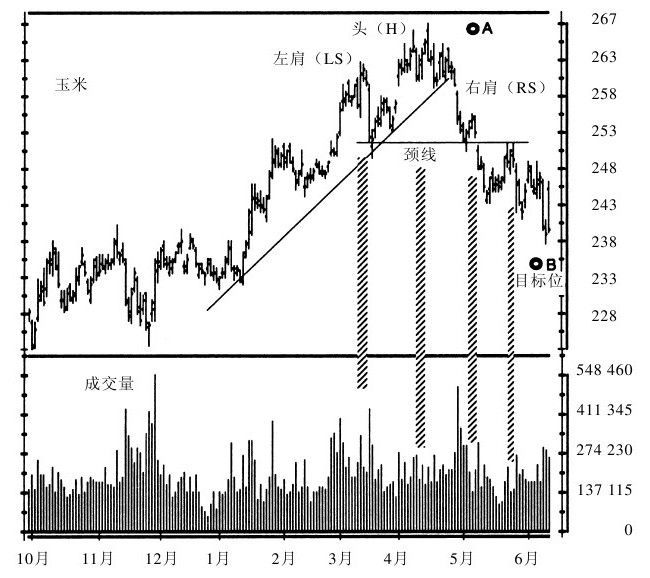

*颈线一破，头部到颈线的距离就是下跌的标尺：图3-11 头肩形（《以交易为生》原图）。*

头肩顶交易法则（多头仓位有三选择：立即抛出、收紧止损、卖一部分留一部分；第四种"害怕却不动"不可取）：
1. 识别出**头部或右肩**时，若出现缩量、跌破上升趋势线、指标与价格背离，就卖出。
2. 自头部下跌形成颈线后，仍持多头仓位者把**止损设在颈线上方**。
3. **右肩**上涨常缩量且指标明显走弱（右肩指标往往高于头部但从未超左肩），是最后兑现时机；在右肩放空、止损设头部上方，并挂"停损转向"单。
4. 一旦**跌破颈线**，随后的缩量回抽是绝佳放空机会，止损设颈线上方一档。

补充：顶部波动大，若止损风险超单笔最大风险（2%），应放弃或买入看跌期权；周线图是顶部则日线头肩顶应马上平仓，周线仍强则收紧止损更好。

**巴什克维尔的猎犬**：可靠形态没有走出期望走势、价格反向运行时出现。名称源自柯南·道尔小说——关键线索是"狗没有叫"（预期应发生的事没发生）。头肩顶指示上涨结束，若价格自右肩继续上涨、向上突破头部，即给出该信号：应回补空头并反向做多；**夭折的头肩顶随后常出现强势上涨**，突破头部时买入、止损设头部上方一档。

**头肩底（内凹的头肩形，图3-12）**：与头肩顶对称，头在最下、两肩在上，出现于跌势尾声。下跌到头部缩量（对熊市的警告）；自头部上涨突破下跌趋势线表明跌势结束；右肩缩量＋上倾颈线预示强势上涨；**突破颈线放量确认**，随后回抽常不触颈线。目标位：颈线到目标（B）的距离与头部（A）到颈线相等，实际涨幅常超出。最佳买点在右肩，止损设头部下方几个点；头肩底操作风险更小（价格波动较小、止损可收窄）。

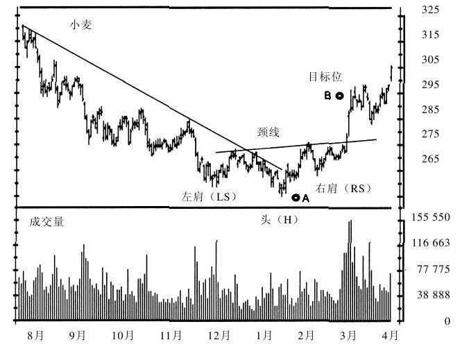

*底部反转要等放量突破颈线才算数：图3-12 头肩底（《以交易为生》原图）。*

**矩形（图3-13）**：
- 特征：价格在两条平行线之间运行（多为水平，也可倾斜）；需4个点——两个高点连上轨、两个低点连下轨；按K线实体区域画线，不按高低点。上轨压力、下轨支撑，表明多空势均力敌。
- 只要主趋势线没破坏，作为持续形态可能性更大；近上轨放量则向上突破可能大，近下轨放量则向下可能大。
- 有效突破成交量比**前5天均量放大1/3～1/2**；不放量可能是假突破。上升趋势中的矩形范围往往比下跌趋势中大；持续越久突破意义越大，周线突破尤为重要。
- 突破后常反抽突破边（B、D、E线），反抽提供与突破同向的低风险机会，止损设矩形内侧；支撑压力角色可反复转化。
- **目标位**：突破后幅度至少与矩形高度相等；最大涨幅为矩形长度（"横起来有多长立起来就有多高"）；普卢默建议以矩形高度乘斐波纳奇系数1.618、2.618、4.236测算目标。

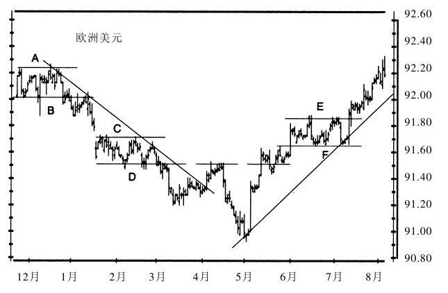

*多空在两道平行线之间打成平手：图3-13 矩形（《以交易为生》原图）。*

矩形交易法则：
1. **矩形内操作**：下轨买入、上轨卖出；用振荡指标（随机指标、RSI、威廉指标触及参考线转向）判断内部反转；下轨买入止损设下轨之下一档，上轨卖空止损设上轨之上一档；见反转信号迅速获利，持仓超过止损位很危险。
2. 从**更长周期**判断是否突破：抓日线突破要看周线趋势，沿周线方向突破可能性更大。
3. **突破跟进**：突破上轨买入或突破下轨放空后，止损设矩形内侧一点儿；随后可能缩量回抽，但有效突破不应重新返回矩形之内。

**盘整和旗形**：盘整也是矩形，按道氏理论是对主要趋势的调整，振幅约为当前股价的**3%**；"线形盘整"而非深幅回调说明主要趋势十分强势。**旗形**是上下轨平行但向上/下倾斜的矩形，**突破方向一般与旗形倾斜方向相反**：上倾旗形向下突破可能大，下倾旗形向上突破可能大。上升趋势中见下倾旗形，可在近期高点附近买入等向上突破；上倾旗形表明机构出货，可在近期低点之下挂卖空单；下跌趋势相反。

**三角形（图3-14）**：
- 构成：两条可交叉的线，上轨由两个以上高点、下轨由两个以上低点连成；也称"蓄势（coils）"。
- 按角度分三类：**对称三角形**（上下角度相等，如上30°下30°）多空势均力敌，趋势延续可能性大；**上升三角形**（上边水平平缓、下边上倾）多方每次能把价格拉回同一水平，向上突破可能大；**下降三角形**（下边平缓、上边下倾）空方每次压到同一水平，向下突破可能大。
- **大小**：高度为前期趋势10%～15%的小三角形成持续形态可能性大（趋势中像逗号）；高度达前期趋势1/3或以上的大三角形成反转可能大。
- **突破位置**：价格一般在运行到三角形长边（水平宽度）的**2/3处**突破；有效突破出现在前2/3部分，后1/3的突破不要操作；跟随到顶点则走势平淡（两位疲惫拳手互相依靠，到顶点双方皆耗尽）。
- 成交量：持续越久量越小；触边放量一边可能被突破；有效突破伴随量能较**前5日均量放大50%以上**。突破后回抽是顺势最佳入场点。
- **目标位**：突破后空间至少与三角形最宽一边等距；强势趋势中的小三角形涨幅可能超过底边高度；也可用斐波纳奇系数。
- 相关市场与同行业个股常同时出现三角形，可互为印证（如黄金先突破，白银、铂金大概率跟随；通用汽车与福特比较，而非与IBM）。

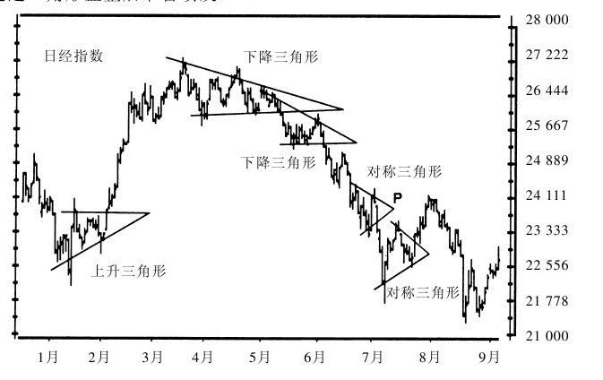

*一边水平一边倾斜，三角形的角度已暗示突破方向：图3-14 三角形（《以交易为生》原图）。*

三角形交易法则（最好不在三角形内操作，除非大三角形；波动收窄使价差和佣金吞噬利润）：
1. 若在**三角形内操作**，用随机指标、透视指标（Elder-ray）等振荡指标抓细微波动。
2. 判断日线三角形突破方向要看**周线图**：周线向上则日线三角形大概率向上突破，反之亦然。
3. **突破挂单**：买单设三角形上边一档（变窄时不断降低买价），卖空单设下边之下一档（变窄时不断提高卖价）；建仓后止损设三角形内侧；有效突破后可能回抽但不会深入三角形内。
4. 突破后**回探**时观察量能：带量回抽可能意味突破失败，缩量回抽是加仓好机会。
5. 价格接近三角形水平方向的**后1/3**时撤销买卖单——后1/3的突破不可靠。

**非典型三角形**：
- **三角旗形**：小三角形，上下边同向倾斜。与趋势反向倾斜者是持续形态——"三角旗飘扬在旗杆的中间"，即旗后涨幅与之前相等；与趋势同向倾斜意味趋势衰竭、即将反转。
- **扩散三角形（喇叭形）**：高点低点都向外扩张，市场波动剧烈、多空倾力介入，对上升趋势来说会扼杀趋势。
- **菱形**：先是扩散三角形后变成对称三角形；难识别、属典型罗夏型形态，操作价值很小，作者经验中"大多数都是假的"。

**双重顶和双重底**：价格上涨到前期高点位置形成双重顶，跌到前期低点附近形成双重底；第二个顶/底可比前一个略高或略低，常使初学者混淆。聪明的交易者用**技术指标背离（牛背离/熊背离）**来识别；**双重底买入、双重顶卖空是最好的交易机会**。

## 三、形态与法则速查表

| 形态/概念 | 关键特征 | 买卖信号 | 目标位 |
|---|---|---|---|
| 支撑/压力 | 连接低点/高点（实体边线）的水平线，角色可互换 | 支撑买、压力卖；接近时收窄止损 | 无固定目标 |
| 真/假突破 | 真突破放量、指标同向；假突破量小、指标背离 | 假突破反向操作，止损在最新极点外 | 返回原区域 |
| 上升/下跌趋势 | 高点低点同步抬升/降低 | 顺势追强：上升买、下跌卖 | — |
| 区间振荡 | 高点、低点各自基本接近 | 买弱卖强，轻微反转即离场 | 区间另一边界 |
| 趋势线 | 沿实体边缘画；方向最重要 | 顺斜率方向操作，触线入场 | 通道线 |
| 陡趋势线（>45°） | 情绪激烈、难持久 | 止损贴线每日调整；破后回抽极点是反向机会 | 极点到线的等距幅度 |
| 趋势通道 | 两条平行边线，越宽趋势越强 | 下半部买、上半部卖 | 对侧通道线 |
| 普通缺口 | 几天内回补，清淡市况 | 反向操作（非好机会） | 缺口边缘 |
| 突破缺口 | 带量跳出盘整，量可达均量2倍，几乎不回补 | 即时顺势跟进，止损在缺口沿内 | — |
| 中继缺口 | 趋势中部、放量≥50%确认、不回补 | 顺势加仓，达标收紧止损 | 缺口起再量一个"起点→缺口"距离 |
| 衰竭缺口 | 末端、不创新高/低后回补 | 缺口方向反向交易（可用期权） | 剧烈反转 |
| 岛形反转 | 两反向缺口夹紧凑振荡放量 | 沿原趋势反方向操作 | 重大反转 |
| 头肩顶 | 头居中、两肩较低；颈线可倾，下倾最空；头肩量递减 | 头/右肩卖；破颈线回抽补仓放空 | 颈线下量"头→颈线"等距 |
| 头肩底 | 反向对称；突破颈线放量 | 右肩买、回抽颈线加买 | 颈线上量"头→颈线"等距，常超出 |
| 矩形 | 两水平线间振荡，4点画线 | 内：下买上卖；突破放量（增1/3～1/2）跟进 | 最小＝高度；最大＝长度；或高度×1.618/2.618/4.236 |
| 盘整 | 振幅约3%的窄矩形 | 线形盘整表明主趋势强 | — |
| 旗形 | 倾斜矩形，突破与倾斜反向 | 下倾旗买、上倾旗卖 | 顺主趋势 |
| 对称三角形 | 上下角度相等，2/3处突破 | 多为持续，顺原趋势方向 | 突破后量最宽边等距 |
| 上升/下降三角形 | 一边水平一边倾斜 | 上倾（水平上轨）向上突破；下降三角形向下突破 | 最宽边等距 |
| 三角旗形 | 小三角形两边同向倾斜 | 逆趋势倾斜＝持续；同向＝衰竭 | "旗杆"等长 |
| 双重顶/底 | 两次测试前高/前低，可略错位 | 顶卖空、底买入，以指标背离确认 | 参照颈线/前期趋势幅度 |

## 四、本章金句（原文原句）

1. "平均指数反映了一切。"——查尔斯·道
2. "每一笔成交价都是所有市场参与者当时达成的价值共识的货币表现。"
3. "大多数交易者看待价格图形就好比是一个巨大的罗夏测试。他们把自己的希望、恐惧和想象也揉进了图形之中。"
4. "交易者在支撑位买入，在压力位卖出，使支撑位和压力位成为一个自我实现的预言。"
5. "支撑和压力就像美酒，年代越久味越浓。"
6. "假突破是业余投资者的祸根，但专业玩家却很高兴。"
7. "在趋势持续时必须追随强势的一方，即在上升趋势中买入，在下跌趋势中卖出。当价格呈区间振荡时，必须反过来操作，即买弱卖强。"
8. "想在市场上判断正确代价是十分昂贵的。职业投资家总是快速止损。"
9. "对于交易者来说，耐心是一种美德。"
10. "横起来有多长立起来就有多高。"
11. "'聪明的资金'总是在市场平静时买入，而业余人士总是在看到新闻时才买入。"

## 五、对当代交易者的启示

1. **先判定市场状态，再选打法**：每次下单前明确"现在是趋势还是区间"——趋势追强（突破买、回撤买），区间买弱卖强；两者的仓位、止损宽度、持仓周期完全不同，混用必亏。
2. **画线以K线实体边缘为准**：支撑压力线、趋势线都沿实体边界画，影线只代表少数人的恐慌极值；长影线本身是反向交易线索，止损可放影线中位。
3. **建立多时间周期工作流**：交易周期不确定时，强制切到长一级周期（如做日线先看周线）定方向，只在长周期方向上找入场点；短周期信号与长周期冲突时放弃。
4. **把假突破当朋友**：在关键价位外预埋反向单，止损放在假突破极点外侧（极窄），目标为返回区域内侧，用高收益/风险比换取"做对一半也盈利"的数学优势。
5. **用成交量和指标验证，不靠形态形状下单**：突破缺口、矩形、三角形的有效突破均有量能门槛（均量放大50%或前5日均量1/3～1/2），并要求随后连续创新高/新低；无量突破按假突破处理。
6. **形态目标位提前写进交易计划**：头肩形量头到颈线距离、中继缺口量起点到缺口距离、矩形/三角形量形态高度，入场前即确定最小目标与失效条件，到位收紧止损。
7. **严守2%单笔风险，超风险就改用期权或放弃**：顶部波动大、止损天然宽，若2%规则放不下仓位，用看跌/看涨期权替代而非放大止损；任何"很有吸引力"的机会都不破例。
8. **警惕"狗没有叫"**：当教科书式完美形态（如头肩顶）出现却不走应有行情，立即认错并反向——形态失败本身是强信号，夭折反转形态后常出现快速主升/主跌。

## 六、一句话核心判断

**图形不是水晶球，而是群体情绪的足迹：交易者的真正优势不在于"认出形态"，而在于用记忆、量能与多周期验证读懂形态背后的群体心理，并以高收益/风险比和铁一般的止损纪律去执行。**
