# 《以交易为生》第4章：计算机化技术分析

> 亚历山大·埃尔德（Alexander Elder）：《以交易为生》（机械工业出版社修订版），第4章"计算机化技术分析"（原书 p80–p113）。

## 一、章节主旨

本章解决一个核心问题：交易者如何借助计算机和技术指标，更客观地识别趋势与转折点。作者先界定三类分析软件（工具箱、黑匣子、灰匣子）与三类主要指标（趋势跟随指标、振荡指标、复合指标），强调"趋势市用趋势跟随指标、盘整市用振荡指标、多类指标相互印证"；随后逐一讲透 8 组工具——移动平均（EMA）、MACD 与 MACD 柱、趋向系统（DMI）、动能指标/变动率/平滑变动率、威廉指标、随机指标（KDJ）、相对强弱指标（RSI）。每个指标均按"构造步骤—参数—群体心理—交易法则"展开，其中 MACD 柱与价格的背离被作者称为"技术分析中最强的信号"。全章落脚于：指标不是"银弹"，成熟判断不可替代；多指标的缺点相互抵消、优点得以保存，正是第9章三重滤网系统的思想源头。

## 二、核心内容逐节梳理

### 4.1 交易中的计算机

- 手工画图可以培养对价格走势的直觉；但要分析更多市场，就需要计算机与技术分析软件。
- "没有计算机的交易者就好比骑车的人"：脚会强壮、能看到风景，但速度太慢。
- 计算机化技术分析比传统图形分析更客观：头肩形可能有分歧，"对于技术指标的方向从来都没有分歧"。

**计算机化分析的三个步骤（顺序不可颠倒）：**

1. 先选软件（不同程序要求不同计算机；软件指挥计算机处理数据、显示结果）。
2. 再选计算机（买最先进的，可以用好多年；配快速的"猫"下载数据；需要高质量图形则配激光打印机）。
3. 最后选要分析的数据（历史数据库＋每日更新）。

**三类软件程序：**

| 类别 | 特征 | 作者评价 |
|---|---|---|
| 工具箱 | 提供处理市场数据的电子工具，可调全部参数、可自编指标、可比较两市场套利、可含期权定价模型、可测试系统盈亏 | "工具箱是给严肃的交易者准备的" |
| 黑匣子 | 输入数据即吐出买卖指令，但不告诉你理由；历史绩效都很好 | "给那些相信有圣诞老人的人用的"，每一种最终都自我毁灭 |
| 灰匣子 | 按公式产生信号，但会简要说明公式并允许适当调参；越接近工具箱越好 | 代表：MESA 公司程序（识别市场周期） |

作者对黑匣子的关键论断："在交易中没有什么能替代成熟的判断。黑匣子的唯一获利途径是出售黑匣子。""每一种黑匣子都注定要失败……因为像交易这样的复杂的人类活动无法自动化。机器可以帮助人类但不能取代人类。"

**市场数据使用要点：**

- 历史数据最好覆盖两轮熊市和牛市；分析新市场先看 20 年以上月线图判断历史位置；买 3～5 年周线数据、1 年日线数据。
- 开始时只关注 6 个或以下的市场，再逐步增加；任何时候只用指标库中 10～12 个指标，新指标先观察数月再决定是否纳入。
- 中长线（持仓数天或数周）与短线（几小时甚至几分钟）好比游戏的第一级与第九级："学会分析市场并在第一级操作，在做短线交易之前先学会做中长线。"实时数据仅为短线所必需。

**三类主要指标（专业玩家分类法）：**

1. **趋势跟随指标**：市场沿趋势运行时有效，盘整市信号"既糟糕又危险"；属于同步或滞后指标，趋势反转之后才反转。包括：移动平均线、MACD、MACD 柱、趋向系统、能量潮（OBV）、收集派发指标。
2. **振荡指标**：盘整市能抓住转折点，趋势市信号"太早而且危险"；属于领先或同步指标，经常在价格转势之前反转。包括：随机指标、变动率、平滑变动率、动能指标、RSI、透视指标、劲道指数、威廉指标、商品通道指标（CCI）。
3. **复合指标**：在揭示群体心理方面有独特作用；属于领先或同步指标。包括：新高—新低指数、看跌/看涨期权比、好友指数、交易者持仓报告、腾落指数、交易者指数。

核心方法论："交易成功的秘密在于综合参照这三类指标中几种不同指标发出的信号，这样它们之间的缺点就能相互抵消，而优点却能保存。"这正是三重滤网交易系统的目的。

### 4.2 移动平均（MA）

**源流与定义：** 代表人物为理查德·唐迁（Richard Donchian，据 MA 交叉设计操作方法）与工程师 J.M.哈斯特（《股票交易节奏的获利魔法》）。MA 表明一定期间内数据的平均值：N 天 MA＝过去 N 天价格之和 ÷ N，将每日 MA 值连成线即成移动平均线。MA 值取决于被平均的价格与天数两个因素。

**三种类型：** 简单移动平均、指数移动平均（EMA）、加权移动平均（WMA）。简单 MA 有一个致命缺陷——每一笔价格导致该值变化两次（"报警两次"）：新数据进入时变化一次（合理），旧价格被淘汰出去时再变化一次（与当前市场无关）。"简单MA就像看门狗，它会叫两次……你不知道该信它哪一次。"

**构造方法（EMA）：**

- 公式：`EMA = Ptod × K + EMAyest × (1 − K)`；其中 Ptod 为当日收盘价，EMAyest 为前一日 EMA，K＝2/(N+1)。
- 手工计算 5 步骤（以 10 天 EMA 为例）：
  1. 选好 EMA 天数（如 10 天）。
  2. 计算系数 K：10 天 EMA 的 K＝2÷11＝0.18。
  3. 计算前 10 天的简单 MA（10 天收盘价之和 ÷10）。
  4. 第 11 天：当日收盘价 ×K ＋ 前日 MA ×(1−K)，即为当日 EMA。
  5. 随后每天重复第 4 步。
- EMA 两大优点：① 赋予最后一个交易日更大权重（10 天 EMA 中最近收盘价权重为 18%，简单 MA 每天等权）；② 不淘汰老数据，老数据慢慢消退。这只看门狗"只在有人靠近住所时才叫唤"。

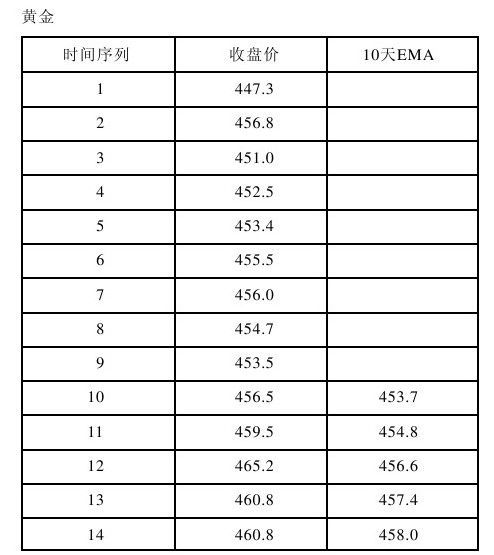

*图4-1 10天EMA计算表（《以交易为生》原图）。* 对照手工计算五步骤即可看清 EMA 的逐日递推过程。

**参数（时长选择）：**

- 短期 EMA 更敏感、能尽早抓住新趋势，但假突破（信号迅速反转）更多；长期 EMA 假信号少，但转折点滞后。
- 若发现市场循环周期，MA 时长应取主导循环时长的一半：22 天周期用 11 天 MA，34 天周期用 17 天 MA；问题是周期不断改变并消失。
- 大拇指原则：想抓住的趋势越长，MA 时长越长。200 天 MA 适合长期股市投资者；大多数交易者用 10～20 天 EMA；MA 时长不应短于 8 天，以免破坏跟随趋势的目的。作者本人一直用 13 天 EMA。

**群体心理：** 单笔价格是群体一致认可的当前价值的留影，单张照片看不出气质；MA 综合好几天价格，能识别群体行为方向。"移动平均发出的最重要的信息是其倾斜方向"：上倾＝群体更乐观（看多），下倾＝群体更悲观（看空）。

**交易法则（共3条）：**

1. 当 EMA 上升时做多：在价格跌到移动平均线附近或稍微跌破一点时买入；保护性止损设在近期低点之下；价格收在 EMA 线之上后，将止损上移到盈亏平衡点。
2. 当 EMA 下降时放空：在价格反弹到 EMA 线附近或稍微突破一点时卖空；保护性止损设在近期高点之上；价格收在 EMA 线之下后，将止损上移到盈亏平衡点。
3. 当 EMA 走平且只作窄幅波动时，市场无趋势，不要再用趋势跟随指标指导操作，但仍继续跟踪，等待新趋势。

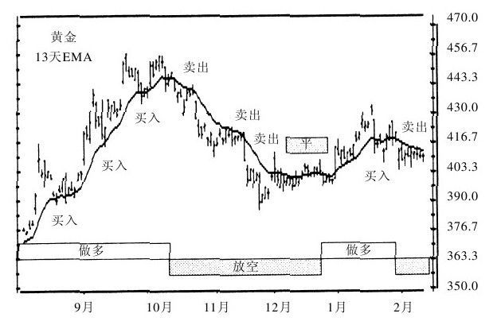

*图4-2 13天EMA（《以交易为生》原图）。* 价格回到 EMA 附近是买点、离 EMA 过远则不宜追高。

**其他要点：** 老式机械系统 4 步（MA 上升且价收其上买入；价收其下卖出；MA 下降且价收其下卖空；价收其上回补），趋势市有效、走平时假信号频发；唐迁用 4 天、9 天、18 天三条 MA 同向交叉。上升 MA 是支撑、下降 MA 是压力；也可对指标（如成交量）做 MA；10 天简单 MA 宜左移四五天，10 天 EMA 宜左移两三天；WMA 可任意配权重但过于复杂，交易者最好用 EMA。

### 4.3 MACD 与 MACD 柱

MACD 由纽约分析师、基金经理杰拉得·艾波（Gerald Appel）设计，由 3 条指数移动平均线构成，两条 EMA 交叉时给出信号。

**构造步骤（原始 MACD 线）：**

1. 计算收盘价的 12 天 EMA。
2. 计算收盘价的 26 天 EMA。
3. 用 12 天 EMA 减去 26 天 EMA，差值画成实线——快速 MACD 线。
4. 计算快速线的 9 天 EMA，画成虚线——慢速信号线。

**MACD 柱构造（第4步）：** MACD柱＝MACD线−信号线。快线在慢线之上柱为正（零轴上方），之下为负（零轴下方），两线交叉时柱为零。柱的倾斜方向由相邻两柱高度决定：最近一根更高（m-M）则上倾，最近一根更低（P-p）则下倾。

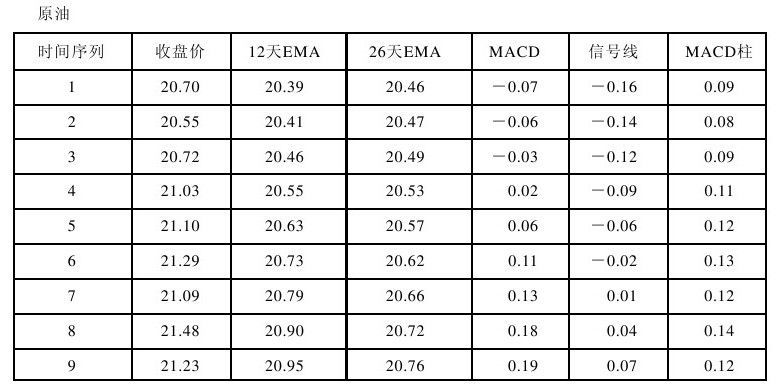

*图4-3 MACD与MACD柱计算表（《以交易为生》原图）。*

**参数：** 标准参数 12/26/9；也有人改用 5/34/7。若结合市场周期：第一条 EMA 取主导周期的 1/4，第二条取周期的一半，第三条（差值的平滑线）与周期无关。作者警告："如果经常有意识地优化MACD指标，时间长了就能用同样的数据产生出任何你想要得出的信号。"软件只有两条 EMA 时，可用 11 天与 26 天 EMA 交叉近似替代。

**群体心理：** 长期 EMA 跟踪长期价值共识，短期 EMA 跟踪短期价值共识。快线上穿慢线＝多方控制市场，宜做多；下穿＝空方主导，宜放空。MACD 柱反映长短期共识之差（多空力量的增减变化）："MACD柱的倾斜方向比它是在零轴之上还是零轴之下更重要"——零轴之上但开始下倾，多方能量耗尽，是最佳卖出信号；零轴之下但开始上倾，空方能量耗尽，是最佳买入信号。

**MACD 线交易法则（共2条）：**

1. 快速 MACD 线上穿慢速信号线时买入（做多），保护性止损设在近期次低点下方。
2. 快速线下穿慢速线时卖出（放空），保护性止损设在近期次高点上方。

其信号与假信号均少于单一移动平均线的机械系统。

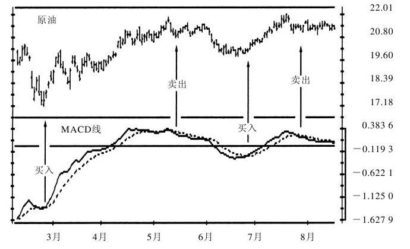

*图4-4 MACD线（《以交易为生》原图）。* 双线金叉做多、死叉放空，信号比单一均线机械系统更少但更可靠。

**MACD 柱交易法则（普通信号2条＋背离信号2条）：**

1. 在 MACD 柱高度停止下降并掉头上升时买入，保护性止损设在近期次低点之下。
2. 在 MACD 柱高度停止上升并掉头下降时卖出，保护性止损设在近期次高点之上。
3. 熊背离卖空：MACD 柱从次高点开始掉头向下而价格却创出新高时卖空，保护性止损设在近期高点之上。
4. 牛背离买入：MACD 柱从次低点掉头向上而价格创出新低时买入，保护性止损设在近期低点之下。

**新高/新低规则：** MACD 柱像汽车前灯。日线 MACD 柱创出近 3 个月新高，价格很可能随后创新高（上升趋势健康，下一轮上涨回测或超过前高）；创近 3 个月新低则价格可能继续探底。柱随同价格同创新高/新低即确认趋势。

**"技术分析中最强的信号"——MACD 柱与价格背离：**

- 此类背离在任何市场一年只出现几次，但给出"技术分析中最强烈的信息"，不是每个重要顶底都会出现，一旦出现重大转折可能就在眼前。
- **熊背离**：价格上涨创出新高而 MACD 柱没有创出新高。表明价格高点相对虚弱、多方势力已虚，"当大多数交易者都兴奋地期待着再创新高时，它们给出了卖出信号！"
- **牛背离**：价格创出新低而 MACD 柱没有创出新低。表明价格正摆脱下跌惯性、空方没有看起来强大，"当大多数交易者恐惧地担心市场还将创出新低时，它们给出了买入信号！"
- **三重牛背离**：牛背离失败、价格继续创新低并止损出局后，价格再创新低时 MACD 柱再次背离（即自第三个次低点掉头向上），是特别强烈的买入信号；三重熊背离法则反之。

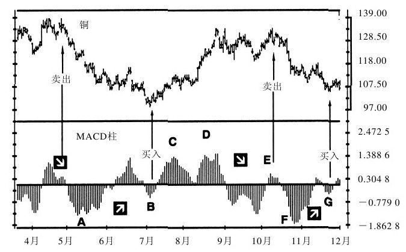

*图4-5 MACD柱背离（《以交易为生》原图）。* 价格创出新低而柱只达次低点，是作者眼中技术分析最强烈的买入信息。

日线 MACD 柱转折太频繁，每当转势就买卖不实际；周线 MACD 柱倾斜变化更有意义（已纳入三重滤网）。长周期信号意味着更大级别走势；周线研究也必须每天做（"市场并不知道有日历"）。

### 4.4 趋向系统（DMI）

趋向系统由小韦尔斯·王尔德（J. Welles Wilder, Jr.）在 20 世纪 70 年代中期提出，后经多人完善。它指明趋势，并指出趋势何时强势到值得跟随。

**构造步骤（共5步）：**

1. **确定趋向变动值（DM）**：比较当日与前一日高低点范围，DM 是当日范围落在前一日范围之外的最大部分，总是正数（+DM、−DM 只表示方向）。DM 有 4 种类型（图4-7）：
   A. 当日范围在前一日范围之上 → +DM。
   B. 当日范围在前一日范围之下 → −DM。
   C. 当日范围在前一日范围之内，或上下超出相等 → DM＝0；两端都超出时按超出更多的一端定正负。
   D. 当日涨停 → +DM＝当日收盘价到前一日高点的距离；当日跌停 → −DM＝当日收盘价到前一日低点的距离。

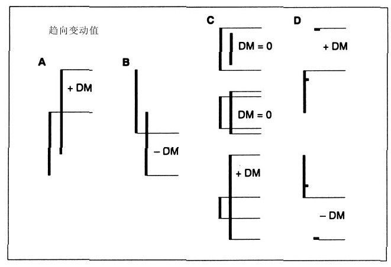

*图4-7 趋向变动值（《以交易为生》原图）。* 即正文所列 DM 的四种类型。
2. **确定真实波幅（TR）**：取以下三者最大值，总为正数：A.当日高点到当日低点；B.当日高点到前一日收盘价；C.当日低点到前一日收盘价。
3. **计算日线趋向指标（DI）**：DI 揭示 DM 占每日真实波幅的比例，便于跨市场比较；DI 都是正数——趋向变动没有向上时 +DI＝0，没有向下时 −DI＝0。
4. **计算平滑趋向线 +DI13 与 −DI13**：即 +DI、−DI 的移动平均（常用 13 天）；两数皆正，以颜色或虚实线区分。
5. **计算趋向平均线 ADX**：衡量 +DI13 与 −DI13 之间的差值，分两步：A.由 +DI13、−DI13 计算日线 DX（如 +DI13＝34、−DI13＝18 代入公式）；B.计算 DX 的移动平均（如 13 天 EMA）得 ADX。

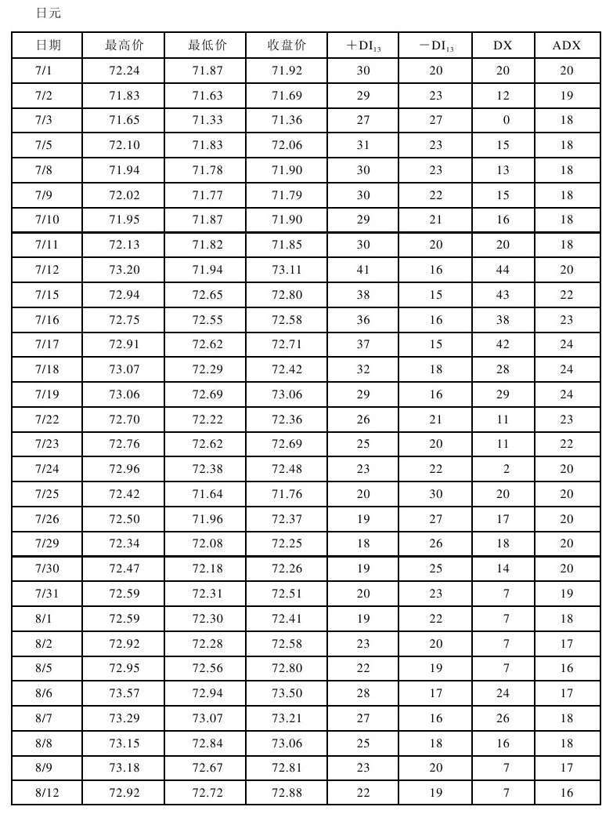

*图4-6 趋向系统计算表（《以交易为生》原图）。*

**参数：** 平滑期标准为 13 天。趋势健康时两趋向线差距加大、ADX 上升；趋势反转或进入区间振荡时 ADX 下降。应当在 ADX 上升而非下降时使用趋势跟随指标。

**群体心理：** 当日高点高于前一日高点＝大众越来越看多；当日低点低于前一日低点＝大众越来越看空。+DI13 在 −DI13 之上＝多方主导，反之空方主导。两线距离加大（ADX 上升）＝主导方更强、非主导方更弱，趋势有望持续；距离缩小（ADX 下降）＝主导方能量耗尽、非主导方积蓄能量，市场陷入混乱，不宜趋势跟随。

**交易法则（共5条）：**

1. +DI13 在 −DI13 之上时做多，−DI13 在 +DI13 之上时放空。最佳做多时机：+DI13 和 ADX 都位于 −DI13 之上且 ADX 上升，做多并把止损设在近期次低点之下；最佳放空时机：−DI13 和 ADX 都位于 +DI13 之上且 ADX 上升，放空并把止损设在近期次高点之上。
2. ADX 下降时市场方向性减弱、假信号多（如潮流变化时的漩涡），最好不用趋势跟随方法。
3. ADX 降到两条趋向线之下时市场横盘整理，不要用趋势跟随系统，但要做好准备——重大趋势就从这种沉寂中产生。
4. ADX 自两条趋向线之下的最低点上涨 4 步（如从 9 涨到 13）时，敲响新一轮趋势的警钟：+DI13 在最上面就买入（止损近期次低点之下），−DI13 在最上面就卖空（止损近期次高点之上）。ADX 在两线下方停留越久，后续走势基础越牢靠；该系统每年只发一两次信号，趋势早期价格波动小、资金风险低。
5. ADX 向上突破两条趋向线表明市场过热；ADX 在两线之上掉头向下表明主要趋势遇到麻烦，是获利了结（放大操作者应兑现部分利润）的好时机。

补充：市场指标有硬信号（价格创新低、均线改向）与软信号之分，ADX 掉头向下是软信号——此时加仓要十分小心，应获利了结、减仓、伺机平仓而不是加仓。

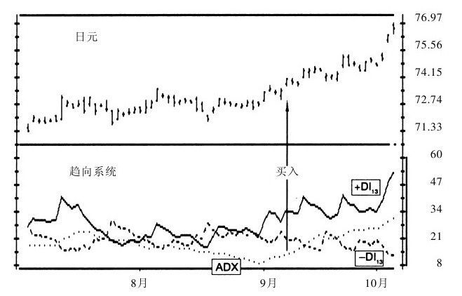

*图4-8 趋向系统的信号（《以交易为生》原图）。* ADX 低位连升敲响新趋势警钟，DI 线上穿确认操作方向。

### 4.5 动能指标、变动率（RoC）、平滑变动率（S-RoC）

振荡指标衡量群体贪婪/恐惧爆发的速度与动能。专业玩家在大众贪婪爆发时卖空、在恐惧哀叹时买进。

**超买与超卖：** 马丁·普宁的比喻——拿狗链遛狗，人的足迹直（趋势跟随指标），狗的足迹在链条范围内左右摇摆（振荡指标），到达链条极点往往掉头，但看到猫/耗子时也可能拽着主人偏离路径，故信号需判断。价格高位＋指标高位＝超买（可能掉头向下）；价格低位＋指标低位＝超卖（可能反转向上）。水平线画法：保证振荡指标在每条线之外只停留约 5%，线只穿过过去 6 个月指标的最高点与最低点，每 3 个月调整一次。强势趋势中指标可在超买/超卖区停留数周，信号过早且危险。

**背离种类（牛背离/熊背离各分 A、B、C 三类）：**

| 类型 | 价格表现 | 指标表现 | 强度 |
|---|---|---|---|
| A 类熊背离 | 创出新高 | 只达到次高点 | 最强烈卖出信号，往往导致价格急剧下跌 |
| A 类牛背离 | 创出新低 | 只达到次低点 | 最强烈买入信号，随后往往是迅猛上涨 |
| B 类熊背离 | 双重顶 | 只达到次高点 | 次强烈卖出信号 |
| B 类牛背离 | 双重底 | 只达到次低点 | 次强烈买入信号 |
| C 类熊背离 | 创出新高 | 双重顶（多方既未变强也未变弱） | 最弱熊背离 |
| C 类牛背离 | 创出新低 | 双重底 | 最弱牛背离 |

"A类背离几乎总是指示出较好的交易机会。B类和C类背离更容易产生假信号。最好不要理它们，除非它们得到了其他指标的强势确认。"识别原则："有效的背离很容易识别，它们似乎要从图上跳出来。如果要用一条原则来说明是否产生了背离，那就先假设没有背离。"三重牛/熊背离（三重价格底/顶＋三重指标底/顶）比常规背离更强，且必须先有一次常规背离失败——这正是严格资金管理的理由。

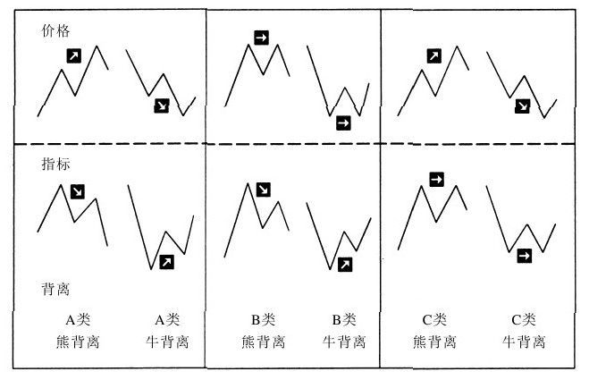

*图4-9 背离类型（《以交易为生》原图）。* A 类背离最强、B 类次之、C 类最弱。

**构造方法与参数：**

- 动能指标：`M = Ptod − Ptod−n`（当日收盘价减 n 天前收盘价）。当日价高为正、低为负、相等为零。
- 变动率：`RoC = Ptod ÷ Ptod−n`（当日收盘价除以 n 天前收盘价）。两价相等 RoC＝1，当日价高大于 1，价低小于 1。
- 常用 7 日窗口；振荡指标时间参数宜窄（检测短期变化），趋势跟随指标宜宽。可用收盘价或中间价（高低点之和÷2）。
- 缺陷：与简单 MA 一样对每笔价格响应两次（进入窗口一次、离开窗口一次）。

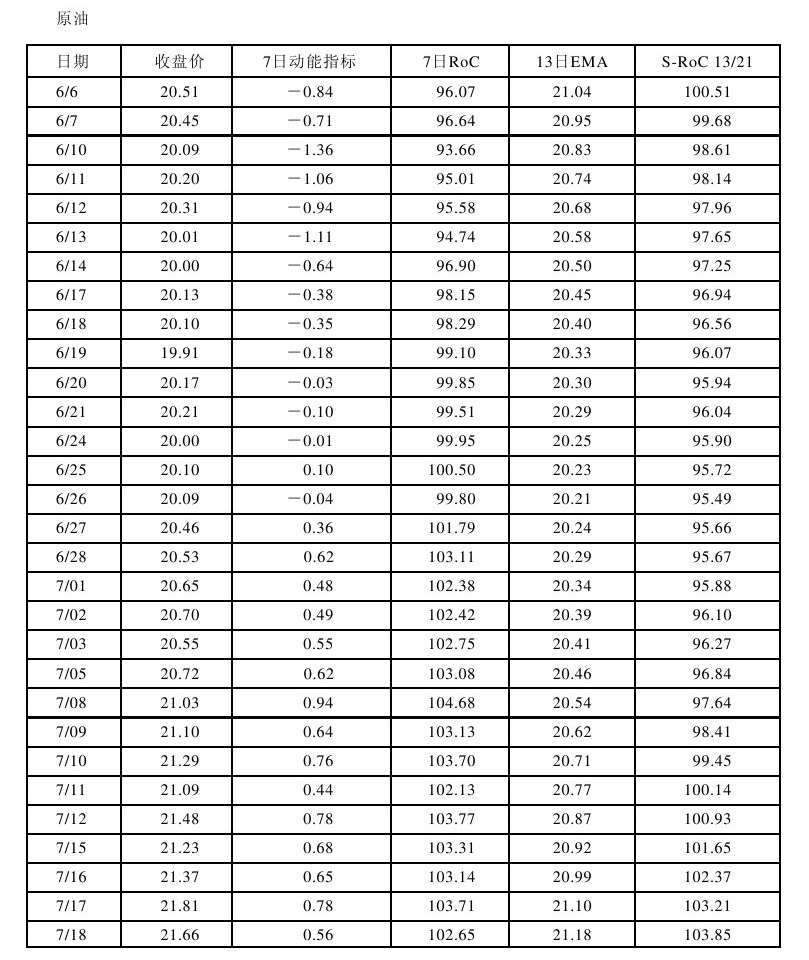

*图4-10 动能指标、变动率和平滑变动率计算表（《以交易为生》原图）。*

**群体心理：** M/RoC 把当天价值共识与几天前共识比较，衡量群体乐观/悲观心理的变化（如每月给孩子量身高并与 6 个月前对比）。指标创新高＝乐观情绪高涨、价格可能继续创新高；价格涨而指标下降＝顶部警示；重大坏消息的"空中障碍"会使 RoC 与价格一同下坠（此时为同步指标）。

**交易法则（共3条）：**

1. 趋势向上时，RoC 下穿其中线并开始掉头向上就买入（上升趋势放缓，如火车停站载客）；趋势向下时，RoC 上穿其中线并开始掉头向下就放空。
2. 持有多头而价格下滑时，看 RoC 回抽前是否创出新高：创新高则持多相对安全；接连留下一系列次高点则趋势转弱，立即卖出。下跌趋势相反。
3. M 或 RoC 往往在价格突破趋势线前一两天先突破趋势线；看到领先指标突破，要为价格突破做准备。

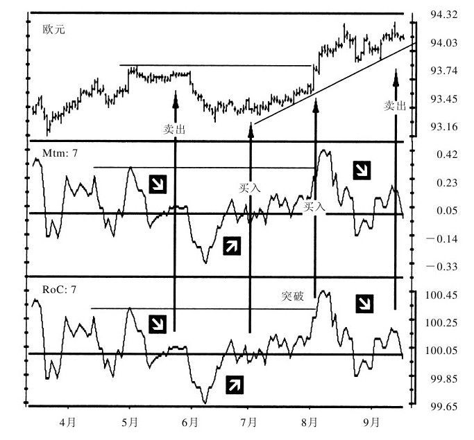

*图4-11 7日动能指标与7日变动率（《以交易为生》原图）。* 价格创新高而 RoC 顶背离，是趋势即将转弱的预警。

**平滑变动率（S-RoC）：** 由弗雷德·G.舒兹曼（Fred G. Schutzman）发明，只对每个价格响应一次。构造：先计算收盘价的 13 日 EMA，再计算该 EMA 值的 21 日变动率（即 S-RoC 13/21）；它比较两个时点的 EMA 价值而非价格，信号更少、质量更高，对参数长短不敏感。先算 RoC 再平滑的做法跳跃性更大，不如 S-RoC。群体心理上，S-RoC 把当日平均大众共识与过去的平均大众共识对比，跟踪大众多空观点的重大改变。

**S-RoC 交易法则（共4条）：**

1. S-RoC 自其中线以下掉头向上时买入。
2. S-RoC 停止上升并掉头向下时卖出；自其中线开始掉头向下时放空。
3. 熊背离（价格创新高而 S-RoC 只达次高点、大众热情减弱）给出强烈放空信号。
4. 牛背离（价格创新低而 S-RoC 只达次低点、恐惧减弱、下跌压力减轻）给出强烈回补空头并做多的信号。

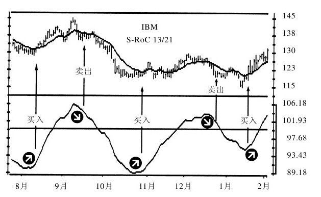

*图4-12 平滑变动率（S-RoC 13/21）（《以交易为生》原图）。* S-RoC 只对每个价格响应一次，信号更少、质量更高。

### 4.6 威廉指标（Wm%R）

威廉指标由拉里·威廉斯（Larry Williams）于 1973 年发明，衡量多空双方创出的峰值距每日收盘价的距离占近期股价范围的比例，确认趋势并警示反转。

**构造方法与参数：** 以收盘价到周期内最高价（Hr）的距离，占周期内最高价与最低价（Lr）之差的百分比表示：`Wm%R = (Hr − C) ÷ (Hr − Lr)`。变动范围 0～100%：收盘价收在近期最高点（多方能量顶峰）时等于 0，画在顶部；收在近期最低点（空方能量顶峰）时等于 100%。常用 7 日窗口；周期市场取周期长度的一半；周线图用 7 周窗口。参考线设为 10% 与 90%。总原则：对振荡指标信号有疑虑就缩短时间参数，对趋势跟随指标则相反（有疑虑就拉长）。

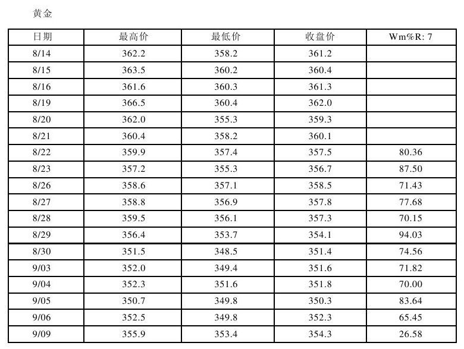

*图4-13 Wm%R指标计算表（《以交易为生》原图）。*

**群体心理：** 周期内高点反映多方最大力量，低点反映空方最大力量；收盘价是当天最重要的共识（账户按收盘价结算）。Wm%R 衡量多空双方在收盘这一"最重要的资金计量时间"的力量对比：上涨中多方不能把价格收在高点附近，说明多方没有看上去强，是放空机会；下跌中空方收不在低点附近，则是买入机会。

**三类信号（按重要性排序）与交易法则（共6条）：**

1. 牛背离：Wm%R 下穿下方参考线后上涨，随后下跌中未能再次下穿该线，表明空方失能；做多，止损设在近期价格低点之下。
2. 熊背离：Wm%R 上穿上方参考线后下跌，随后上涨中未能再次上穿该线，表明多方失能；放空，止损设在近期价格高点之上。
3. 失败振荡（卖出）：上涨途中未触及上方参考线就停升掉头，多方特别弱，卖出。
4. 失败振荡（买入）：下跌途中未触及下方参考线就停跌掉头，空方特别弱，买入。失败振荡出现在强势趋势调整期，反而确认趋势。
5. 上穿上方参考线＝潜在顶部，卖出信号。
6. 下穿下方参考线＝潜在底部，买入信号。

超买超卖信号仅在区间振荡时有效；强势上涨中可在顶部停留一周甚至更久（此时超买是强势而非放空机会），强势下跌中可数周超卖。用法：先确认主要趋势——周线牛市时只用日线 Wm%R 的买入信号（卖出信号不放空）；周线熊市时只用卖出信号（买入信号不做多）。

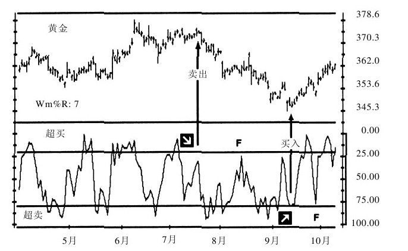

*图4-14 7日威廉指标（《以交易为生》原图）。* F 点提示强势趋势中超买超卖信号可能是假突破，需结合周线趋势过滤。

### 4.7 随机指标（KDJ）

乔治·莱恩（George Lane）使随机指标流行。它跟踪每日收盘价与近期高低点范围的关系，由快线（K 线）与慢线（D 线）组成，通过多步平滑过滤噪音。

**构造步骤：**

1. 计算"初始随机值"（raw stochastic）K：`K = (Ctod − Ln) ÷ (Hn − Ln)`，Ctod 当日收盘价，Ln、Hn 为所选 n 天内最低、最高价。标准窗口 5 天；窄窗口抓更多转折点，宽窗口识别重要转折。
2. 计算 D 值：K 值的平滑值，平滑参数常取 3 天。
3. 快速随机指标＝K 线＋D 线同图，对转折点敏感但假信号多；慢速随机指标——快速指标的 D 值成为慢速的 K 值，再做一次 3 天平滑得慢速 D 值，过滤噪音更好。交易者一般用 5 日慢速随机指标（经 3 日平滑）。

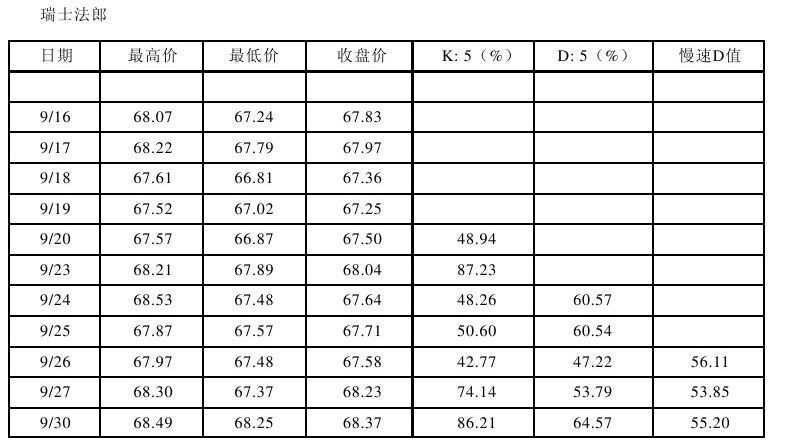

*图4-15 随机指标计算表（《以交易为生》原图）。*

**参数与区间：** 数值 0～100；参考线 20% 与 80% 标示超买超卖，慢速指标很少达到 Wm%R 那样的极限。短期（约 5 日）抓短期转折，长期（14～21 日）识别重要转折。

**群体心理：** 上涨时市场趋于收在高点附近；多方盘中推高却收不在高点附近，随机指标掉头向下，表明多方比看起来弱，发出卖出信号。下跌中收盘价位于高点附近，说明空方只能盘中压低、无法维持，指标掉头向上即买入信号。

**三类信号（按重要性：背离、超买超卖、线的方向）与交易法则（共5条）：**

1. 牛背离买入：价格创新低而指标只达高于前期低点的次低点，指标自次低点反身向上时做多，止损设在市场最新低点之下；第一个低点在低位参考线之下、第二个低点在该线之上时，是最佳买入信号。
2. 熊背离卖空：价格创新高而指标只达低于前期高点的次高点，指标自次高点反身向下时放空，止损设在市场最新高点之上；第一个高点在高位参考线之上、第二个高点在该线之下时，是最佳卖出信号。
3. 周线上升趋势中，等待日线随机线下穿下方参考线，不必等交叉或掉头，把买单挂在最近一根 K 线高点上方一档；止损取买入日低点与前一日低点中的低者。底部又窄又浅＝空方弱、可能强势上攻；又深又宽＝反弹可能弱，只采用强势信号。
4. 周线下跌趋势中，等待日线随机线上穿上方参考线，把卖单挂在最近一根 K 线低点之下；随机线交叉时市场往往快速下跌；止损取交易日高点与前一日高点中的高者。窄形顶部＝多方弱、可能快速下跌；又高又宽的顶部＝多方强，忽略卖出信号更安全。
5. 随机指标超买时不要买入，超卖时不要放空——这一原则过滤掉大多数不好的交易。

**线的方向：** 两条随机线同向时确认短期趋势：价格涨且两线上行，上升趋势或将持续；价格跌且两线下行，短期下跌或将持续。

**其他要点：** 周线随机指标往往比周线 MACD 柱提前一周变向，是收窄止损或获利了结的预警。单独使用宜选长期随机指标；作为三重滤网一部分配合趋势指标则短期更好。雅各布·伯恩斯坦普及"随机爆发"（stochastic pop）：线上穿上方参考线显示强势，买入博快速上涨、线一掉头就卖出，抓牛市中的小浪花。机械地按两线交叉买卖无利可图——指标在趋势市与区间市有效性不同，再怎么优化也无效。

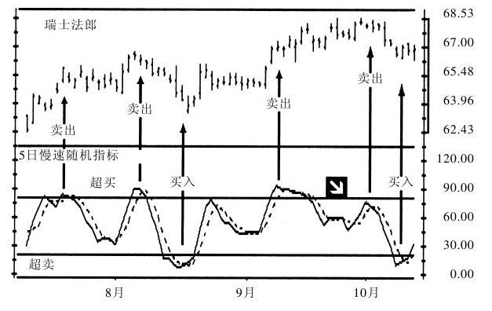

*图4-16 5日慢速随机指标（《以交易为生》原图）。* 慢速 K、D 线在 20/80 参考线外侧掉头是主要信号。

### 4.8 相对强弱指标（RSI）

RSI 由 J.韦尔斯·王尔德发明，通过监控收盘价变化衡量标的强弱，是领先或同步指标，"从不滞后"。RSI 的峰谷形态不因窗口宽度改变而改变，短期 RSI（7 日或 9 日）信号可见性更好。

**构造步骤（7 日 RSI，共5步）：**

1. 获得 7 日收盘价。
2. 找出上涨价格，涨幅求和除以 7，得上涨收盘价的涨幅均值。
3. 找出下跌价格，跌幅求和除以 7，得下跌收盘价的跌幅均值。
4. 用涨幅均值除以跌幅均值得相对强弱值 RS，代入公式得 RSI。
5. 每天重复。

手工简略算法（取代第2、3步）：新上涨均值＝(前日上涨均值×6＋当日涨幅)÷7；新下跌均值＝(前日下跌均值×6＋当日跌幅)÷7；再进行第4步。

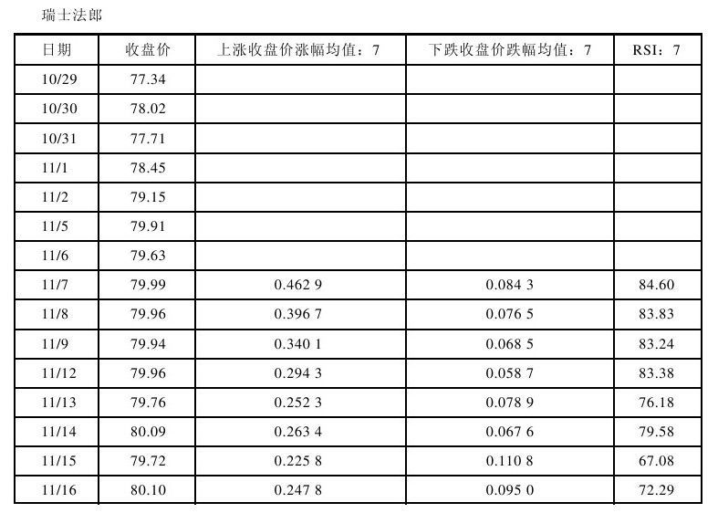

*图4-17 7日RSI指标计算表（《以交易为生》原图）。*

**参数与区间：** RSI 在 0～100 间变动。超买超卖水平因市场、因时间而异，"没有神奇的标准线"。常用参考线 30/70；牛市可用 40/80，熊市可用 20/60。采用 5% 原则：过去 4～6 个月 RSI 位于参考线之外的时间不超过 5%；参考线每 3 个月调整一次。"超卖信号和超买信号就像温度计上显示的冷热程度。同一温度在夏天和冬天有着不同的含义。"

**群体心理：** 收盘价是当天最重要的共识——市场收高则多方赚钱、空方赔钱，期货市场收盘后资金从输方划转胜方。RSI 揭示收盘时多方或空方是否变得强势。

**三类信号（按重要性：背离、图形形态、RSI 水平）与交易法则（共6条）：**

1. 牛背离买入：价格创新低而 RSI 只达高于前期低点的次低点，RSI 自次低点掉头向上时买入，止损设在最近次低点之下；第一个低点在下方参考线之下、第二个在该线之上时信号尤强。
2. 熊背离卖出：价格创新高而 RSI 只达低于前期高点的次高点，RSI 自次高点掉头向下时卖出，止损设在最近次高点之上；第一个高点在上方参考线之上、第二个在该线之下时信号尤强。当价格创新高/新低而 RSI 未能穿越其参考线时，是最强烈的背离。
3. RSI 突破其下降趋势线时，以高于价格趋势线的价位挂买单买入，捕捉向上突破。
4. RSI 突破其上升趋势线时，以低于价格趋势线的价位挂卖单放空，捕捉向下突破。趋势线、支撑压力、头肩形在 RSI 上均有效，RSI 往往比价格提前一两天完成形态。
5. RSI 下穿下方参考线然后又上穿此线时买入。
6. RSI 上穿上方参考线然后又下穿此线时放空。

水平信号的趋势过滤：只有周线趋势向上时，用日线超买信号买入才有利；只有周线趋势向下时，用日线超卖信号放空才有利。对于"正向反转/负向反转"等据称能预测任何极限点的概念，除提出者外尚无人据此取得显著成功。

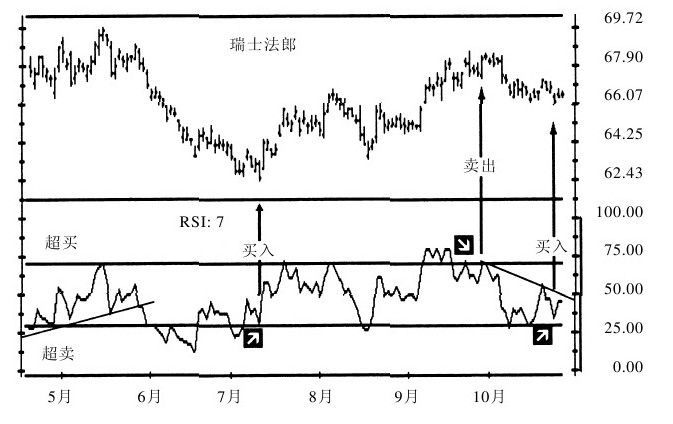

*图4-18 7日RSI指标（《以交易为生》原图）。* RSI 往往比价格提前一两天完成形态，趋势线突破与背离是其最重要的信号。

## 三、指标速查表

| 指标 | 类型 | 构造要点 | 主要买卖信号 |
|---|---|---|---|
| EMA | 趋势跟随 | EMA＝收盘×K＋前日EMA×(1−K)，K＝2/(N+1)；常用13天 | 上倾回踩买、下倾反抽卖；走平不用 |
| MACD 线 | 趋势跟随 | 12日EMA−26日EMA＝快线；快线9日EMA＝信号线 | 快线上穿信号线买、下穿卖 |
| MACD 柱 | 趋势跟随 | MACD线−信号线，零轴上下柱图 | 柱掉头（普通信号）；与价格牛/熊背离＝最强信号 |
| 趋向系统 DMI | 趋势跟随 | DM→TR→DI→+DI13/−DI13→DX→ADX | 上位DI方向操作；ADX低位连升4步追新趋势；ADX高位掉头获利 |
| 动能 M | 振荡 | 当日收盘−n日前收盘（常用7日） | 中线掉头、趋势线提前突破、背离 |
| 变动率 RoC | 振荡 | 当日收盘÷n日前收盘（7日，等于1为中值） | 同动能指标；与价格背离信号最佳 |
| 平滑变动率 S-RoC | 振荡 | 13日EMA的21日RoC（13/21） | 中线掉头；与价格牛/熊背离 |
| 威廉指标 Wm%R | 振荡 | (周期最高−收盘)/(最高−最低)，0～100%，线10%/90% | 背离＞失败振荡＞超买超卖 |
| 随机指标 KDJ | 振荡 | K＝(收盘−n日低)/(n日高−n日低)，D＝K的3日平滑；5日慢速 | 背离＞20/80超买超卖＞两线方向 |
| RSI | 振荡（领先/同步，从不滞后） | 7日涨幅均值÷跌幅均值→RS→RSI；线30/70 | 背离＞图形形态（趋势线）＞参考线来回穿越 |

## 四、本章金句（原文原句）

1. "交易就是一种信息的游戏，计算机能帮你处理更多的信息。"
2. "当指标指明向上时，它是明确指示向上；当它指明向下时，也是明确指示向下。"
3. "工具箱是给严肃的交易者准备的，黑匣子是给那些相信有圣诞老人的人用的。"
4. "在交易中没有什么能替代成熟的判断。黑匣子的唯一获利途径是出售黑匣子。"
5. "机器可以帮助人类但不能取代人类。"
6. "交易成功的秘密在于综合参照这三类指标中几种不同指标发出的信号，这样它们之间的缺点就能相互抵消，而优点却能保存。"
7. "成功的交易者并不预测未来，而只是监测市场、管理仓位。"
8. "MACD柱的倾斜方向比它是在零轴之上还是零轴之下更重要。"
9. "MACD柱和价格走势的背离在任何市场中一年都只出现几次，但它们给出的是技术分析中最强烈的信息。"
10. "搞清楚什么时候用振荡指标、什么时候用趋势跟随指标是一名老到的分析师的标志。"

## 五、对当代交易者的启示

1. 先选软件/平台再配硬件，坚持用"工具箱"式可自定义、可调参、可回测的工具；对任何只给买卖指令、不解释逻辑的"黑匣子"信号源（含今天的各类喊单群、自动跟单 EA）保持零信任。
2. 建立指标分工清单：趋势判定只看趋势跟随指标（EMA、MACD/柱、DMI），择时只在盘整或回调中用振荡指标（KDJ、Wm%R、RSI、RoC），先判市场状态再选工具，杜绝一把锤子敲所有钉子。
3. 把 EMA 斜率作为趋势过滤器：只沿 EMA 倾斜方向交易，并把买点放在价格回踩 EMA 处而非远离 EMA 处，以提高收益/风险比；EMA 走平时关闭趋势策略。
4. 重点扫描背离：把"价格新高 + MACD 柱/RSI/KDJ 次高"设为自选股/品种的程序化预警，优先做 A 类背离；B、C 类背离必须有其他指标确认才动手。
5. 参数去神秘化：13 日 EMA、12/26/9 MACD、13 日 DMI、7 日振荡、5(3) 慢速 KDJ、7 日 RSI 可直接作为起步模板；不做针对历史数据的过度优化，参数一经确定保持稳定。
6. 强制执行多周期过滤：周线定方向、日线找信号——周线牛市只接日线多头信号，周线熊市只做日线空头信号；周线信号每天检查，不等周末。
7. 每个信号配套止损纪律：做多止损近期次低点之下、做空止损近期次高点之上，信号失效（如牛背离失败）立即止损并等待"三重背离"这类更强的二次机会，靠资金管理活得久。
8. 路径选择上先中长线后短线：先在日线/周线级别证明盈利能力，再考虑分钟级实时交易；短线所需的"全自动反应"必须建立在低级别已经训练成型的盘感之上。

## 六、一句话核心判断

计算机和指标给交易者的不是预测未来的"银弹"，而是一套客观的群体力量测量仪——在趋势市跟随趋势指标、在盘整市使用振荡指标、以多周期多指标背离相互印证，并配上不容商量的止损，才是技术分析真正的获利方式。
