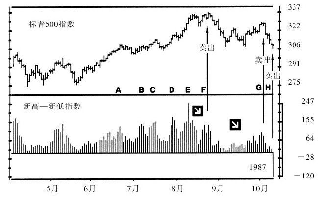
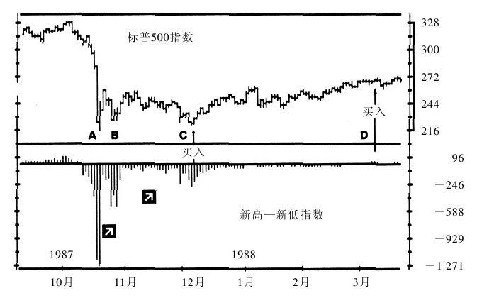
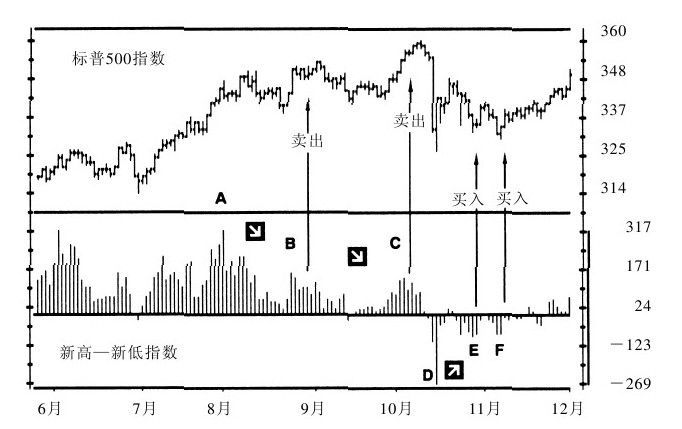
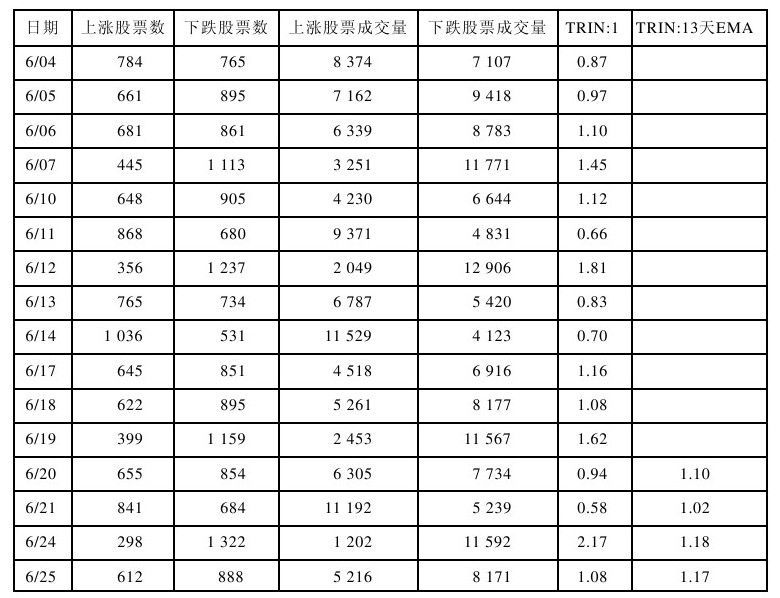
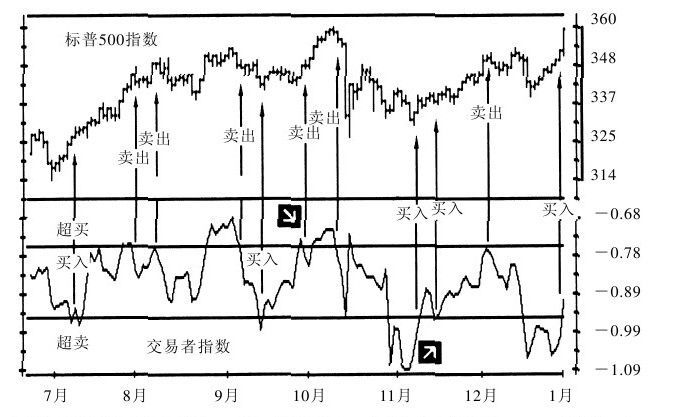

# 《以交易为生》第6章：股市指标

> 亚历山大·埃尔德（Alexander Elder）著：《以交易为生》（机械工业出版社修订版），第6章"股市指标"。

## 一、章节主旨

- 1982年推出股指期货后，股票与期货两个市场之间的隔墙开始消失，"聪明的交易者认为自己有责任掌握两个市场的工具"。
- 股市指标帮助期货和期权交易者更好地把握股指期货操作时点；本章系统讲解新高—新低指数 NH-NL、交易者指数 TRIN，以及腾落指数、最活跃股票等辅助指标。
- 核心逻辑：NH-NL 衡量市场"长官"（领涨、领跌股）的力量对比；TRIN 衡量主导市场群体的乐观与悲观程度。二者均为领先指标，其与价格的背离提供最佳操作信息。

## 二、核心内容逐节梳理

### （一）6.1 新高—新低指数（NH-NL）

#### 1. 如何构造 NH-NL

- NH-NL 跟踪市场领导的数量，衡量任一天中股价创出年内新高的股票数或创出年内新低的股票数。
- "股价创出年内新高的股票就是多方的领导，股价创出年内新低的股票就是空方的领导。"
- 当 NH-NL 与价格涨跌同步时确认趋势；与价格背离时，表明这是股市的顶或底。
- 计算公式（原文照录）：

```
NH-NL = 创出年内新高的股票数 - 创出年内新低的股票数
```

- 数据口径：必须使用数据供应商提供的创出 52 周新高、新低的股票数；不要用古老的"日历法"（只算当年1月1日以来的新高、新低）。
- 画法：以零为垂直参考线画成柱状。新高股数多于新低股数时为正，画在中线之上；反之为负，画在中线之下；二者相等时为零。

#### 2. 群体心理

- 股票出现在新高名单上，表明一群焦急的多方正在追逐它的股份；出现在新低名单上，表明一群激进的空方正在抛售它的股份。
- NH-NL 比较领涨个股与领跌个股的力量对比，"是股市里的领先指标"；标普500等覆盖较广的指数走势总是跟随 NH-NL 的走势。
- 兵团比喻：交易所的股票如同一个兵团，"创出新高和新低的股票就是长官"。创新高的是领头攻占山头的长官，创新低的是领头放弃抵抗撤退的长官。
- NH-NL 上穿中线，表明多方领导强势；下穿中线，表明空方领导强势。市场创新高且 NH-NL 也创新高，多头领导增强，上升趋势有望延续；市场上涨而 NH-NL 萎缩，则"一个长官逃跑的兵团有可能掉头开溜"。
- NH-NL 的新低表明下跌趋势有望延续；股市下跌而 NH-NL 掉头向上，表明"长官不再逃跑了"，整个兵团有望上攻。
- 历史案例：1987年8月牛市峰值出现熊背离（E～F区间）发出卖出信号；9月反弹中 NH-NL 仅达100（G点）显示弱势；10月 NH-NL 转负（H点），在历史性暴跌前再次发出卖出信号。崩盘后10月新低近1300只（A点），11月、12月两次考验低点时 NH-NL 低点抬高（B、C点），形成牛背离，D点转正确认，开启长达两年的牛市。



*图6-1 新高—新低指数（《以交易为生》原图）。*

#### 3. 交易法则

交易者需关注 NH-NL 的三个方面，按重要性排列：与价格在顶部与底部的背离、NH-NL 的趋势、位于中线之上或之下的位置。

1. **熊背离（卖出）**：市场创出新高而 NH-NL 只达到一个次高点，表明多方领导力正在弱化，上升趋势结束。若最近峰值在 +100 左右，随后可能出现重大转折，此时该放空；若峰值远高于 +100，表明向上的领导力还很强大，足以阻止市场下跌。
2. **牛背离（买入）**：市场创出新低而 NH-NL 只达到一个次低点，表明空方领导力正在弱化。若近期低点在 -100 左右，表明空方领导力耗尽，重要的向上转折即将来临；若远低于 -100，则下跌可能稍有停顿但趋势不会反转。"要记住，股市底部的牛背离比股市顶部的熊背离发展快，所以要快买慢卖。"
3. **顺着 NH-NL 趋势操作**：NH-NL 上升时，持有多头仓位并加仓是安全的；市场收平或上涨而 NH-NL 下降，应将短线多头仓位获利了结。NH-NL 下跌时，持有或增仓空头仓位很安全；市场继续下跌而 NH-NL 上升，则下跌趋势有问题，要回补空头。
4. **横盘时的信号**：市场横盘整理时 NH-NL 上升，发出牛市信息和买入信号——"长官正在向顶峰进军而士兵还躲在散兵坑里"；横盘时 NH-NL 下跌则发出放空信号——长官正在逃跑而士兵仍在坚守，但士兵也不会留下来坚持战斗。
5. **穿越中线**：NH-NL 在中线之下停留数月后上穿中线，表明上升走势可能即将开始，应寻找买入机会，可用振荡指标把握精确时点；在中线之上停留数月后下穿中线，表明下跌走势可能即将开始，应寻找放空机会。



*图6-2 新高—新低指数（《以交易为生》原图）。*

#### 4. 有关 NH-NL 的其他情况

- 旧法：用 10 天与 30 天 NH-NL 简单移动平均线，10 日线上穿 30 日线买入、下穿卖出。但 NH-NL 本身已能给出清晰信号；若一定要用平滑值，最好用指数移动平均值。
- 纽约股票交易所、美国股票交易所、柜台交易和伦敦股票交易所每日均报告创新高、新低股票数；海外交易所若不报告，可用计算机编程，对全市场一年日线逐日标记 52 周新高、新低。
- 适用限制：在由少数股票主导的市场不适用。例如米兰交易所几百只股票中，菲亚特与 Generale 两家占总市值近 70%，其他股票影响可忽略不计。



*图6-3 新高—新低指数（《以交易为生》原图）。*

### （二）6.2 交易者指数（TRIN）与其他股市指标

#### 1. 如何计算 TRIN

- TRIN 是领先的股市指标，由理查德·阿姆斯（Richard Arms）普及，通过衡量主导市场群体的乐观程度，显示主要上涨和下跌趋势何时反转。
- 需要 4 个数据：上涨股票数及其成交量、下跌股票数及其成交量。计算公式：

```
         上涨股票数 / 下跌股票数
TRIN = ───────────────────────────────
       上涨股票成交量 / 下跌股票成交量
```

- 计算示例（原文照录）：
  - 1000 只上涨、成交1亿股，1000 只下跌、成交1亿股，TRIN = 1；
  - 1500 只上涨、成交1.5亿股，500 只下跌、成交5000万股，TRIN 仍 = 1；
  - 涨跌家数比 2:1、成交量比 4:1，则 TRIN = 0.50（2/1÷4/1）——多方十分乐观，上涨过度，顶部就在眼前；
  - 涨跌家数比 1:2、成交量比 1:4，则 TRIN = 2（1/2÷1/4）——空方十分乐观，下跌过度，市场底部临近。
- 平滑：TRIN 日线变化剧烈，应用 13 天指数移动平均值过滤噪音；本章后文所称 TRIN 均指日线 TRIN 的 13 天 EMA。
- 画法：反过来画成垂直线，低值画在上面表示顶峰，高值画在下面表示低谷；两条水平参考线标示超买、超卖区。
- 参考线取值（研究起点，非固定）：牛市超买线一般 0.65 或 0.70，熊市一般 0.70 或 0.75；牛市超卖线一般 0.90 或 0.95，熊市一般 1.00 或 1.10。
- 画参考线的最佳办法：检查过去 6 个月标普500等指数图，标出所有重要顶部和底部，画两条穿过 TRIN 相应顶部和底部的参考线；超买线、超卖线每 3 个月调整一次。



*图6-4 交易者指数（TRIN）计算表（《以交易为生》原图）。*

#### 2. 群体心理

- "股市是一个癫狂与抑郁交替发作的东西，它在极度狂热与极度沮丧之间来回变换。"交易者可用 TRIN 诊断市场的狂热和沮丧程度，并为情绪反转下注。
- "群体是情绪化的、短期导向的。"趋势之所以超过预期，正因群体行为情绪化；当交易大众精疲力竭时趋势反转，TRIN 能显示他们何时精疲力竭。
- 上涨中多方贪婪，买进太多，上涨股成交量超出上涨家数的合理比例；TRIN 进入超买，表明大众乐观达到顶峰。
- 下跌中空方抛售，下跌股成交量相对下跌家数显得太高；TRIN 进入超卖，表明空方做过头，向上转折为期不远。
- 城铁站比喻：人流最多时正是趋势高峰期；测算站台上的通勤人数即可判断交通转折点，TRIN 在股市做的正是这种工作。
- 专业玩家利用 TRIN 信息，"总是采取与偏离方向相反的操作策略，期待着市场回归常态"。

#### 3. 交易法则

TRIN 要反过来画：高数值代表底部，低数值代表顶部。平衡市中 TRIN 在 0.75～0.85 之间波动（小于 1.0，因为上涨股票成交量一般超过下跌股票成交量，"人们往往是乐观超过悲观"）。不能机械运用，同一数值在牛市、熊市含义不同：牛市早期 0.60 表明多方很强，应寻找做多机会加仓；熊市中同样的 0.60 意味着重要的放空机会。

1. **买入**：当 TRIN 离开其超卖区时买入。当它上穿其下方参考线时，表明空方能量耗尽。
2. **卖出**：当 TRIN 离开其超买区时卖出，表明多方能量耗尽，"此时放空比抓住精确的顶点更安全"。（以上参考线方位均按原文反装图表述照录。）
3. **与 NH-NL 结合（一）**：TRIN 超卖而 NH-NL 创出新低，表明空方领导力仍很强，下跌趋势有望延续；TRIN 超卖而 NH-NL 出现牛背离，表明这是一个重要低点。二者结合使交易者有信心加大仓位。
4. **与 NH-NL 结合（二）**：原文照录——"如果TRIN超卖而NH—NL创出新高，表明多方领导力仍很强，上升趋势有望延续。如果TRIN超卖而NH—NL出现熊背离，往往表明这是一个重要的市场顶部。这时可以重仓放空。"
5. **熊背离**：股市创出新高而 TRIN 只达到低于前期上涨高点的次高点，表明多方力量正在减弱，发出强烈卖出信号。
6. **牛背离**：股市创出新低而 TRIN 只达到高于前期下跌低点的次低点，表明空方要出售的股票减少，市场将要上涨，发出强烈买入信号。

#### 4. 有关 TRIN 的其他情况

- 纽约股票交易所整个交易期间持续发布涨跌家数及成交量信息，当冲者可用即时行情图的 TRIN 指标指导操作。
- TRIN 可用于任何提供上述数据的交易所；首先在海外市场使用 TRIN 的交易者将获得竞争优势。



*图6-5 交易者指数（TRIN）（《以交易为生》原图）。*

#### 5. 腾落指数（A/D 线）

- 含义：测算大众参与上涨和下跌的程度。若新高、新低股是长官，道琼斯工业平均股是将军，A/D 线显示士兵们是否跟随长官。
- 计算：每日 A/D = 上涨股票数 - 下跌股票数（平盘股票不予考虑）。例：1900 只股票中 900 涨、700 跌、300 平，当日 A/D = +200；每日值累加前一天的累积值，形成累积 A/D 线。
- 用法：关注 A/D 线的新高和新低（绝对值主要取决于起止日期）。市场与 A/D 线同步创新高，上涨有广泛基础，趋势有望延续；市场创新高而 A/D 线只是次高点，参与上涨的股票减少，上涨趋势可能接近尾声；市场创新低而 A/D 线只是次低点，下跌走势接近尾声。此类信号通常比市场反转提前几周甚至几月。

#### 6. 最活跃的股票（MAS）

- 含义：纽约股票交易所 15 只最活跃股票的 A/D 线，是大资金指标，显示大资金看多还是看空。IBM 等大市值股常榜上有名，其他股票多因极端消息刺激才上榜。
- 计算：当日 MAS = 最活跃 15 只股票中上涨家数 - 下跌家数。例：9 涨、4 跌、2 持平，当日 MAS = 5；累加形成累积 MAS 线。
- 用法：MAS 与市场同向，大资金认同当前趋势，趋势有望延续；二者反向，大资金在赌市场反转；MAS 与价格走势背离时，市场反转可能性尤其大。

#### 7. 其他股市指标

- "只有少数股市指标经受住了时间的考验。"新高—新低指数和 TRIN 可能是最好的股市指标，随后是腾落指数和最活跃的股票。
- 市场变化已"枪毙"许多旧指标：平均成交量暴涨、道指大涨后，按低价股成交量编制的指标失去作用；期权普及后，会员卖空比、专家卖空比因归入跨市套利而失效；保守零股购买人转向共同基金，零股统计失去价值；赌徒可买看跌期权后，零散卖空比不再有效。

## 三、指标速查表

| 指标 | 计算方法 | 多头信号 | 空头信号 |
|---|---|---|---|
| NH-NL 新高—新低指数 | 创52周新高股数 − 创52周新低股数 | 价格新低而 NH-NL 次低点（牛背离，低点约 -100 最佳）；横盘中上升；数月后上穿中线 | 价格新高而 NH-NL 次高点（熊背离，峰值约 +100 最佳）；横盘中下跌；数月后下穿中线 |
| TRIN 交易者指数 | (上涨家数/下跌家数) ÷ (上涨成交量/下跌成交量)，取13日EMA，反装 | 离开超卖区（高数值回落）；价格新低而 TRIN 次低点（牛背离） | 离开超买区（低数值回升）；价格新高而 TRIN 次高点（熊背离） |
| A/D 腾落指数 | 每日上涨家数 − 下跌家数，逐日累积 | 市场新低而 A/D 线仅次低点：下跌近尾声 | 市场新高而 A/D 线仅次高点：上涨近尾声 |
| MAS 最活跃股票 | 15只最活跃股中上涨家数 − 下跌家数，逐日累积 | MAS 与市场同向确认升势；与价格背离时预示向上反转 | MAS 与市场背离、尤其与价格背离时，预示下跌反转 |

## 四、本章金句（原文原句）

1. "股市指标包括新高—新低指数（这可能是股市的最领先的指标）、交易者指数和其他几种指标。"
2. "股价创出年内新高的股票就是多方的领导，股价创出年内新低的股票就是空方的领导。"
3. "军事家们说，世界上没有不好的士兵，只有不好的长官。"
4. "要记住，股市底部的牛背离比股市顶部的熊背离发展快，所以要快买慢卖。"
5. "市场顶部总会出现过度乐观，市场底部总是悲观过度。"
6. "股市是一个癫狂与抑郁交替发作的东西，它在极度狂热与极度沮丧之间来回变换。"
7. "专业玩家利用这一信息，因为他们总是采取与偏离方向相反的操作策略，期待着市场回归常态。"
8. "只有少数股市指标经受住了时间的考验。"

## 五、对当代交易者的启示

1. 把市场广度数据纳入每日复盘：自行获取全市场一年日线，用程序标记52周新高、新低家数，不要只盯指数点位。
2. 背离交易要有量化门槛：NH-NL 熊背离峰值在 +100 附近、牛背离低点在 -100 附近才是高胜算转折；远离零轴的背离只意味着停顿，据此规则过滤假信号。
3. 执行上"快买慢卖"：底部牛背离发展快，买入信号出现要果断；顶部熊背离演变慢，卖出可以分批、不必赌精确顶点。
4. TRIN 必须按市况重新标定：每3个月依据近6个月指数与 TRIN 的实际极值重画超买、超卖线，切忌跨牛熊市套用同一数值。
5. 指标组合确认仓位：TRIN 超卖叠加 NH-NL 牛背离才重仓买入；TRIN 超买叠加 NH-NL 熊背离才重仓放空，单一指标不加大仓位。
6. 用 A/D 线检验趋势"广度"：指数创新高而累积 A/D 线不创新高时，主动降低多头杠杆，这类警告常提前数周乃至数月。
7. 定期淘汰失效指标：市场微观结构一变（衍生品普及、资金行为迁移），旧指标即失效；任何指标都要在当下数据上重新验证后再使用。

## 六、一句话核心判断

股市的顶底不由指数本身决定，而由领涨领跌"长官"的数量（NH-NL）与群体情绪的极端程度（TRIN）先行暴露——跟随领导、与情绪极端反向操作，是本章的根本交易准则。
