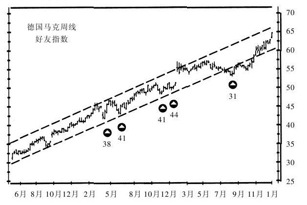
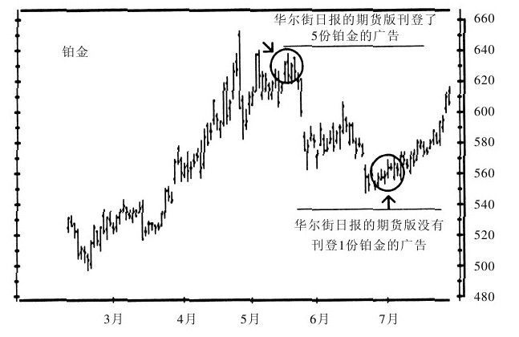

# 《以交易为生》第7章：心理指标

> 亚历山大·埃尔德（Alexander Elder）：《以交易为生》（机械工业出版社修订版），第7章"心理指标"。

## 一、章节主旨

本章讨论一类不以价格本身、而以市场参与者的情绪与实际投入为对象的指标。埃尔德将其分为两大类：

- **一致性指标（consensus indicators）**：又称反向指标，跟踪投资顾问、财经媒体、广告所反映的群体观点。群体高度一致看多则卖出，高度一致看空则买进。
- **投入指标（commitment indicators）**：依据政府机构和交易所发布的实际买卖汇总报告，跟随记录良好的群体（套利者、公司内部人、交易所会员）操作，与记录糟糕的群体（小投机者、赌徒型零股交易者）反向操作。

作者同时强调心理指标的定位：它们不如趋势跟随指标或振荡指标精确，"只是让你注意到趋势即将反转的事实"，精确时点仍须借助技术指标确认。

## 二、核心内容逐节梳理

### （一）一致性指标的理论基础

- 衡量什么：市场群体观点的一致程度。"只要市场群体还有冲突，趋势就会继续。当群体达成强烈共识时，趋势就将反转。"
- 核心逻辑：价格由群体确定，"当大多数人转而看多时，剩下的能支撑牛市的买家就不多了"。
- 理论源流：
  - 查尔斯·麦基（苏格兰律师）《非同寻常的大众幻想与群众性癫狂》，描写荷兰郁金香热与英国南海泡沫；
  - 汉弗莱·B. 尼尔《逆向思考的艺术》，将反向理论用于金融市场；
  - 亚伯拉罕·W. 科恩（纽约律师）1963年创办《投资者信息》，以投资顾问民调代替全体交易者看法：多数看空时是买点，强烈看多时是卖点；
  - 詹姆斯·H. 斯皮特1964年创办"市场风向标"，将理论用于商品交易，并按订阅数量给观点配权重。

### 7.1.1 跟踪投资顾问们的观点

- 衡量什么：投资顾问整体的多空情绪。作为整体，投资顾问"并不比一般交易者强"，他们"在市场顶部时最乐观，在市场底部时最悲观"。
- 为何集体看错：多数顾问跟随趋势，因为害怕错过趋势、显得笨进而失去订阅者；趋势持续越久，他们宣称趋势延续的声音越大。
- 数据质量：有些"变色龙"把话说得模棱两可，评级机构编辑凭经验迫使其立场可归类；只要同一位编辑评级，数据就保持内在一致性。

**1. 投资者信息（Investors Intelligence，股市）**

- 数据来源：科恩1963年创立（1983年逝世后由迈克尔·伯克接任），监测约130位投资顾问，制成看多、看空、看平比例表。
- 关键细节：看空比例尤为重要，"因为对于股市投资顾问来说，从感情上就不太愿意看空"。
- 交易法则（原文数值）：
  - 看空比例上升到**55%以上**：市场接近重要**底部**；
  - 看空比例降到**15%以下**且看多比例超过**65%**：市场接近重要**顶部**。

**2. 市场风向标（Market Vane，期货市场）**

- 数据来源：给32个市场约70位投资顾问评级，每人看多程度分9个点一级，再乘以估算订阅量，加总得出0（最悲观）至100（最乐观）的一致性评级，即好友指数（bullish consensus）。
- 交易法则：好友指数达到**70%～80%**时市场该掉头向下；接近**20%～30%**时该买进。
- 反向操作的结构原理（以1000位投资者持有12000份合约为例）：多空合约数永远相等，但人数在变——
  - 好友指数80%：空方人均持仓量是多方的4倍，"大资金是市场的空方"；
  - 好友指数20%：多方人均持仓量是空方的4倍，"大资金是市场的多方"。
  - 结论："大资金如果愚蠢就不会变大"，应沿大资金所在方向操作。
- 使用要点：
  - 至少获取**12个月**历史数据，记住以往转折时的水平，每3个月更新一次；
  - 买卖阈值因市场而异、每隔几个月调整（如德国马克牛市中好友指数跌破45%即买入，且指数越低随后上涨越具爆发性）；
  - 领先信号：顾问观点有时在主要趋势转折前一两周改变，如好友指数从78跌到76、或从25升到27，说明最明智的顾问正在抛弃获胜趋势。

*图7-1 好友指数（《以交易为生》原图）。*

### 7.1.2 来自媒体的信号

- 衡量什么：主流财经媒体从"骑墙"转向明确单边立场的程度。
- 行为逻辑：记者需要显得严肃、聪明、信息灵通，害怕显得无知，因此惯于写"除非有某些不可预见的因素导致市场下跌，否则货币政策有望助推市场上扬"式的安全表述；编辑甚至同时刊登观点矛盾的文章，美其名曰"展现一幅平衡的画面"（原文举《商业周刊》同期刊登"通胀之风日盛"与"为何通胀恐慌仅此而已"为例）。
- 解读法则："只有一轮强势的、持续时间长的趋势才能让财经记者和编辑们从墙头下来"；"当财经记者从墙头下来并表达强烈看多或看空的观点时，趋势也该反转了"。
- 封面法则：当《商业周刊》封面画一头牛时，往往是将多头仓位获利了结的时候；封面画一头熊时，底部不会太遥远。

### 7.1.3 来自广告的信号

- 衡量什么：券商/经纪公司在主流媒体同一版面集中推介同一"机会"的广告密度。
- 解读逻辑：只有已深入人心的上升趋势才能突破几家经纪公司的惯性；当他们一致认同趋势、登广告宣传时，趋势已经很老了。
- 交易法则：
  - 同一版面出现**3个或以上**同一市场的广告，是**空头警报**，表明顶部；
  - 《华尔街日报》商品版广告几乎从不建议卖出（放空难让业余人士感兴趣），专门吊起信息最不灵通者的做多欲望；同日同报出现3个以上同一市场的推介时，应利用技术指标寻找放空信号。

*图7-2 作为反向指标的广告（《以交易为生》原图）。*

### 7.2 投入指标总论

- 数据性质：政府机构与交易所发布的实际交易汇总，包含资金投入与情绪投入。
- 总原则："跟随那些有良好投资记录的机构操作，采取与那些操作记录糟糕的机构反向操作的策略。"
- 主要数据源：CFTC报告套利者与大投机机构仓位；SEC报告公司内部人买卖；纽约股票交易所报告会员与散户的买卖及融券数量。

### 7.2.1 交易者的投入（CFTC持仓报告）

- 申报机制：持仓达到申报水平即被划为大投机者（如100份玉米、300份标普500）；经纪公司上报，CFTC每两周发布汇总。另有仓位限制（如玉米净仓位不超2400份、标普500不超500份）以防操控。
- 三类参与者：
  - **商业人士（套利者）**：正常经营中需要实际商品的企业，理论上为对冲风险；保证金低、不受投机仓位限制；有内幕信息、资本强大，"作为一个群体在期货市场上的交易记录最好"，长期跟随有利可图（橙汁套利者是少数例外）。
  - **大投机者**：过去（约10年前以前）多为精明的富裕个人，记录良好；今天主要是商品基金，"这些跟随趋势的大笨熊作为一个群体记录很糟糕"。
  - **小投机者**：典型的"弄错方向的柯里根"，仓位需用持仓量减去前两类得出。
- 数据陷阱：分类带人为色彩，存在把投机客户登记成套利者等捉迷藏行为；部分套利者甚至可借现货影响力操纵期货价格（油轮改道例子，属非法）。
- 分析方法：单看方向无意义（套利者往往因持有现货而放空，小交易者天然偏多），必须把现有仓位与历史正常仓位对比。
- **COT指数（交易者持仓指数）**：由蒂斯·阿诺德发明、斯蒂芬·布瑞斯（Bullish Review通讯发行人）普及，测算净仓位相对历史区间的偏离度。
  - 交易法则：COT指数升至**90%以上**，商业投资者不同寻常地看多，发出**买入**信号；跌至**10%以下**，商业投资者不同寻常地看空，发出**卖出**信号。

### 7.2.2 内部人交易

- 数据来源：持股超过5%的管理层与投资者须向证监会报告，证监会制表后每月公布。
- 群体特征："公司内部人整体是低价买进、高价卖出"——大跌后买入，上涨且高估时加快抛售。
- 过滤法则：单个内部人的买卖说明不了什么（可能因个人支出卖出、因行使期权买入）；只有**3个以上**高管或大股东在**一个月内**持续同向交易才有意义——3人持续买进则股票有望上涨，3人持续卖出则有望下跌。

### 7.2.3 股票交易所的会员

- 逻辑：会员尤其专家（specialist）拥有特权，"执照就是一部印钞机"，整体记录优于短线投机者。
- 两个指标（20世纪80年代以前极理想）：
  - 会员融券比（MSSR）：会员融券数量相对于融券余额的比率；
  - 专家融券比（SSSR）：专家融券数量相对于会员融券数量的比率。
- 原始法则：MSSR偏高（**超过85%**）、SSSR偏高（**超过60%**）表明精明者在抛空，市场已到顶部；MSSR偏低（**低于75%**）、SSSR偏低（**低于40%**）表明精明者在买进，市场接近底部。
- 失效警示：80年代起指标变得不规律——精明交易者转到期权市场操作，无法分辨抛空是看空还是套利。

### 7.2.4 零股交易

- 对象：一次交易少于100股的小投资者；成交量占比从一个世纪前的1/4降到20年前的1%。
- 群体特征："零股交易者作为一个整体是价值投资者。他们低价买进高价卖出。"
- 零股卖出比：测算卖出与买入之比。下降表明零股交易者在买进，底部临近；上升表明在卖出，顶部临近。
- 零股融券比：性质截然不同，跟踪其中赌徒的放空行为；比值非常低时顶部临近，非常高时底部临近。
- 失效警示：七八十年代起失去价值——聪明的小钱转入共同基金，赌徒转投期权市场；且专业玩家也开始使用99股零股单据，撮合机制也变得有利于零股交易。

## 三、指标速查表

| 指标 | 数据来源 | 看多（买入/底部）信号 | 看空（卖出/顶部）信号 |
|---|---|---|---|
| 投资者信息多空比例 | 约130位股市顾问观点 | 看空比例 >55% | 看空 <15% 且看多 >65% |
| 好友指数 | 市场风向标，约70位顾问、32个市场，按订阅量加权 | 指数接近 20%～30%（牛市中可放宽，如德国马克 <45%） | 指数达 70%～80% |
| 顾问观点微变 | 上述评级的周际变化 | 指数从25升至27等自低位回升 | 指数从78跌至76等自高位回落 |
| 主流杂志封面 | 《商业周刊》等 | 封面画熊，底部不远 | 封面画牛，获利了结 |
| 广告密度 | 主流报刊同一版面 | —— | 同版面3个以上同一市场广告（空头警报） |
| COT指数 | CFTC每两周持仓报告（商业群体净仓位偏离度） | >90%（商业资金异常看多） | <10%（商业资金异常看空） |
| 内部人交易 | SEC月度数据 | 一个月内3个以上内部人持续买入 | 一个月内3个以上内部人持续卖出 |
| MSSR / SSSR | 交易所会员、专家融券数据 | MSSR<75%、SSSR<40%（80年代后失效） | MSSR>85%、SSSR>60%（80年代后失效） |
| 零股卖出比 | 零股交易者卖/买之比 | 指标下降（零股客在买） | 指标上升（零股客在卖） |
| 零股融券比 | 零股交易者放空数据 | 比值非常高 | 比值非常低（七八十年代后失效） |

## 四、本章金句

1. "只要市场群体还有冲突，趋势就会继续。当群体达成强烈共识时，趋势就将反转。"
2. "当群体高度一致地看多时，卖出应该不错；当群体高度一致地看空时，准备买进将有利可图。"
3. "因为价格是由群体确定的，当大多数人转而看多时，剩下的能支撑牛市的买家就不多了。"
4. "投资顾问们在市场顶部时最乐观，在市场底部时最悲观。"
5. "大资金如果愚蠢就不会变大。"
6. "当财经记者从墙头下来并表达强烈看多或看空的观点时，趋势也该反转了。"
7. "当《商业周刊》在封面画一头牛时，往往是将多头仓位获利了结的时候；当它在封面画一头熊时，底部也不会太遥远。"
8. "有记录显示，公司内部人整体是低价买进、高价卖出。"

## 五、对当代交易者的启示

1. **把社交媒体情绪当作当代"好友指数"**：当短视频、论坛、社群对某板块一致喊多、散户排队晒盈利时，按一致性原则视为顶部预警而非追涨理由；一片死寂、齐声叫惨时再研究买点。
2. **用基金发行量替换"报纸广告"信号**：爆款基金一日售罄、ETF份额天量、券商集中推送同一主题，等价于"同版面3个广告"——趋势往往已进入后段。
3. **情绪指标只报警、不定时**：收到一致性警报后，必须等待趋势指标、形态或振荡指标确认后再动手，避免因"大众很疯狂"而提前做空被碾轧。
4. **与历史区间比较，而非看绝对方向**：套用COT思路跟踪聪明钱数据（持仓报告、产业资本增减持），建立至少一年的基线，只在偏离度极端时行动。
5. **重视群体内部的"领先微变"**：价格创新高而情绪指数先从78滑到76式的小回落，往往是最聪明资金离场的早期信号；关注情绪与价格的背离。
6. **定期检验指标是否已经失效**：MSSR、零股指标都因期权、基金兴起而报废；今天的情绪指标同样会被被动投资、ETF、算法交易改变结构，使用前先验证其近年的有效性。
7. **跟踪内部人要过滤噪音**：单名高管减持可能只是个人用钱，只有多名高管在短期内同向买卖才构成可信信号，并应结合估值与技术面综合判断。

## 六、一句话核心判断

群体情绪的极端一致就是趋势反转的燃料：大众极度看空时准备买入、极度看多时准备卖出，但扣动扳机的精确时机永远交给技术指标确认。
