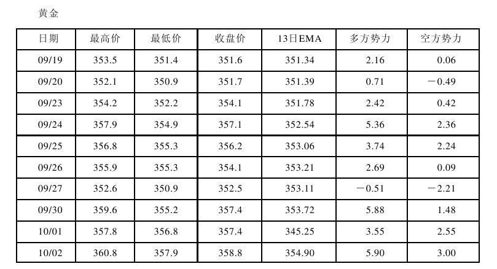
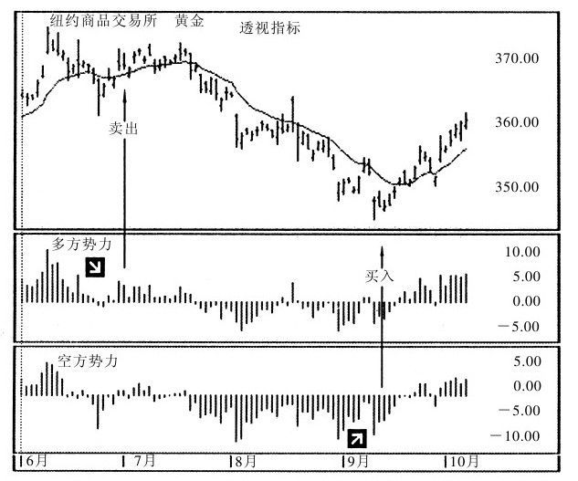
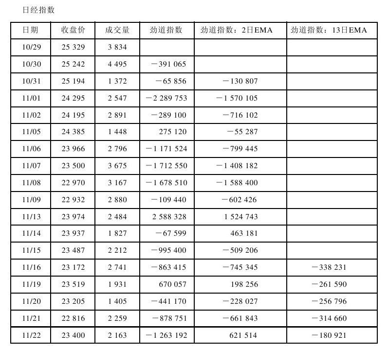
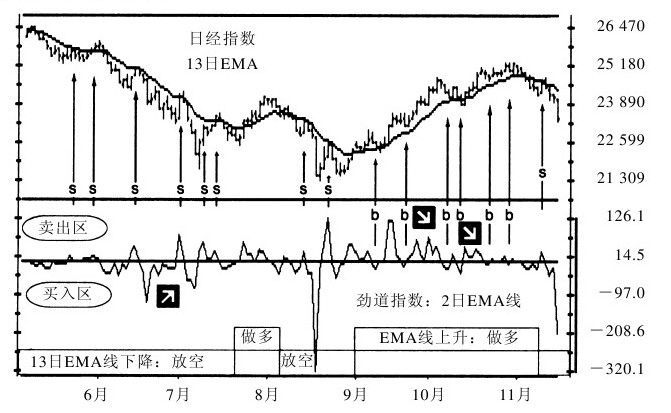
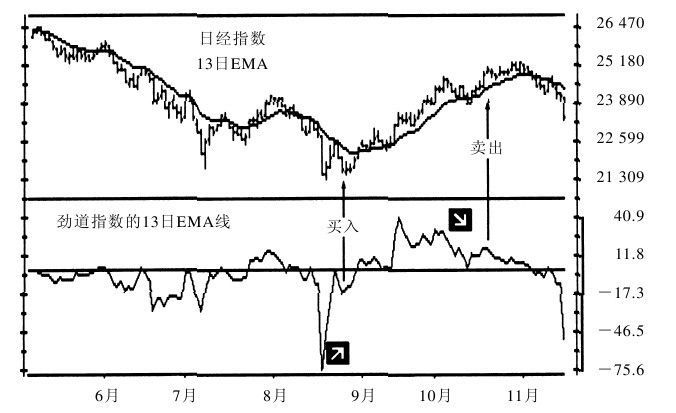

# 《以交易为生》第8章：新指标

> 亚历山大·埃尔德（Alexander Elder）著：《以交易为生》（机械工业出版社修订版），第8章"新指标"。
> 本章介绍作者自创的两个技术指标：透视指标（Elder Ray，1989年发明）与劲道指数（Force Index）。

## 一、章节主旨

本章集中介绍埃尔德自创的两个指标，核心目标不是预测未来，而是"看清多空双方何时变得更强或更弱"，从而跟随主导市场的一方操作。

- **透视指标（8.1）**：类似 X 射线，"交易者用透视指标来检查潜伏在市场表象之下的多空双方的势力"。它以一条 13 日 EMA 衡量趋势，以"多方势力（bull power）"和"空方势力（bear power）"两个振荡指标衡量多空双方把价格推离平均价值共识的能力。
- **劲道指数（8.2）**：一种振荡指标，"衡量每一次上涨和下跌的背后多空方的劲道"，把价格变化的方向、幅度与成交量三者结合，"提供了一种全新的利用成交量来进行交易决策的实用方法"。
- 两指标均可单独使用，但作者反复强调：与趋势识别（EMA 倾斜方向或周线趋势）结合、只顺趋势方向操作，效果更好；两者都特别适用于第9章的三重滤网交易系统。

## 二、核心内容逐节梳理

### 8.1 透视指标（Elder Ray）

#### （一）构造：公式与4个步骤

透视指标"结合了趋势跟随指标和振荡指标的优点"：一条指数移动平均线（EMA）是趋势跟随指标；多方势力和空方势力是振荡指标。屏幕/绘图纸分为 3 个水平窗口：上方画柱状图与 EMA，中间画多方势力柱，下方画空方势力柱。

构造步骤（原文4步）：

1. 在最上方窗口画出任何一个交易标的的柱状图。
2. 在同一窗口画出收盘价的 EMA 线——"13天EMA线是不错的选择"。
3. 按公式计算**多方势力值**，用柱状线画在中间窗口：
   - **多方势力 = 最高价 − 13日EMA值**
   - 任一天的多方势力值 = 当日最高价 − 当日 EMA 值。正常情况下柱线最高价在 EMA 之上，值为正、柱在中线之上；市场急剧下跌、整个柱线跌到 EMA 之下时，值转负、柱落到中线之下。
4. 按公式计算**空方势力值**，用柱状线画在最下端窗口：
   - **空方势力 = 最低价 − 13日EMA值**
   - 任一天的空方势力值 = 当日最低价 − 当日 EMA 值。正常情况下值为负、柱在中线之下；市场急速上升、最低价位于 EMA 之上时，值转正、柱落到中线之上。

数值含义（照原文）：

- "一般情况下多方势力是正值，空方势力是负值。"
- "多方势力值越高，则多方越强势；空方势力值越低，则空方越强势。"
- "当多方势力值转负时，表明空方很强势，足以完胜多方；如果空方势力值转正，表明多方非同寻常的强势，足以完胜空方。"
- 13 天 EMA 反映平均价值共识，其倾斜方向代表市场趋势；多方势力反映多方把价格推升到平均价值共识之上的能力，空方势力反映空方把价格打压到平均价值共识之下的能力。
- 背离定调："当价格创出新低而空方势力值只达到了一个次低点时，产生牛背离并发出最佳买入信号；当价格达到前期高点或创出新高而多方势力值只达到了一个次高点时，产生熊背离并发出最佳放空信号。"

*图8-1 透视指标计算表（《以交易为生》原图）。*

#### （二）交易心理

透视指标包含价格、移动平均值、每根柱的最高价与最低价四类信息，其心理含义如下：

1. **价格是货币化的价值共识**：买方因看涨而买，卖方因看跌而卖，未下决心的交易者在旁观望并对双方施压；"每一笔交易的价格反映的是任何一种交易工具的最新价值共识"。
2. **移动平均线是一段时期内价值共识的平均值**：10 天 MA 代表过去 10 天的平均价值共识，20 天 MA 同理；EMA 比简单 MA 更可靠。"移动平均线的最重要的信息是其倾斜方向。当它上升时，表明大众看得更多；当它下降时，表明大众看得更空。要沿移动平均线的倾斜方向操作。"
3. **柱线最高价 = 期间多方的最大力量**：多方不断买进直到无法再把价格推高；日线最高点代表一天内多方的最大力量，周线最高点代表一周内多方的最大力量。
4. **柱线最低价 = 期间空方的最大力量**：空方不断卖出并放空直到无法再把价格压低；日线、周线最低点分别代表一天、一周内空方的最大力量。
5. 透视指标通过测算每根柱线最高点、最低点与 EMA 的差距，比较多空最大力量与平均价值共识的差异：
   - 多方势力测算柱线最高点到 EMA 的距离，多方变强时上升、蹒跚时下降；"当多方把头埋在水面下时空方势力转正"（原文如此，指多头被完全压过 EMA）。
   - 空方势力测算柱线最低点到 EMA 的距离，空方变强时下降、变弱时上升；"如果空方势力转正，表明多方十分强势，抓住空方的颈背把空方举出了水面"。

原文要点小结（6条）：

1. 价格是价值共识，体现在行动中。
2. 移动平均线是平均价值共识。
3. 每根柱线的最高点反映了在此期间多方最强的力量。
4. 每根柱线的最低点反映了在此期间空方最强的力量。
5. 多方势力指原始的多方力量与平均价值共识之间的差距。
6. 空方势力指原始的空方力量与平均价值共识之间的差距。

#### （三）交易法则

总原则：透视指标可单独使用，但与其他方法（尤其三重滤网）结合效果更好。若单独使用，"要记住它的EMA线的倾斜方向代表趋势，只能顺趋势方向操作"，再用多、空势力柱寻找顺势买卖点。三重滤网用周线图识别趋势，再用日线势力柱找机会：周线向上只采用日线买入信号，周线向下只采用日线放空信号。

**1. 买入（买与卖）**

买入的两个基本条件：

1. 趋势向上（用 EMA 线或周线趋势跟随指标来识别）。
2. 空方势力柱为负但在上升。

第3条和第4条不是必需的但最好有：

3. 多方势力柱近期高点高于前期高点。
4. 空方势力柱自牛背离点上升。

配套法则（照原文）：

5. **空方势力柱为正值时不要买入**：这发生在狂奔的上升趋势中、整个柱线都涨到 EMA 之上时；此时买入是在博傻理论（the greater fool theory）——高价买入后希望有更傻的傻蛋以更高价格接货。
6. **最佳买入点**：空方势力柱为负值但开始上升时——"当空方重新站稳脚跟但开始再次下滑时"。当空方势力柱向上挑时，在最近两天的高点之上挂买单（停止买单）；上涨继续即触单建仓。
7. 一旦做多，将保护性止损位设在近期次低点之下。
8. **最强烈的买入信号**：空方势力柱与价格出现牛背离——价格创新低而空方势力柱只达到次低点，表明价格是惯性下探、空方正在变弱；空方势力柱自次低点向上挑时可加仓买入。
9. **加仓法则**：上升趋势持续时，只要空方势力柱下穿其中线然后再次挑头向上，就可增加多头仓位。
10. **卖出多头**：不要受多方势力柱每次起伏跳动的影响；跟踪其峰谷形态，只要每次价格创新高时多方势力柱都创新高，上升趋势就安全。当价格创出新高而多方势力柱只达到低于前期高点的次高点时，发出卖出信号。

**2. 放空与回补**

放空的两个基本条件：

1. 趋势向下（根据 EMA 线或周线趋势跟随指标判断）。
2. 多方势力柱为正但在下降。

第3条和第4条不是必需的但最好有：

3. 空方势力柱的近期低点比前期低点低。
4. 多方势力柱正自熊背离点下降。

配套法则（照原文）：

5. **多方势力柱已经是负值时不要放空**：瀑布式下跌中整个价格柱都位于 EMA 之下时如此；此时放空等于赌空方还能把多方的头摁得更低，是博傻理论的另一个翻版。
6. **最佳放空时点**：多方势力柱为正但在下降时——多方蹿到水面上透了一口气又开始下沉。在近两日的低点之下挂放空单，下跌持续则自动成交。
7. 一旦放空，将保护性止损位设在近期次高点之上。
8. **最强烈的放空信号**：多方势力柱与价格出现熊背离——价格创出新高而多方势力柱只达到次高点，表明多方比以前弱、价格呈惯性上攻；多方势力柱自次高点掉头向下时可增加放空仓位。
9. **加仓法则**：下跌趋势延续时，只要多方势力柱上穿其中线然后再次向下挑，就可以增加放空仓位。
10. **回补空头**：下跌趋势中监控空方势力柱的峰谷形态（比单一上下波动更重要）；价格创新低同时空方势力柱也创新低，则下跌趋势安全。价格创新低但空方势力柱只达到次低点时产生牛背离，表明空方能量耗尽、价格惯性下探，"这是回补空头仓位并准备反手做多的信号"。

作者总结："多方势力柱、空方势力柱与价格的背离是最佳操作时机。"

*图8-2 透视指标（《以交易为生》原图）。*

### 8.2 劲道指数（Force Index）

#### （一）构造：公式与参数

劲道指数包含三种基本市场信息：**价格变化的方向、价格变动范围和成交量**。每轮走势的劲道由方向、幅度和成交量确定：价格收高劲道为正，收低劲道为负；价格变化幅度越大劲道越大，成交量越大走势劲道越大。

原始公式（原文）：

- **劲道指数 = 当日成交量 ×（当日收盘价 − 前一日收盘价）**

画法与平滑：

1. 将未经平滑的劲道指数画成柱线，零轴处画水平中线：收高为正、画在中线上方；收低为负、画在中线下方；收平为零。
2. 未经平滑的劲道指数波动频繁，用移动平均线平滑后信号更好：
   - **短期劲道指数 = 劲道指数的 2 日 EMA 平滑**（最低程度的平滑，有助于发现入市点）。
   - **中期劲道指数 = 劲道指数的 13 日 EMA 平滑**（跟踪多空劲道的长期变化）。
3. 可用程序缩小非常大的劲道指数值：用劲道指数除以最新收盘价即可。

两条 EMA 的分工（原文）：

- 沿价格 13 日 EMA 方向操作时，"在2日EMA线为负时买入、为正时卖出将有利可图"。
- 13 日 EMA 上穿中线表明多方占主导，转负表明空方占主导；其与价格的背离标明重要转折点。

*图8-3 劲道指数计算表（《以交易为生》原图）。*

#### （二）交易心理

1. 市场收高表明多方赢得当日战争，收低表明空方获胜；当日收盘价与前一日收盘价的距离反映获胜程度，距离越大胜利越重要。
2. "成交量反映市场参与大众的投入程度。"放量的价格变化像雪崩，滚下来时聚集了很多大众；"放量上涨和下跌的惯性更大，趋势持续的可能性更大。相反，低成交量表明新增输方减少，趋势正在接近尾声。"
3. "价格反映市场参与者的思想，而成交量反映他们的情感。劲道指数把价格与成交量结合起来，它显示市场参与者的思想和情感是否同步。"
4. 劲道指数创新高，多方劲道强、上升趋势有望延续；创新低，空方劲道强、下跌趋势有望延续。
5. 两种走平警告趋势即将反转：价格变化没有得到成交量确认（量价背离）；高成交量只带来价格小幅变动。

#### （三）交易法则

**1. 短期劲道指数（2日EMA）**

2 日 EMA 对短期多空劲道变化高度敏感：上穿中线多方更强，下穿中线空方更强。它过于敏感，最适合用来精确把握其他指标（趋势跟随指标）的信号，帮助交易者"买弱卖强"。总纲："根据13日EMA线判断趋势上升且劲道指数下穿零轴时，发出买入信号；当趋势下降且劲道指数上穿零轴时，发出放空信号。"

原文法则（编号照录）：

1. **在上升趋势中，应在劲道指数的2日EMA线转负时买入。** 任何上升趋势都有回调，等到其转负再买能买得离短期底部更近。具体下单：2 日 EMA 转负时，将买单挂在当日最高价之上；趋势继续则自动成交建仓，价格下跌则不执行，再把买单挂低到最新柱线最高点之上一档。成交后将保护性止损设在交易当日或前一日最低点之下，取两者中的低值——强势上涨中很少被触及，趋势较弱时能尽早脱身。
2. **在下跌趋势中，当2日EMA转正时放空。** 这是多方的一次快速反抗。将放空单挂在最新价格柱低点之下；若挂单后 2 日 EMA 继续上涨，每天把放空单抬高到最新价格柱低点之下一档。成交后保护性止损设在最新或前一价格柱高点之上，取高值；"要尽早将止损位下移到盈亏平衡点"。
3. **牛背离发出强烈买入信号**：价格创出新低而劲道指数只达到次低点时产生牛背离。
4. **熊背离发出强烈卖出信号**：价格创出新高而劲道指数只达到次高点时产生熊背离。

加仓与平仓（原文）：

- 加仓：上升趋势中每当劲道指数转负就增加多头仓位；下跌趋势中每当转正就增加放空仓位。
- 预判走势：2 日 EMA 跌至月内最低点，空方强势、价格有望继续走低；升至月内最高点，多方强势、价格有望继续走高。
- 短线投资者：转负买入者在指标转正时卖出；转正放空者在指标转负时回补。
- 长线投资者：只有当趋势变化（按价格 13 日 EMA 倾斜方向判断）或劲道指数 2 日 EMA 与趋势出现背离时才平仓。

*图8-4 劲道指数：2日EMA线（《以交易为生》原图）。*

**2. 中期劲道指数（13日EMA）**

13 日 EMA 表明多空势力的长期变化：相对中线的位置标明谁占主导，与价格的背离标明重大转折点。原文法则（续编号）：

5. **中线位置定多空**：位于中线上方表明多方主导市场；位于中线下方表明空方占主导；在中线附近振荡表明是无趋势市场，警告不要采用趋势跟随操作法。
6. **新高确认上涨、熊背离强烈放空**：13 日 EMA 创出新高确认上升趋势、上涨有望持续；价格创出新高而指标只达到次高点（熊背离），警告多方正在失势、空方即将接管，发出强烈放空信号。
7. **新低确认下跌、牛背离强烈买入**：13 日 EMA 创出新低确认下跌趋势、下跌有望持续；价格创出新低而指标只达到次低点（牛背离），警告空方正在失势，发出强烈买入信号。

趋势生命周期（原文描述）：

- 上涨开始时价格往往放量上升，13 日 EMA 创新高确认趋势；随时间推移，价格上涨速度放缓或成交量萎缩，指标顶点开始降低并最终跌破中线，"这表明牛市的基础已被破坏"。
- 下跌开始时价格往往放量下跌，指标创新低确认趋势；随后下跌减速或量能萎缩，指标低点逐渐抬高并最终上穿中线，"这表明熊市的基础已被动摇"。
- 劲道指数的尖形低点有双重信息：长期看往往标明重要下跌趋势的结束；短期看告诉交易者近期价格低点很可能会被回测或超出。

*图8-5 劲道指数：13日EMA线（《以交易为生》原图）。*

## 三、两个指标速查表

| 指标 | 构成 | 买入信号 | 卖出/放空信号 |
|---|---|---|---|
| 透视指标 Elder Ray | 13日EMA（趋势）＋多方势力＝最高价−13日EMA；空方势力＝最低价−13日EMA（两个振荡柱） | 趋势向上＋空方势力柱为负但上升；最强信号：价格创新低而空方势力仅次低点（牛背离）；空方柱下穿中线再上挑可加仓 | 趋势向下＋多方势力柱为正但下降；最强信号：价格创新高而多方势力仅次高点（熊背离）；多方柱上穿中线再下挑可加空；牛背离回补空头 |
| 劲道指数 Force Index | 劲道指数＝当日成交量×（当日收盘−前日收盘）；2日EMA（短期）与13日EMA（中期）平滑 | 上升趋势中2日EMA转负买；2日EMA与价格牛背离强烈买入；13日EMA在中线上方且牛背离/上穿中线 | 下跌趋势中2日EMA转正放空；2日EMA熊背离强烈卖出；13日EMA在中线下方；中线附近振荡为无趋势市场，勿用趋势跟随法 |

## 四、本章金句（原文原句）

1. "为了成为一名成功的交易者，你用不着预测未来，只需知道多空双方何时何方主导市场，并跟随主导方操作即可。"
2. "每一笔价格都是货币化的价值共识。"
3. "移动平均线的最重要的信息是其倾斜方向……要沿移动平均线的倾斜方向操作。"
4. "价格反映市场参与者的思想，而成交量反映他们的情感。劲道指数把价格与成交量结合起来，它显示市场参与者的思想和情感是否同步。"
5. "放量上涨和下跌的惯性更大，趋势持续的可能性更大。相反，低成交量表明新增输方减少，趋势正在接近尾声。"
6. "X线显示隐藏在健康皮肤之下的断骨，透视指标则显示潜伏在趋势下面的主导群体何时失势。"
7. "多方势力柱、空方势力柱与价格的背离是最佳操作时机。"
8. "如果你在空方被多方举出水面时买入，那你是在博傻理论（the greater fool theory）—高价买入后希望有一个更傻的傻蛋以更高的价格来接货。"

## 五、对当代交易者的启示

1. **先定趋势，再找入场点**：任何信号下单前，先用价格 13 日 EMA 倾斜方向（或更大周期趋势）确定多空立场，只接受顺趋势方向的信号，把"顺势"变成不可协商的前置过滤条件。
2. **把背离作为最高优先级信号**：价格创新高新低但对应力道指标（空方势力/多方势力/劲道指数）只出次高点、次低点，说明趋势靠惯性运行、主导方能量耗尽，应重点等待 EMA 掉头确认后入场。
3. **用量能验证价格，思想与情感必须同步**：放量顺趋势运动可持有/加仓；缩量创新高/新低、或放量却只换来小幅价格变动，都按反转预警处理，收紧止损而非加仓。
4. **用挂单交易回调，不追价**：上升趋势中等劲道指数 2 日 EMA 转负、在当日高点之上挂停止买单；下跌趋势中等其转正、在最新柱低点之下挂放空单；未成交则逐日移动挂单，从机制上避免情绪化追涨杀跌。
5. **进场即设止损，并尽快移至保本**：多头止损放在入场日或前日最低价的较低者之下，空头放在较高者之上；放空盈利后尽早把止损下移到盈亏平衡点。
6. **按持仓周期选择离场规则**：短线交易者在劲道指数反向穿越零时获利了结；长线持仓只在趋势 EMA 改变方向或指标与趋势背离时离场，不为指标日常抖动出局。
7. **识别无趋势市场并停手**：劲道指数 13 日 EMA 在中线附近反复振荡时，明确放弃趋势跟随策略，转为观望或改用震荡打法，保护本金等待方向明朗。

## 六、一句话核心判断

**不必预测未来：用 EMA 辨认谁在主导市场，用势力柱与劲道指数（尤其是它们与价格的背离）确认主导方是否失势，然后顺势进场、挂单回调、严格止损。**
