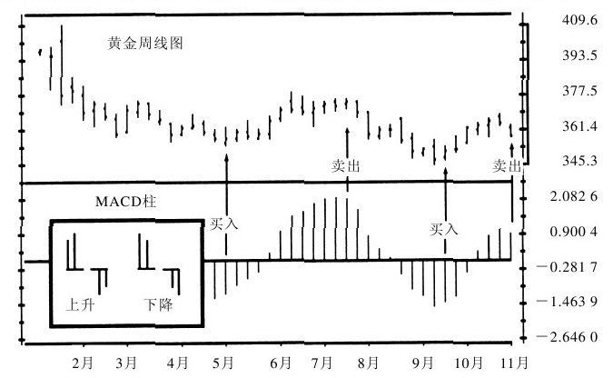
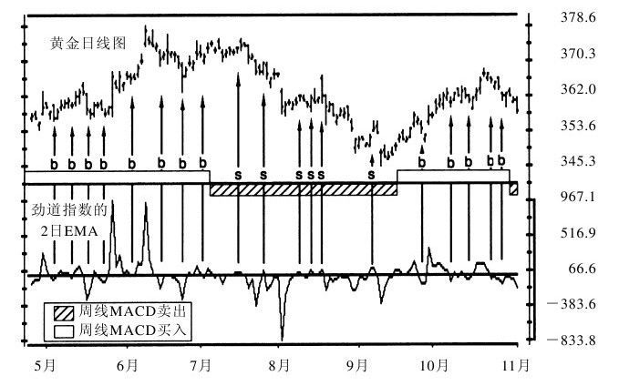
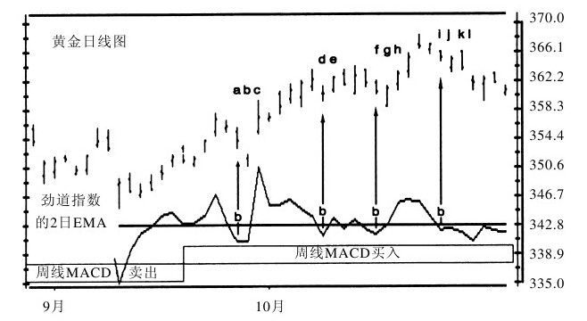
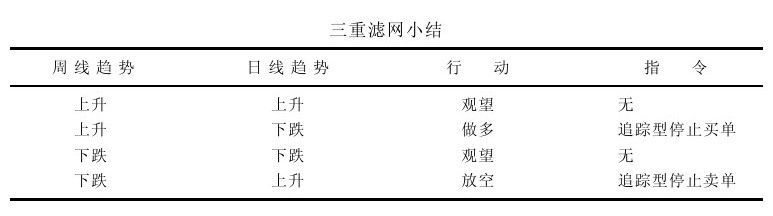
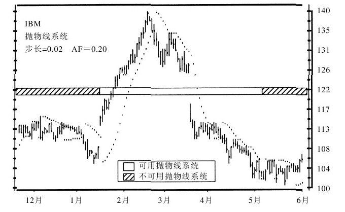
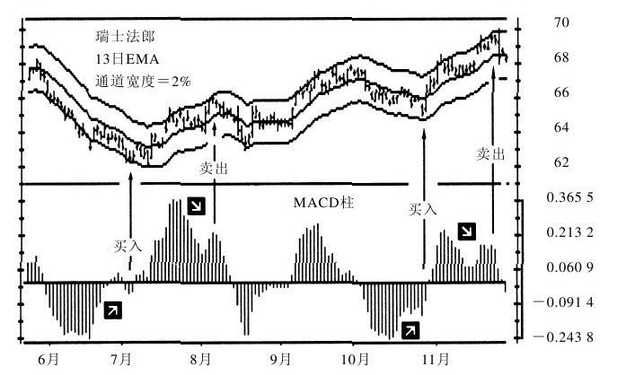

# 《以交易为生》第9章：交易系统

> 亚历山大·埃尔德 著：《以交易为生》（机械工业出版社修订版），第9章"交易系统"。

## 一、章节主旨

本章介绍三套作者亲用或推崇的、可机械化执行的交易系统：作者本人发明的**三重滤网交易系统**、小韦尔斯·王尔德的**抛物线交易系统**，以及以移动平均线为基准的**通道交易系统**。三套系统分别解决不同问题：三重滤网解决"趋势跟随指标与振荡指标互相矛盾"以及"不同时间周期信号互相矛盾"两大难题；抛物线解决强趋势行情中"如何兼顾价格与时间、只顺交易方向移动止损"的问题；通道解决"如何客观识别市场高估与低估、避免被群体情绪裹挟"的问题。全章贯穿一条主线：**先判大趋势定方向，再用逆趋势波动找入场点，最后用窄止损和资金管理保命**。

## 二、核心内容逐节梳理

### （一）9.1 三重滤网交易系统

三重滤网交易系统由作者发明，自1985年起一直用于实盘操作，1986年4月首次发表于《期货》（Futures）杂志。它对每次操作进行三重测试或过滤，通过三重滤网考验的操作获利概率大幅提高。它将趋势跟随法与反趋势技术结合，从好几种时间周期分析所有潜在交易机会；"三重滤网不仅仅是一套交易系统，更是一套方法，一种操作风格。"

**解决的问题1：趋势跟随指标与振荡指标的矛盾（9.1.1）**

1. 市场太复杂，不可能用单一指标分析清楚；初学者追逐"神奇方法"，失灵后便连本带利还给市场。
2. 同一市场不同指标会发出互相矛盾的信号：上升趋势中，趋势跟随指标上升发出买入信号，振荡指标却超买发出卖出信号；下跌趋势中则相反。
3. 趋势行情中按趋势跟随指标操作有利可图，区间振荡时它会发假信号；振荡指标则在区间振荡时有效，趋势来临时过早发出危险信号。
4. 人为折中不可取：采用的趋势指标多结果就偏向趋势，振荡指标多就偏向振荡，交易者总能凑出一组指标得到他想要的结果。
5. 三重滤网的目的：去掉两类指标的缺点，保留它们的优点。

**解决的问题2：选择时间周期——因素5（9.1.2）**

1. 同一时点不同周期图趋势可能相反（如日线上升、周线下跌）。
2. 道氏理论：查尔斯·道认为市场有长期（数年）、中期（数月）和小趋势三种；罗伯特·雷亚将趋势分为**潮流、波浪和涟漪**，主张沿潮流方向操作、利用波浪、忽略涟漪。
3. 三重滤网的观察基础：每一时间周期与更长一级或更短一级的比例关系基本上与 **5** 有关。
4. 交易者先自定**中期**周期；高一层级为**长期**，低一层级为**短期**。例如做数天至数周的交易：日线为中期，周线为长期，小时线为短期；当冲者可以10分钟线为中期、小时线为长期、2分钟线为短期。
5. 总原则：首先看长期走势图，只允许沿潮流（长期趋势）方向操作，利用与潮流逆向的波浪寻找入场点——周线向上则日线下跌产生买入时机，周线向下则日线上涨提供放空机会。

**第一层滤网——市场潮流（9.1.3）**

1. 从分析长期（周线）走势图开始；大多数人只看几个月日线，先看周线等于把视角比竞争对手扩大5倍。
2. 工具：用趋势跟随指标判断长期趋势。最初系统用**周线MACD柱的倾斜方向**，倾斜方向由相邻两根柱子的关系确定。
3. 方向判定：MACD柱向上倾斜表明多方占主导，应做多；向下倾斜表明空方占主导，应放空。
4. 信号质量：周线MACD柱掉头向上发买入信号，**自中线下方掉头向上时买入信号最佳**；掉头向下发卖出信号，**自中线上方掉头向下时卖出信号最佳**。
5. 纪律：周线趋势向上时只允许做多或观望；周线趋势下跌时只允许放空或观望。
6. 可替换工具：史蒂夫·尼森用趋向系统作第一层；哪怕13周指数移动平均线的倾斜方向这样简单的工具也可使用，规则相同——关键是先分析周线趋势，再从日线找同向机会。
7. 第一层滤网法则（原文）："利用趋势跟随指标判断周线趋势，且只顺从趋势方向操作。"它只去除买入、卖出、观望三种选择中的一种："你要么顺流而下，要么观望。"

*图9-1 MACD柱周线图：三重滤网的第一层（《以交易为生》原图）。*

**第二层滤网——市场波浪（9.1.4）**

1. 目的：识别与潮流逆向的波浪。周线向上时用日线下跌找买点，周线向下时用日线上涨找放空点。
2. 工具：用振荡指标观察日线图，且只采用与周线趋势同向的日线信号——周线向上只买日线振荡指标的买入信号、忽略卖出信号；周线向下反之。
3. 指标选择：劲道指数和透视指标很适用，但**随机指标和威廉指标更有效**；RSI响应太慢，不适于三重滤网。
4. 劲道指数（2日EMA）信号：周线MACD柱上升时，劲道指数2日EMA下穿中线而未创数周新低，为买入信号；周线MACD柱下降时，其上穿中线而未创数周新高，为放空信号。
5. 透视指标信号：周线向上时，日线空方势力柱下穿零轴后又向上翻升，为买入信号；周线向下时，日线多方势力柱上穿零轴后又向下滑落，为放空信号。
6. 随机指标信号：周线MACD柱上升而日线随机指标跌到 **30以下**（超卖），是买点；周线MACD柱下降而日线随机指标升到 **70以上**（超买），是卖点。
7. 威廉指标用于三重滤网需要四五天时间，用法与随机指标类似。

*图9-2 日线劲道指数：三重滤网的第二层（《以交易为生》原图）。*

**第三层滤网——盘中突破（9.1.5）**

1. 定位：第一层判周线潮流，第二层识别日线反向波浪，第三层识别与潮流同向的小涟漪，依据即时价格变化找入场点；不需要走势图或指标。
2. 上升趋势中采用**追踪型买进停止单**；下跌趋势中采用**追踪型卖出停止单**。
3. 做多操作（周线上升、日线振荡指标下降时）：将买入价设在前一天高点之上一档；价格涨过前一天高点则买单自动成交，若继续下跌则不成交，第二天把买入价下调到最新高点之上一档；每天不断下调，直到成交，或周线指标反转、买入信号消失为止。
4. 放空操作（周线下跌、日线振荡指标上升时）：将放空价设在前一天低点之下一档；价格向下突破则放空单成交，若继续上涨则每天调高放空价位；目标是顺下跌的周线趋势，在日线上升的盘中抓住向下突破点。
5. 图9-3范例（a—l点）完整展示：每次劲道指数下穿中线即挂买单（买入价＝当日高点或其上一档），继续下跌则逐日下调买入价，突破当日高点时买入并把止损设在该柱低点；l点黄金低开触及保护性止损，验证"止损很重要，因为没有完美无缺的指标"。

*图9-3 追踪型停止买入：三重滤网的第三层（《以交易为生》原图）。*

**止损法则（9.1.6）**

1. 前提："恰当的资金管理是交易成功的根本。"三重滤网要求止损位设得**窄一点**。
2. 买入后：止损单挂在交易当天或前一天低点下方一档，**取二者中的低者**。
3. 放空后：保护性止损单设在交易当天或前一天高点上方一档，**取二者中的高者**。
4. 行情朝有利方向发展后，尽快把止损位移到盈亏平衡点；首要原则是保护住50%的账面浮盈。
5. 窄止损的逻辑：只顺潮流操作，若交易不能迅速生效，说明市场背后发生了根本性变化，应赶紧走人，逃命后才能从旁观者角度重新审视市场。
6. 持仓与加减仓：保守者在第一次信号时建仓并持有到主要趋势反转或止损出局；积极者可用日线振荡指标的每个新信号加仓。
7. 出场：中长线者持有到周线趋势反转；短线者可按第二层滤网信号获利了结（如做多后劲道指数转正或随机指标升到70，可卖出后再等下一买点）。

*图9-3（小结表） 三重滤网小结（《以交易为生》原图）。*

### （二）9.2 抛物线交易系统

抛物线交易系统（the parabolic trading system）由小韦尔斯·王尔德于1976年提出；急涨急跌行情中止损位轨迹形如抛物线，因而得名。其目的是抓住趋势并在趋势反转时抓住转折点，独特之处在于**既考虑价格变化，也考虑时间的流逝**——大多数交易者只关注价格而忽略时间。

**SAR的构造（9.2.1）**

1. 它是一套**反转系统**，设计上要求交易者始终留在场内：多头止损出局的同时以同一价位放空，空头止损出局的同时以同一价位做多。该法在通胀严重的70年代很有效，后来多有反复，现在只应在市场沿趋势运行时选择性使用。
2. 优良传统：**只顺交易方向调整止损位，绝不逆交易方向调整**——做多只能上移止损位，放空只能下移止损位。
3. 每日调整公式：**第二日止损位＝当日止损位＋AF×（当日EP－当日止损位）**。
   - EP（极限点）：自建仓以来市场达到的极限，做多为建仓以来最高点，放空为最低点。
   - AF（加速因子）：决定顺趋势方向调整止损的速度，取值取决于建仓以来创新高或新低的次数。
4. 交易当天 AF＝0.02（止损调整幅度为极点与初始止损差距的2%）；市场每创出一次新高或新低，AF增加0.02，**上限为0.20**。
5. 举例：做多创3次新高，AF＝0.08（0.02＋0.02×3）；创9次新高，AF＝0.20，此时日线止损上移幅度为极点与最新止损差距的20%。
6. 行情不创新高/新低时，AF仍在顺趋势方向推动止损，故无趋势行情中抛物线会强迫交易者出局。
7. 常见自定义参数：基本值步长约0.015～0.025，最大值约0.18～0.23，调高更灵敏、调低更迟钝。

**交易心理（9.2.2）**

1. 输方破产是因为老持有赔钱仓位等反转；抛物线强行制止不作为，从入场起就设止损并要求顺交易方向调整。
2. 价格走平即提醒"时机不对"：除非预计交易后价格立即朝预期方向运行，否则不该买进或放空。
3. 核心精神（原文意）："要么盈利见涨，要么止损出局。"
4. 在价格直上直下、难以用惯常图形形态或指标设止损的急涨急跌行情中，抛物线是设立止损位的最佳工具。

**交易法则（9.2.3）**

1. 开始采用时要追溯计算好几周的止损位，然后每天调整；唯一例外：若算出的止损位进入前一天的价格范围，就不调整——止损位应保持在前一天价格范围之外。
2. 趋势性市场有效，无趋势市场多有反复、会消耗资金，**不要把它当作自动交易方法**使用。
3. 原始反转规则：持多头触及止损则卖出两份合约（平仓＋自动放空）；持空头触及止损则买入两份合约（平仓＋自动做多）。
4. 作者建议：最好用其他方法（如三重滤网）入场，确认赶上强劲趋势后再改用抛物线管理止损。
5. **连续两次假信号即表明市场走平，应停用抛物线**，但继续在纸上跟踪，直到再次获得两个真信号为止（图9-4中5月连续两次假信号即应停用）。
6. 法则（1）：发现赶上强势上涨时，回溯数周数据套用系统，逐日更新止损位，保护多头盈利。
7. 法则（2）：发现赶上快速下跌时同样回溯套用，逐日更新止损位，保护空头盈利。

*图9-4 抛物线系统（《以交易为生》原图）。*

### （三）9.3 通道交易系统

价格常沿通道运行，像河流在山谷中流淌：上涨时上档似有无形压力，下跌时下档似有无形支撑。通道能帮助识别买卖点、避开不好的交易机会。哈斯特在1970年出版的《股票交易节奏的获利魔法》中最早研究交易通道。

**构造通道的4种方法（9.3.1）**

1. 画一条与趋势线平行的通道线。
2. 画两条与移动平均线平行的通道线：一条在均线上方，一条在下方。
3. 同上，但每条线与均线的距离依市场波动性而定（即布林线）。
4. 根据高点、低点各画一条移动平均线。
5. 适用分工：趋势线平行通道适于长期分析（尤其周线）；均线通道适于短期分析（日线和盘中）；随波动调整宽度的通道擅于在早期阶段抓住主要新趋势。
6. 通道方向定策略：通道走平时可在下轨买进/回补空仓、上轨卖出/放空；通道上升时只能做多（下轨买进、上轨卖出）；通道下降时只能放空（上轨放空、下轨回补）。

**移动平均线通道（9.3.2）**

1. 基准：**13日指数移动平均线（EMA）**，上下各画一条平行通道线。
2. 公式：**通道上轨＝EMA＋通道系数×EMA；通道下轨＝EMA－通道系数×EMA**。
3. 调整标准：通道必须覆盖 **90%～95%** 的价格走势；下轨之下市场被低估，上轨之上市场被高估。
4. 实例：1992年标普500指数期货日线通道系数为1.5%；13日EMA为400点时，上轨406点、下轨394点。
5. 维护：通道系数至少每3个月调整一次；价格连续突破并在通道外停留数天则加宽，多次未达轨边就折返则收窄；剧烈行情加宽、平静行情收窄；周线通道系数一般为日线系数的2倍。

**通道背后的群体心理（9.3.3）**

1. EMA反映期间内价值共识的均值：价格上穿均值时空方获利了结或放空，价格跌破均线时低位承接者买入、空方回补，循环往复。
2. 价格近均线时估值基本合理；在下轨附近或之下被低估，在上轨附近或之上被高估。
3. 原文比喻："市场就像一位躁郁性精神病患者"——兴奋到极点将平静，低落到极点将回升；通道标明大众乐观与悲观情绪的极限点，上轨是多方能量耗尽，下轨是空方能量耗尽。
4. "每种动物都是离家越近时越拼命"：上轨是空方背水一战打败多方之处，下轨是多方背水一战打败空方之处。
5. 上涨未触及上轨是空头信号（多方走弱）；放量突破上轨并收于其上表明趋势强势，下跌反之。通道使交易者在众人乐观/悲观的极端处保持客观冷静。

**交易法则（9.3.4）**

1. 业余人士赌突破：向上突破上轨时追买、向下突破下轨时追杀，期待新趋势快速致富。
2. 专业玩家赌市场重返常态、反向操作：正常情况下价格留在通道内，大多数突破是衰竭型假突破；向上突破停止即放空，向下突破后不再创新低即买入。跟随专业玩家胜数更大。
3. 杰拉得·艾波的操作原则：
   - （1）通道相对平坦时，上轨附近是卖点，下轨附近是买点。
   - （2）通道迅速上升时，突破上轨显示多方十分强势；价格突破后正常会重返移动平均线，**重返均线是绝佳买点**，重返通道顶部时卖出多头。
   - （3）急跌行情反向运用：突破下轨后回抽均线是放空点，重返下轨时回补空头。
4. 通道与指标背离结合信号最佳（曼宁·斯图勒提出）：
   - （4）价格达上轨而指标（随机指标或MACD柱）只达次高点，形成**熊背离**，发出卖出信号。
   - （5）价格达下轨而指标只达次低点，形成**牛背离**，发出买入信号。图9-5中瑞士法郎上下轨处的牛/熊背离之后分别对应强势上涨与急挫。
5. 多周期验证：周线和日线均显示价格自通道底部向顶部运行时可做多，自顶部向底部运行时可放空。
6. （6）通道上升时在均线之下做多、上轨处获利了结；通道下降时放空、下轨处获利了结。上升通道中应在通道下半部买进，下降通道中应在上半部放空。

*图9-5 根据通道与指标来操作（《以交易为生》原图）。*

**标准差通道——布林带（9.3.5）**

1. 出处：佩里·考夫曼《新商品交易系统和方法》提及，约翰·布林推广；独特之处是宽度随波动率而变，交易法则不同于其他通道。
2. 计算五步：（1）计算21日EMA；（2）每日收盘价减当日21日EMA得全部差值；（3）求差值平方和得总方差；（4）总方差除以EMA时长得平均方差；（5）平均方差开方得标准差。
3. 波动剧烈时带宽增加，波动减小时带宽缩小；**窄布林带表明市场平静沉闷，大行情常自平坦底部爆发**。
4. 法则：价格向上突破非常窄的布林带发出买入信号，向下突破发出放空信号；价格自带外回抽上轨或下轨时应平仓。
5. 对期权交易者特别有用：波动率低、期权便宜时帮助判断买点，波动率高、期权贵时帮助判断卖点。
6. 其他（9.3.6）：可用高点的13日EMA作上轨、低点的13日EMA作下轨，但不如其他通道平滑；CCI（商品通道指数）原理与通道相同、衡量相对均线的偏差，使用通道线即不必再用CCI，通道线视觉效果更好。

## 三、三套系统对比表

| 系统 | 适用行情 | 买点 | 卖点 | 止损 |
|---|---|---|---|---|
| 三重滤网 | 趋势行情（顺大趋势做回调） | 周线趋势向上＋日线振荡指标到位（如随机指标＜30），价格突破前日高点一档（追踪型停止买单）成交 | 周线趋势向下＋日线振荡指标超买（如随机指标＞70），跌破前日低点一档（追踪型停止卖单）放空；周线反转即离场 | 买入后设在当天或前日低点下方一档（取低者）；放空后设在当天或前日高点上方一档（取高者）；尽快移至保本，窄止损 |
| 抛物线 | 急涨急跌的强趋势行情；无趋势时停用 | 不用来入场；以其他系统入场后用SAR保护盈利，空头止损反转时按原系统同步做多 | 多头触及SAR即平仓并可反手放空 | SAR每日顺交易方向上移（多头）/下移（空头），AF自0.02起每次创新高低加0.02，上限0.20，绝不反向移动 |
| 通道（均线通道/布林带） | 走平通道内高抛低吸；上升通道只做多、下降通道只做空；布林带擅长抓平静后的突破 | 价格触及/跌破下轨被低估处买进；重返上升通道均线是绝佳买点；下轨＋牛背离信号最强；向上突破极窄布林带 | 价格触及/突破上轨被高估处卖出/放空；上轨＋熊背离信号最强；自布林带外回抽轨边平仓 | 可结合三重滤网的窄止损与背离失效信号；突破后不延续（假突破失败）即反向认错 |

## 四、本章金句（原文原句）

1. "市场太复杂了，因此不可能用单一指标分析清楚。"
2. "你要么顺流而下，要么观望。"
3. "止损很重要，因为没有完美无缺的指标。"
4. "恰当的资金管理是交易成功的根本。"
5. "要么盈利见涨，要么止损出局。"
6. "市场就像一位躁郁性精神病患者。当他兴奋到极点时，就将逐渐平静下来；当他的情绪低落到极点时，就将逐渐回升。"
7. "每种动物都是离家越近时越拼命。"
8. "大行情常自平坦底部爆发。"

## 五、对当代交易者的启示

1. **先定大周期再做小周期**：下单前先看高一个层级（约5倍时长）的图表定方向，只顺长期趋势操作，日内、短线信号一律服从周线/大级别趋势，从源头过滤掉一半劣质交易。
2. **不同类型指标分工而非混用投票**：趋势指标（MACD柱、均线斜率）只用于定方向，振荡指标（随机指标、劲道指数）只用于在回调中择时，不要把两类信号折中凑出自己想要的答案。
3. **入场用"突破触发"而非主观预测**：大周期向上、小周期回调到位后，用前日高点上方一档的追踪停止单等市场自己证明强势再进场；不突破就不成交，并逐日跟随调整挂单价。
4. **止损必须又窄又机械化**：建仓即挂止损，多单取当天/前日低点更低者下方一档，浮盈后尽快移到保本点；交易不能迅速盈利就视同判断错误，立刻离场。
5. **识别系统失效的客观信号并停用**：抛物线连续两次假信号、价格长期在通道中部提前折返，都说明当前行情不适用该系统；应停用实盘、继续纸面跟踪，等待系统与行情重新匹配。
6. **极值处与大众反向思考**：价格触及通道上轨、群体乐观时考虑卖，触及下轨、群体悲观时考虑买；上轨＋指标熊背离、下轨＋牛背离是优先级最高的转折点信号。
7. **把"波动率"纳入交易工具箱**：用布林带监控波动收缩，平坦收窄处往往孕育大行情；期权买方在低波动（带宽收窄）时布局、高波动时兑现，并据此动态调整通道宽度和仓位。

## 六、一句话核心判断

**没有万能指标，只有"大周期定潮流、逆波动择时机、停止单等确认、窄止损保命"的纪律化系统——交易者的优势不在预测，而在过滤与执行。**
