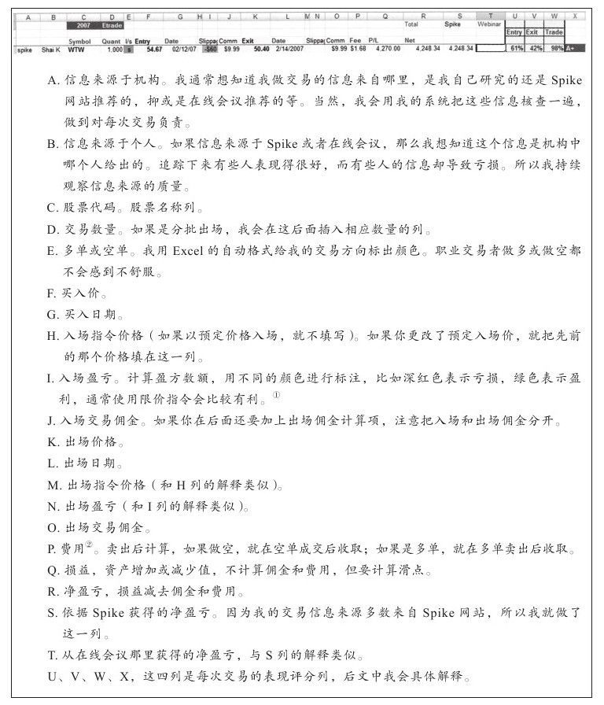
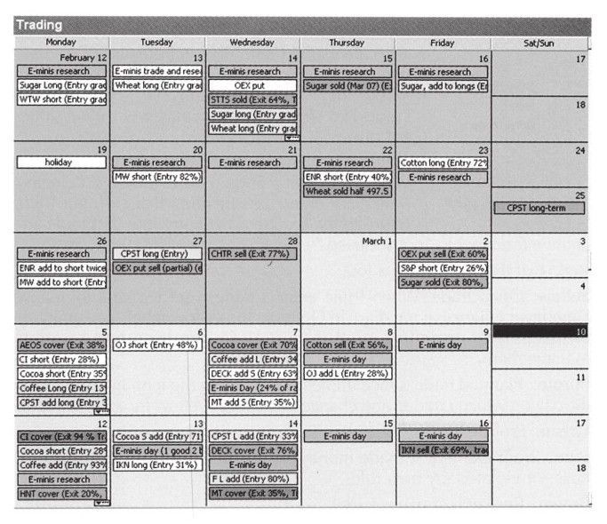
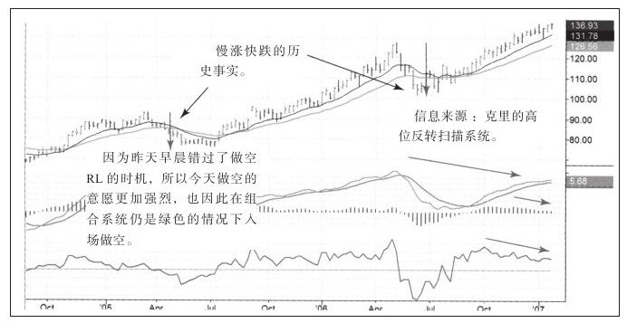
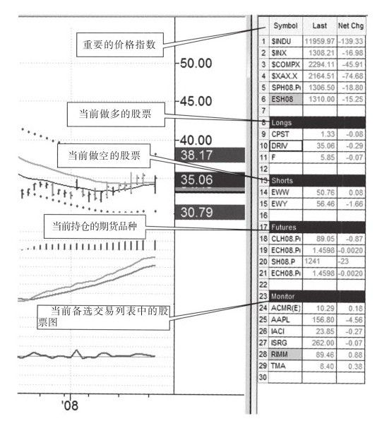
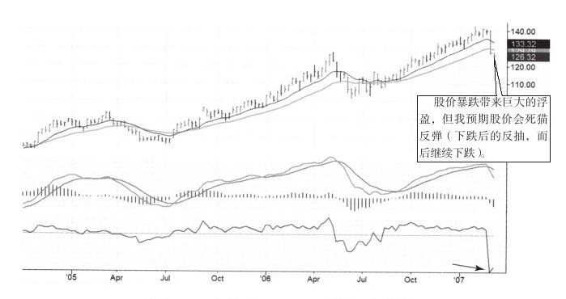
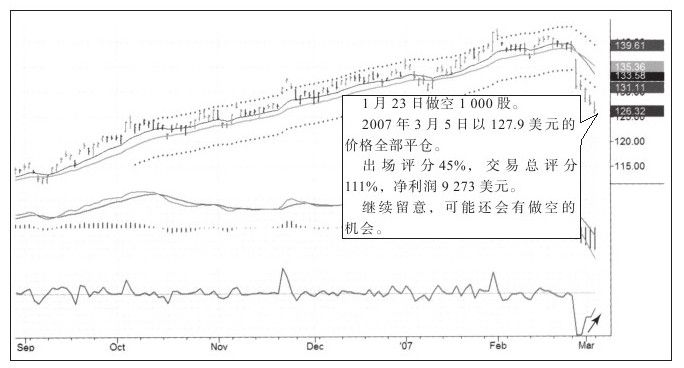

# 《以交易为生II》第3章：做好交易记录

> 亚历山大·埃尔德（Alexander Elder）著，《以交易为生II：卖出的艺术》（Come Into My Trading Room）第3章。

## 一、章节主旨

- 开始一次新交易时，交易者必须定下两个目标：**首先是盈利，其次是在交易后有所成长**。
- 即便是周全计划的交易也可能出错，最优秀的交易者也不可能每次都获胜；因此对每一次交易最基本的目标应是"交易后能得到提高"。
- 无论盈亏，都必须不断吸取经验教训。最好的学习方式是**做好每次交易记录**；不做记录却想成为合格交易员，"将是一场梦"。
- 单独一次获利不能说明任何问题——"即便是让猴子往写满股票的黑板上扔飞镖"也可能赚钱；真正困难的是**持续盈利**。
- 资金管理规则帮助度过逆境期；资金管理和好的交易记录是在市场中生存和成功的基石，分析技术反而可以从书本中学到。
- 为此需要做好**两套交易记录**：交易者的表格（电子表格）与交易日记（画报式日志），并用客观评分衡量每一笔交易的质量。

## 二、核心内容逐节梳理

### （一）好记录，好交易

- 交易记录把"一闪而过的经验"转变成**固化的记忆和经验教训**；市场分析和买卖决策都记录在交易日志中，困境时可重新检验这些信息。
- 几乎所有人都有盈利的交易，但再大的盈利，只要有一次大亏便失去意义；需要建立**长期可盈利的模式**。
- 只有资产不断增长，才能证明交易能力。人们往往在大盈利或一连串盈利后骄傲自满、大乐失察；"交易是一件如履薄冰的事，骄傲自满迟早会让利润回吐"。

### （二）交易者的表格：基础工作

- 作者常吃惊于交易者"少得可怜的交易记录"。**不能依赖经纪人**——经纪人做不到那么细致，必须有自己的表格。
- 作者在公司网站（www.elder.com）免费提供基础版电子表格，也可发邮件至 info@elder.com 索取模板（书中图3-1）。
- 不需要成为表格专家，但用表格管理交易数据会获益匪浅；新手拿出看盘时间的1/10学习基本表格知识，水平很快提升。
- **更新节奏**：每次交易后就在表格上更新一次，花不了多长时间。
- 表格体系包含三部分：
  1. **逐笔交易记录表**：含表头、数据及对数据的解释（图3-1）；
  2. **每个账户一个记录账户金额的表格**；
  3. **周账户资金汇总表格**。
  后两者用来**追踪资产曲线（权益曲线）**。
- 原文图注明确的字段细节：
  - 使用**限价指令无滑点**（译者注）；
  - **Fee 多指监管费，由卖方交**（译者注）；
  - **U列＝入场（买入）评分，V列＝出场（卖出）评分，W列＝交易评分**（详见评分一节）。
- 其余列记录每笔交易的实际成交、费用与盈亏等基础数据（图3-1为电子表格截图，正文未逐条列出全部列名）。

*图3-1 交易者的表格：基础工作（《以交易为生 II：卖出的艺术》原图）。*

### （三）交易日记：持续盈利的关键

- "犯错可以，但不要重复犯错。"犯错是探索和学习的表现；**重复犯错是粗心或其他心理问题的标志**。
- 持续做好交易日记是从错误中学习的最好方法，它把赚钱的喜悦和亏钱的苦楚都放入**可以追溯的文件**中。
- **形式：画报式日记，有图表、有文字。** 图表中用箭头、线和点评记录入场和出场时的情况。
- **时间纪律**：通常在早饭之前完成前一天的交易日记；开盘前做完计划，开始崭新的一天。
- **记录频率**：除非常活跃的日内交易外，应记录每一次交易；若每天多次交易，也应在每三四次交易后做一次记录。
- 作者把关心的人或事拍成照片随身摆放，同样希望交易者**"把交易拍下来"**，从而比以往更了解它们。
- **工具**：
  - 用 **Snagit** 从行情软件抓图、画线、写文字，再把完成的图表粘贴进日记，也用于和朋友通过邮件分享截图；
  - 记录软件是**微软 Outlook**：在日历功能中新建一个名为"交易"的日历，可按日/周/月查看；作者偏好月历格式（带可开关目录）；
  - 与朋友克里·劳文、杰夫·帕克共同创建了专为坚持写交易日记设计的 Outlook 方案，命名为 **AK-47**，在其网站上有描述。

*图3-2 Outlook中的交易日记（《以交易为生 II：卖出的艺术》原图）。*

- **颜色标记法**（点击日历新建记录时标记，便于月总结；颜色可自选，以下为作者的选择）：
  1. **无色（白色）**：已完成的交易。交易结束做两件事——记录出场情况、创建新入场日记；把颜色从黄色变为白色。
  2. **红色**：以亏损出场。
  3. **黄色**：开仓状态。第一次入场即标黄；日历上出现黄色即知还有持仓要处理。
  4. **紫色**：计划中的交易。交易实施时，把日记中的图表拖入交易当天，颜色改为黄色。
  5. **绿色**：以盈利出场。
  6. **蓝色**：盈利不足的交易——盈利额少于本应赚到的，或破坏了规则。
  7. **棕色**：研究中（模拟交易）。

*图3-2（图例） 交易日记颜色约定（《以交易为生 II：卖出的艺术》原图）。*

- 大多数时候插入**日线图和周线图**，必要时加月线图或盘中走势图。
- 实例（做空 DB）：周线图上斜箭头线表示顶背离、垂直箭头线预示可能快速下跌；日记中还有专门内容提醒自己**等待合适时机再出手**，防止因看空而急于入场。

*图3-3 做空RL的日记截图（《以交易为生 II：卖出的艺术》原图）。*

- 日线图记录了一次看空的顶背离和**向上假突破（非常重要的交易信号）**；记录入场情况，并**以百分比形式评价两个出场指令的质量**。图表摆面前就能回想：什么做对、什么做错、如何提高入场能力。

*图3-4 交易日记：DB、入场、周线图（《以交易为生 II：卖出的艺术》原图）。*
- 作者坦承这次 DB 交易是提早平仓的，但强调单笔输赢本身意义不大，**有意义的是学会如何做交易日记**。

### （四）如何记录交易计划

- 翻看股票时，在走势图中做简要标记，或在日记本中写下**日期、报价和注释**，标明潜在交易对象——目的是把注意力集中在机会较好的股票上；有了候选股再细致研究、为有希望的股票制定计划。
- **交易计划的标准制作流程**：
  1. 用 Snagit 截出**周线图**，用箭头、线、文字做好标记；
  2. 粘贴到新创建的 Outlook 日历中；
  3. 同样截出**日线图**，粘贴到同一日历，放在周线图下面；
  4. 在股票名称下面给日历命名，用**计划交易的颜色（紫色）**标记以利辨识，保存。
- **下单与风控**：登录经纪商网站下好订单，请经纪人成交后立即通报；成交后用 **OCO（one cancels other，一个成交即取消另一个）**方式设定止盈止损指令，不看行情时也不怕意外。
- **备选列表**：已制定计划的股票放入行情软件的备选列表；只看为数不多的股票，看太多容易分心。
- 屏幕窗口（图3-8 TradeStation 设置）自上而下显示：**重要市场指数 → 做多/做空的股票与持仓期货 → 最下方备选列表区**；窗口追踪每日最新价格和净利变化。
- 设置成点击右侧品种、走势图自动出现在左边；并**在走势图上直接写下关键信息**（市场活跃时容易忘记）：
  - **A. 入场日期和入场价；**
  - **B. 提醒目标价和止损价；**
  - **C. 交易陷入麻烦。**

*图3-8 交易前的软件总屏（《以交易为生 II：卖出的艺术》原图）。*

- **执行后的记录动作**：把入场日历从计划那天移到入场那天；可加入入场当天图表与简单评论——交易规模、交易评分、入场质量评价、交易引发的感受等；标签颜色由"计划"改为"开仓"。
- 新手被巨大成交量压得无所适从；**制订计划和制作备选品种让人工作有条理**，从而更可能盈利。
- 出场日记实例（DB）：周线图显示跌破价值区、位于两条均线之下，强力指标严重下滑指向潜在底部，MACD 跌入可能反转区域；日线图显示严重超跌、跌破通道，但强力指标转强——熊市下跌很快，所有下跌都有尽头。点评中有**出场评分45%（还算不错，但总交易评分更好）**，净利超过9000美元，注释"继续留意，可能还会有做空的机会"。

*图3-5 做空交易日记（出场页）（《以交易为生 II：卖出的艺术》原图）。*

*图3-6 交易日记：DB、出场、周线图（《以交易为生 II：卖出的艺术》原图）。*

- **了结一次交易不代表交易结束**：仍可回顾、学习，未来可能还有新机会。
- 好的记录习惯能让你发现并弥补所用交易方法的缺陷；做得够久甚至可能不再犯错，资产曲线必然不断上升。

### （五）玛格丽特方法：把图表挂在墙上

- 电子日记之外的**低科技**追踪方法，来自好友玛格丽特。
- 警示：翻看股票时感觉到的"好机会"，很可能并不是好机会；"如果再跌到支撑位我就买进"——三周后股票真到了那个价位，你还认为它是机会吗？
- **最好的机会总是姗姗来迟**；下单前需要等待更多确定信息，如玩字谜游戏需要更多字母出现，才能最接近地猜出词。
- 做法：玛格丽特的交易室有两个黑板，挂满图表；看到机会即将来临，就把该股走势图**打印出来、用红笔标记**，观察历史走势、等待机会；走进办公室就能看到手绘信号，不会错过机会。
- 维护要点：**交易完成或取消计划后，务必把旧图表从墙上取下**，确保计划始终是最新的。

### （六）给交易表现评分

- 不评价自己的交易表现，"就像短跑运动员说自己跑得很快但从不用计时器"；从来没有"休闲式交易"，交易从来是严肃的事。
- 作者主要对**买入、卖出和总体交易质量**三方面评分。
- 原理：比较买入点/卖出点在当天价格波动中的位置——**买入尽可能接近当天最低价，卖出尽可能接近当天最高价**。
- **买入评分**：
  - 公式：买入评分 =（当天最高价 − 买入价）/（当天最高价 − 当天最低价）
  - 最低价买入＝100%；最高价买入＝0。
  - **低于20%差劲；高于50%好；高于80%优秀。**
- **卖出评分**：
  - 公式：卖出评分 =（卖出价 − 当天最低价）/（当天最高价 − 当天最低价）
  - 最高价卖出＝100%；最低价卖出＝0。
  - **80%以上优秀，20%以下差劲。**
- 作者的目标是**评分高于50%**：在日内中点之下买入、中点之上卖出；专家交易员以低买高卖为生。
- 心理作用：坚持收盘后做入场评分，会慢慢在盘中**控制追涨杀跌的冲动**。
- 账户盈亏不能衡量单次表现——单次盈亏严重依赖头寸大小和市场波动幅度；衡量单次质量最好的方式是**盈亏数量与市场波动幅度的比值**。
- 用**日线图通道**反映近期波动幅度：波段交易在日线图加通道和长期移动均线；日内交易在5分钟图上加通道和较长期均线。
- 科学事实：价格围绕价值上下波动，不断重复高涨和下落；故用**单次交易利润占通道宽度的百分比**衡量波段交易质量。
- **交易等级（交易评分）**：
  - 公式：交易等级 =（出场价 − 入场价）/（通道上轨 − 通道下轨）；
  - 从**入场那天**开始计算通道高度；
  - 等级划分：
    - **A 级：30%及以上**（A+ 级：超过30%的交易，原文如此表述）；
    - **B 级：20%～30%；**
    - **C 级：10%～20%；**
    - **C- 级：低于10%；**
    - **D 级：低于0。**
- "只赚到钱是不够的，还要赚到好的交易评分。"个人投资者没有顾问，必须自己衡量成绩。

### （七）两种交易策略

- 两种流行买入策略：
  1. **"低买、高卖"——价值型交易**：发掘价值，在价格接近或低于价值时买入，目标在高于价值时卖出。
  2. **"高买、更高卖"——动量型交易**：只在股价加速时买入，在股价开始失去动能时卖出。
- 图表工具：每张图放两条指数移动平均线（EMA），两线之间为**价值区**；以慢速均线为基础计算**通道**，95%的价格包含其中；高于上轨为超买，低于下轨为超卖。
  - 译者注引《走进我的交易室》：通道上轨 = EMA + EMA×通道系数；通道下轨 = EMA − EMA×下轨系数。
- 按性格选择：怀疑趋势的人选价值型；喜欢扫描疯狂趋势、试图在反转前离场的人选动量型。
- 无论选择哪种，**都应在交易前写下交易计划**，这样才能领先于交易对手；"只要有计划，就肯定比其他市场投资者更有优势"。

## 三、记录表格与评分速查

### 1. 三套表格

| 表格 | 用途 |
|---|---|
| 逐笔基础交易记录表（图3-1） | 记录每笔交易数据；限价指令无滑点，Fee（监管费）由卖方交；U列入场评分、V列出场评分、W列交易评分 |
| 账户金额表（每个账户一个） | 记录账户金额 |
| 周账户资金汇总表 | 追踪资产（权益）曲线 |

更新频率：**每次交易后更新一次**；模板见 www.elder.com 或邮件 info@elder.com 索取。

### 2. 日记七色标记

| 颜色 | 含义 |
|---|---|
| 无色/白 | 已完成的交易（记录出场、新建入场日记后由黄转白） |
| 红 | 亏损出场 |
| 黄 | 开仓状态 |
| 紫 | 计划中的交易（实施后转黄） |
| 绿 | 盈利出场 |
| 蓝 | 盈利不足／破坏规则 |
| 棕 | 研究中（模拟交易） |

### 3. 评分公式与等级

| 项目 | 公式 | 标准 |
|---|---|---|
| 买入评分 | （当天最高价−买入价）/（当天最高价−当天最低价） | >80%优秀，>50%好，<20%差劲；目标>50% |
| 卖出评分 | （卖出价−当天最低价）/（当天最高价−当天最低价） | >80%优秀，<20%差劲；目标>50% |
| 交易等级 | （出场价−入场价）/（通道上轨−通道下轨），自入场日算通道 | A≥30%（A+为超过30%）；B 20–30%；C 10–20%；C- <10%；D <0 |

## 四、本章金句（原文原句）

1. "当开始一次新的交易时，交易者必须定下两个目标：首先是盈利，其次是在交易后有所成长。"
2. "最好的学习方式是做好每次交易记录，不做交易记录却想成为一名合格的交易员将是一场梦。"
3. "资金管理和好的交易记录是在市场中生存和成功的基石。"
4. "每个人都有做对的时候，即便是让猴子往一个写满股票的黑板上扔飞镖，选出来的股票也很可能获得不错的收益。"
5. "犯错可以，但不要重复犯错……犯错是探索和学习的表现，重复犯错却是粗心或者其他心理问题的标志。"
6. "最好的机会总是姗姗来迟，在决定下单买入或做空前，你需要等待更多确定的信息。"
7. "只赚到钱是不够的，还要赚到好的交易评分。"
8. "无论你用什么方法，只要有计划，就肯定比其他市场投资者更有优势。"

## 五、对当代交易者的启示

1. **把"成长"设为与盈利并列的目标**：单笔盈亏受运气、头寸和波动摆布，唯有复盘带来的能力沉淀完全属于自己。
2. **建立结构化的双轨记录体系**：电子表格管数据与权益曲线，图文日记管决策过程与心理；今天用 Notion、TradingView、截图工具即可实现作者的 Outlook+Snagit 流程。
3. **用客观公式替代感觉**：入场/出场评分与通道占比评分把"我觉得这笔做得不错"变成可比较的数字，长期统计即可发现自己的系统性短板。
4. **评分改变盘中行为**：知道收盘后要按日内位置打分，追涨杀跌的冲动会被"买得更低、卖得更高"的目标自然抑制。
5. **计划先行、OCO 兜底**：盘前完成计划、备选清单保持精简、成交后立即挂条件单，用流程隔离情绪化决策。
6. **区分"赚钱"与"好交易"**：D 级评分也可能赚钱（靠运气），A 级评分也可能亏损（但执行正确）；追踪评分分布比追踪短期盈亏更重要。
7. **低科技方法依然有效**：玛格丽特挂图表的本质是让待验证的交易想法持续可见、及时清理；任何形式的"可视化候选池+过期下架"机制都值得借鉴。

## 六、一句话核心判断

**持续盈利不靠某次暴利，而靠"表格＋日记＋评分"构成的闭环：把每一次交易的决策、情绪与执行质量固化成可追溯、可衡量的记录，让自己无论盈亏都在交易后变得更好。**
