# 《以交易为生II》第4章：止盈

> 作者：亚历山大·埃尔德（Alexander Elder）
> 书名：《以交易为生II：卖出的艺术》
> 章节：第二部分 如何卖出 · 第4章 止盈

## 一、章节主旨

本章回答"买入之前必须想清楚的三个问题"中的第一个问题：**这只股票的止盈价是多少？**

作者在章首列出买入前必须回答的三个问题：

1. **你的止盈价是多少**——这只股票可能会涨多少？
2. **股票跌多少你才会相信你的买入决策是错误的**，并止损？
3. **这只股票的期望损益比是多少**？潜在的收益和风险之间的关系是什么？

作者强调："职业交易者经常思考这三个问题，赌徒却从不这样问自己。"

核心论点：

- 进入市场如跳入激流，你能完全控制的只有**跳入时机（入场点）**；同时必须顺流而跳，并在搁浅之前找好**上岸的地方（止盈目标）**。
- 没有盈利目标的业余交易者会"迷迷糊糊，没有方向"。克里·劳文一针见血地指出：**人们都想从市场中赚钱，但都没想过要从市场中赚多少钱。**
- 作者常用的止盈工具：**移动平均线、通道线、支撑和压力水平、其他方法**。
- 波段交易者用"移动平均线 + 通道"组合设置目标价；长期交易则要看长期支撑和压力。
- 全书章节的核心心理底色是"**知足**"：目标控制贪婪，二鸟在林不如一鸟在手。

## 二、核心内容逐节梳理

### （一）移动平均线卖出

#### 1. 理论依据：牛市三阶段与"价值回归"

罗伯特·雷亚（20世纪50年代知名市场技术分析师，道氏理论解释者）把牛市分为三个阶段：

1. **第一阶段**：价格收复熊市的超跌部分——市场从深度低估恢复到正常水平；
2. **第二阶段**：价格由于基本面的向好预期而继续上涨；
3. **第三阶段**：价格由于投资者狂热、乐观和贪婪而上涨，人们买入的理由是"价格将一直涨下去"。

雷亚的理论本适用于持续几年的牛市，作者发现可以在较短时间周期内运用。

关键法则：

- 移动平均线体现的是**投资者对股票长期价值的共识**。
- 价格低于均线并把均线往下"拽"时，熊市正在酝酿；价格止跌、均线走平时，需注意熊市可能结束。
- 市场像两党制系统："熊党"失势，就在下届"选举"加入"牛党"。
- **牛市的第一个目标位是价值的位置，也就是站上移动平均线。**
- **周线图中，在价值之下买入，把盈利目标设置在价值区，这个方法非常好用。**
- 三重过滤网系统要求：**周K线做战略决策，日K线实施战术性买入或卖出。**

#### 2. 案例：EXTR

- 历史最高价 **120美元**，最低价接近 **3美元**；以 **3.5美元** 交易，绝对是一笔好交易。
- 股价跌破长期支撑 **4.05美元** 后跌速变慢、趋势由跌转平；MACD柱和强力指标走强，为牛市信号。
- 判定周线价值回归目标区：**3.67~3.96美元**，即两条移动平均线之间的区域。
- 日线出现**向下假突破**（看涨信号）、MACD柱底背离、强力指标底背离（表明突破式下跌动力不足）。
- 交易计划：
  - 止损：**3.31美元**；
  - 止盈：**3.81美元**（高于通道上轨的位置）；
  - 从最新收盘价到目标价 **37美分**，到止损价 **13美分**；
  - **收益风险比接近 3:1**，虽不是最好，但完全能接受。
- 入场：当日中点之下买入，**买入评分 56%**。买入后第二天仍弱、第三天创新低（触发紧邻低点的止损盘——教训：止损应设在比关键价格更远一点的地方）。
- 出场：第二周几乎一天涨到上轨并以接近最高价收盘，转天窄幅震荡（上涨受阻信号），在 **3.63美元** 卖出。作者把止盈看做工作目标：市场极强可上修目标，但**稍露疲态就尽早出场**。
- 评分：**出场评分 70%**；18美分 ÷ 通道宽度43美分 = **交易评分 42%，A+交易**，实现"低于价值买入、价格高估时卖出"。

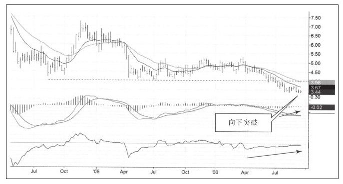

*图4-1 EXTR周线压缩图（《以交易为生 II：卖出的艺术》原图）。*

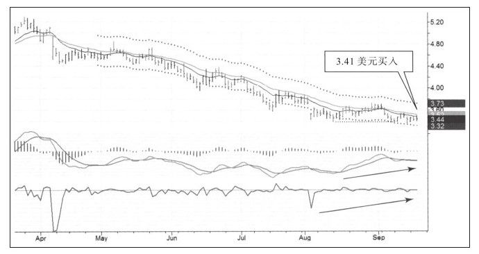

*图4-2 EXTR周线走势图（《以交易为生 II：卖出的艺术》原图）。*

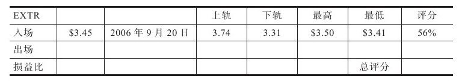

*图4-3 EXTR日线图，入场（《以交易为生 II：卖出的艺术》原图）。*

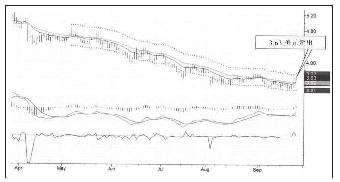

*图4-4 EXTR日线图，出场（《以交易为生 II：卖出的艺术》原图）。*

#### 3. 案例：黄金期货

- 期货品种少，周末容易全部扫描一遍。图表右侧：盘中跌破支撑线但收盘在支撑线之上——**向下假突破是很有效的牛市信号**（学自大卫·威斯）。
- 强力指标快速下跌尖角 = 市场极度恐慌、多头惨败出局、市场即将见底；MACD线和MACD柱在9月、10月双底中均底背离。
- 交易计划（2006年10月10日）：买入12月份合约，价格 **577.80美元**；止盈在周线价值区附近、**630美元之上**；止损略低于近期最低价。
- 入场当天最高 580.80美元、最低 573美元；**入场评分 38%**（不算好）；盈利目标为慢速EMA与通道上轨之间。
- 出场：10月13日（入场后第三天，星期五）卖出。理由：价格碰到慢速移动平均线时窄幅震荡——**价值区无论被上穿还是下穿都会是阻力区，突破必须强而有力；窄幅震荡表示阻力更大或动力更小**。另一动机是隔周飞往欧洲、想把头寸降至最小。
- 评分：**卖出评分 52%**，总体交易等级 **B-**；只赚 **13.2美元**，与通道差 **69美元** 相去甚远。
- 后续：出场后四天黄金创新高，随后暴跌回初次入场价。教训：**"只要有怀疑就立即出场。"** 不要因错失赚大钱的机会打击自己。

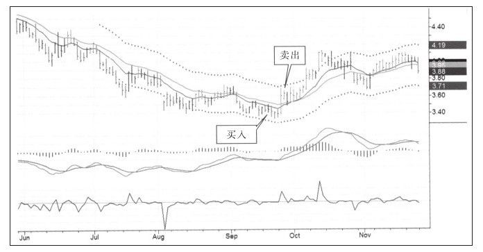

*图4-5 移动平均线卖出（黄金）（《以交易为生 II：卖出的艺术》原图）。*

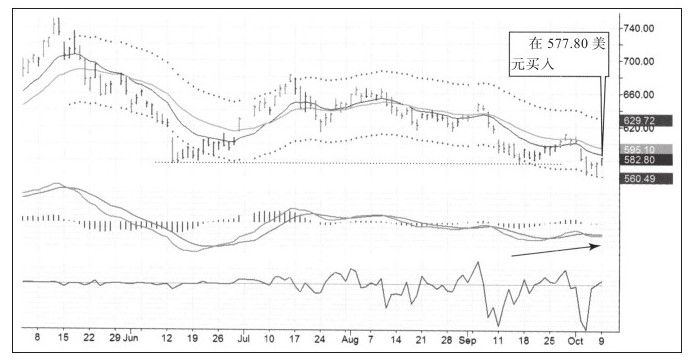

*图4-6 黄金日线（一）：盘中假跌破支撑（《以交易为生 II：卖出的艺术》原图）。*

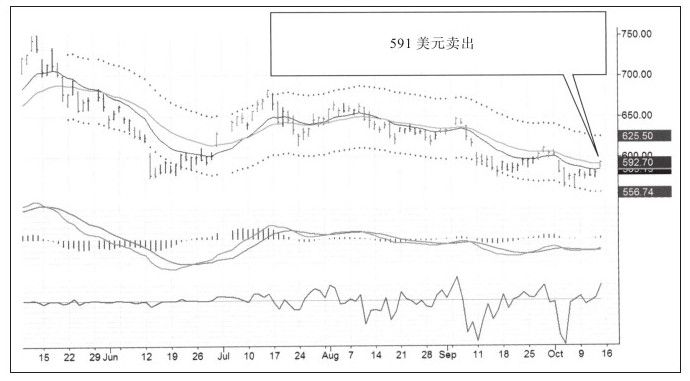

*图4-7 黄金日线（二）：碰慢线窄幅震荡（《以交易为生 II：卖出的艺术》原图）。*

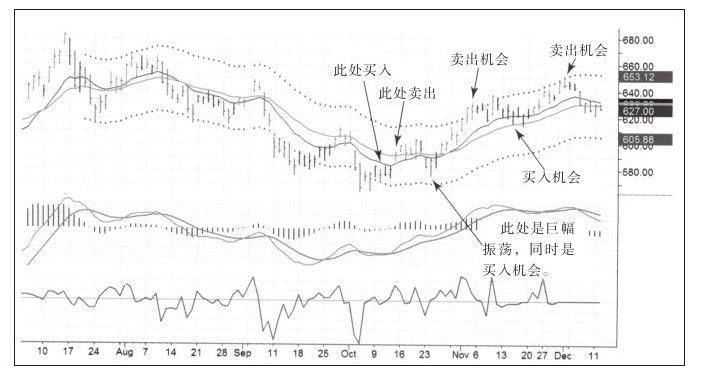

*图4-8 黄金后续两个月走势（《以交易为生 II：卖出的艺术》原图）。*

### （二）使用通道技术卖出

#### 1. 适用逻辑与基本法则

- 熊市刚走出时用移动平均线做目标；**牛市确立后价格通常高于均线，均线卖出不再是好方法**。
- 典型上升模式（INFY日线）：**重复地在价值区买入，在高于上轨时卖出**，模式稳定时"绝好的盈利目标就是价格运行到上轨之上时"。但市场绝不是取款机。
- **用移动平均线定义价值，用通道定义超买/超卖区**：理想是低于价值买入，在通道附近的超买水平卖出。
- 为得到30%以上的交易评分，应尽量逢低买入。
- EMA均线之间的价值区是好买点；**上轨显示超买区域，即止盈价格区**。
- 通道宽度由交易程序按最新价自动计算：**价格波幅加剧，通道变宽，目标盈利价并不固定**，今天定的目标几天后可能改变。

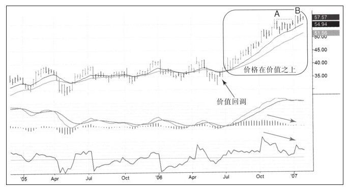

*图4-9 通道内价值回调（《以交易为生 II：卖出的艺术》原图）。*

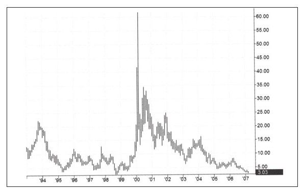

*图4-10 INFY日线图（《以交易为生 II：卖出的艺术》原图）。*

#### 2. 案例：CEGE

- 90年代牛市中达 **60美元**，后崩跌，最近跌到 **3美元附近**，从最高点跌幅 **超过95%**。
- 作者把**跌幅超过90%的股票叫做"跌落的天使"**，经常从中寻找候选品种。
- 周线：假突破 + MACD柱底背离（"丢失的右肩"类型，指标不能再低于0），显示跌无可跌。
- 日线：超卖后第一波上涨已发生，价格当时在价值区内，日线**上轨就是反弹的绝好盈利目标位**；考虑周线牛市模式，价格很可能超过目标。
- 出场：杰夫·帕克指出股票已严重超买、在通道上轨附近震荡两天、MACD柱超买；作者因已持很多多头头寸，转天卖出降仓位。
- 评分：**出场评分仅 6%**，卖出后股价迅速上升；总评分 **36%，A级**。最重要的是保持**平均分大于50%**。
- 教训：坚定止盈目标非常重要；**不必为错失的利润惩罚自己，否则未来会胆大妄为**。

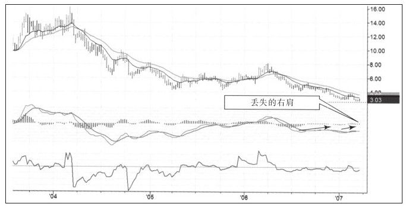

*图4-11 CEGE周线压缩图（《以交易为生 II：卖出的艺术》原图）。*

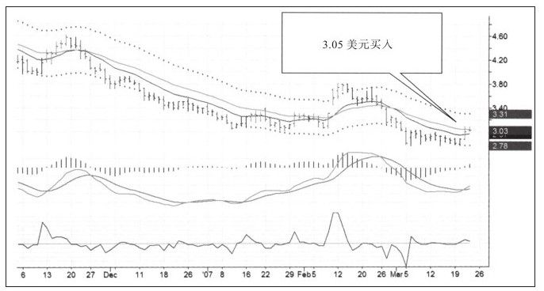

*图4-12 CEGE周线，买入（《以交易为生 II：卖出的艺术》原图）。*

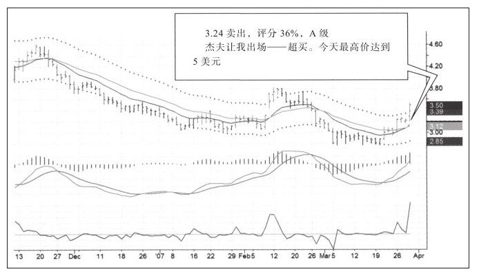

*图4-13 CEGE日线图，买入（《以交易为生 II：卖出的艺术》原图）。*

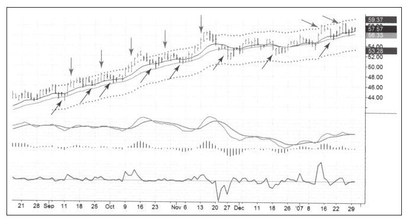

*图4-14 通道卖出研讨案例（《以交易为生 II：卖出的艺术》原图）。*

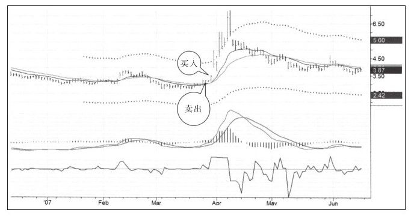

*图4-15 通道上轨卖出（A级交易）（《以交易为生 II：卖出的艺术》原图）。*

#### 3. 贪得无厌终是祸

核心观点：

- 好运来临时多数人想要更多。把"想要更多"带入交易：即便盈利也不快乐，为没买在最低、卖在最高而恼羞成怒——这是追求不义之财，会让人**买得过早、卖得过晚**。
- **"市场能给予的就那么多，如果想要的更多，必然适得其反。"**
- **"知足"是人生也是交易中最重要的词**：决定赚多少能让你快乐并据此设定目标，目标控制贪婪；要求太多的人成为贪婪和物欲的奴隶，知足的人获得自由。
- 暴富经历会让多数人精神错乱、不断冒险直至风险失控，由巨盈变巨亏；需要**利润管理计划**（后续章节详述）。
- 应把通道当作**动态的、而非铁一般**的目标：市场转弱时，接受比预期少的利润无可厚非，不是每次价格都能刚好运行到上轨之上。**愿意接受较少利润的人，往往最终能获得更多。**

违反"上轨全部卖出"规则的两个案例：

- **小麦**：依据周线、日线双指标底背离在接近低点买入；因非常看多，**只了结1/3仓位**，违反规则。价格在上轨之上徘徊几天后崩跌，眼看利润减少被迫卖出。
- **糖（2007年）**：1月基于周线强烈看多，3月买入；价格在通道上轨之上时**只平掉1/3、持有余下2/3**；因走势印证判断而忽略上轨之上的长上影K线（收盘近最低价，转弱信号）；随后崩跌被迫立即出场，错过赚大钱的机会。

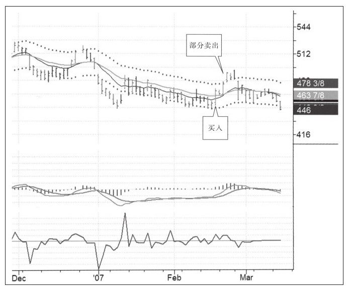

*图4-16 小麦日线图（《以交易为生 II：卖出的艺术》原图）。*

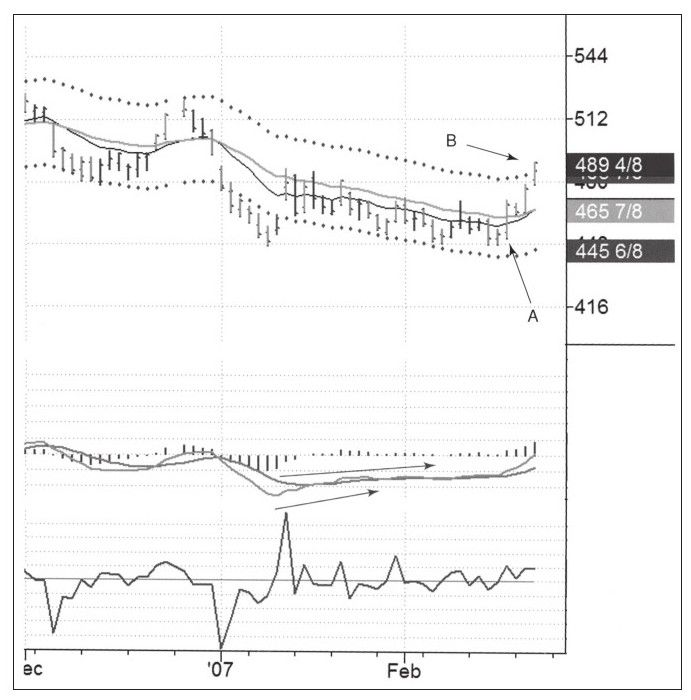

*图4-17 小麦案例 A/B 点（《以交易为生 II：卖出的艺术》原图）。*

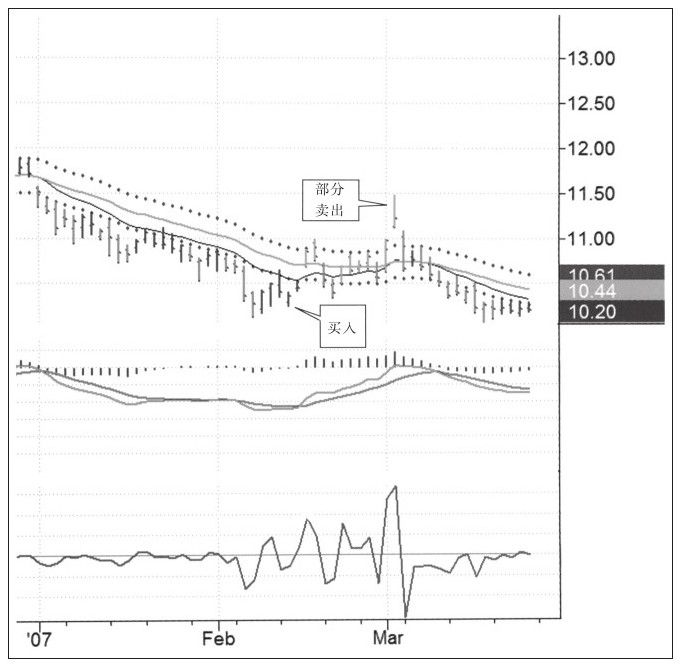

*图4-18 糖周线图（《以交易为生 II：卖出的艺术》原图）。*

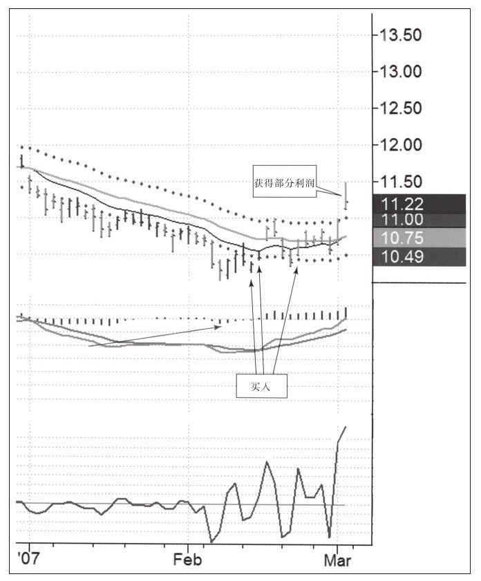

*图4-19 糖，分批卖出（《以交易为生 II：卖出的艺术》原图）。*

作者强调："知足"好于"奢求更多"——知足让人冷静、自控，这种感受会在未来交易中引导你获取更多利润。出现错误时不惩罚自己，用交易日记分析、学习，接受不完美。

#### 4. 反弹跌跌撞撞

- 用通道设定目标后，若觉得反弹会更高：**经验表明不要持有头寸过久**。
- 具体法则：**如果价格比初始目标价低一些，就等"价格创新高失败的那天"以收盘价卖出，或者在次日开盘后不久卖出。**
- 不要试图预测顶底：一波上涨的最高成交价是市场最贵的那个价格，且只有一个、出现频率极低，恰好卖在那里的概率很低，**财富会因寻找顶底而流失**。
- 雅虎案例：10月起行情，低于价值→反弹到上轨之上→跌回价值区→再涨到上轨之上；第二波上涨第三天调整，强力指标显示振幅收窄、成交量下降，**最重要的是股价创新高失败——卖出信号**。后几天虽有新高，但大的上涨已结束；三天没有创出新高便跌回价值区。
- 结论：**早卖胜过晚卖**；交易后千万不要后悔，记住"知足"。

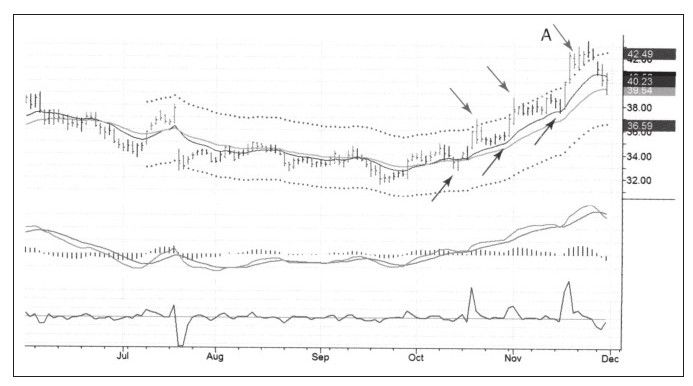

*图4-20 雅虎：反弹跌跌撞撞（《以交易为生 II：卖出的艺术》原图）。*

### （三）压力位卖出

#### 1. 适用对象与本质

- 移动平均线卖出适用于超卖后的反弹；通道卖出适合短线波段；**长线交易（以月甚至年衡量）需要更大的盈利目标**——"猎鹿的人需要一杆大枪"。
- 压力/支撑区 = **大量交易发生过的地方**；每个价格都是买卖双方达成的共识，以某价格成交的量越大，认同者越多；成交密集区代表众多参与者认同该价格。
- 价格运动如水在堤坝前打转：堤坝决裂则"蜂拥向前"直到下一个"池塘"。**交易区间代表一大批交易者对价值区间的认同。**
- 业余者赌突破（区间之上买入、之下卖出）；职业者知道**大多数突破都是假突破**，在区间上边缘卖出、下边缘买入，长期必胜。
- 支撑和压力建立在两种情感之上——**痛苦和后悔**：
  - 区间上沿买入被套者痛苦，等反弹回本即卖出；
  - 做空者后悔没早做空，价格回到当初想做空的位置时再度做空；
  - 两种情绪共同阻止价格向上突破，成就区间上沿。
- **支撑和压力不是玻璃板，更像铁丝网**：一些很好的买入信号发生在价格轻微跌破支撑时——洗出不坚定多头后牛市重新主导。

#### 2. 案例：IBM

- 2005年跌到 **73~78美元** 区间震荡约 **3个月**，区间内成交 **5亿股**、总价值约 **370亿美元**；强力指标尖角下跌是见底信号。
- 一年后再度跌回该区间，很多人因一年前没买而后悔，大量买入推高股价。
- 上方目标：近年只要进入 **95~100美元** 区间就有沉重抛压——2004年以100美元买入者苦等解套卖出。
- 提醒：**不亏本不是真正的不亏本**（利息、货币贬值、机会成本、精神负担都是损失）。若在接近75美元买入，**95~100美元区间就是非常好的获利了结区**。

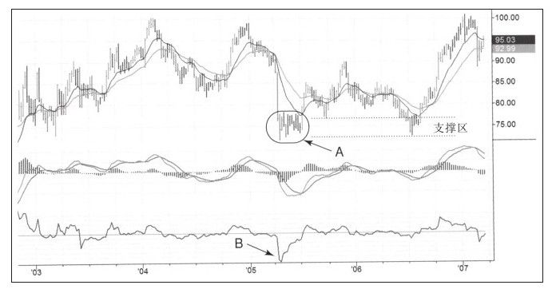

*图4-21 IBM压力位卖出（《以交易为生 II：卖出的艺术》原图）。*

#### 3. 案例：欧元

- 2001年创立后3年从 **0.85美元** 升至 **1.36美元**；2005年熊市下跌，在2004年低点获支撑后又跌破（洗出脆弱多头）。
- 长线多单目标：阻力在成交密集区 **1.30~1.35**（即2005年的顶）。
- 货币几乎24小时波动、出了名地难做；建议波段交易者不要交易货币，留给日内交易者或长线交易者。
- 后续：MACD底背离 + 向下假突破 + 周线上涨在区域B相互验证，买入成功；到达压力区点C后停止上涨、整理数月。2006年底至2007年初MACD柱顶背离，表明上涨走到尽头。
- 设置长期目标的最大价值：**把注意力放在长远但可到达的目标上，不被短期波动洗出局**。

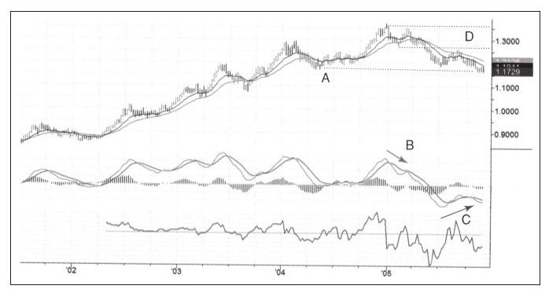

*图4-22 欧元压力位卖出（《以交易为生 II：卖出的艺术》原图）。*

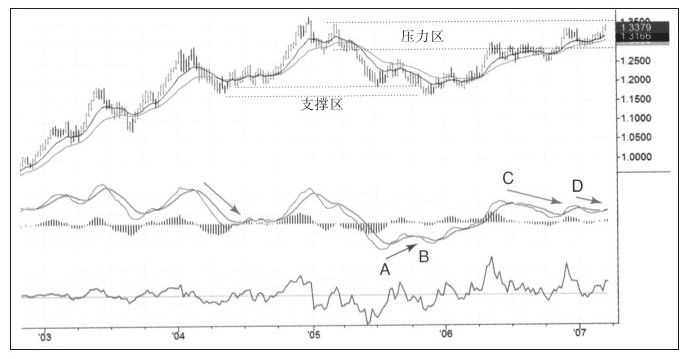

*图4-23 MACD底背离加向下假突破（《以交易为生 II：卖出的艺术》原图）。*

#### 4. 总结案例：STTSY（芯片检测企业）

- 1990年股价达 **60美元**，熊市跌至 **6美元**（"跌落的天使"）；熊市中从17美元、5美元之下均有大反弹——**熊市中活跃的股票往往是下次牛市的绝佳候选**。但应等止跌后再买，不买下跌途中的股票。
- 过去6个月三个明显低点：**5.50、5.40、5.37美元**，支撑牢靠；小幅创新低也拒绝加速下跌并返回区间（实力资金打穿低点接恐慌盘的下影线）。
- 强压力区在 **16美元附近**（每次到达即遇天花板）。MACD柱在最近下跌中处于零轴之上；强力指标3次尖角下跌、一次比一次浅，空头越来越弱。
- 交易：以 **5.99美元买入1万股**，准备持有到 **16美元**（可能需多年），希望赚 **10万美元**。
- 又以 **6.13美元** 加买5000股，几周后在 **6.75美元** 卖出（每股赚62美分，"快钱"）。
- 持有过程：涨至8.16美元跌回买入价；再涨8.85美元时出现强力指标顶背离和见顶组合信号，因死守16美元目标未卖，浮盈减少近3万美元、一度亏损；后因底背离再涨到8.42美元。
- 2007年2月，持有两年后涨到 **8.65美元**（略超前高8.42美元），动能减弱、周线区间收窄（预示下跌），精神负担沉重，于 **8.39美元全部卖出**：1万股赚2.4万美元 + 5000股赚3000美元，**共2.7万美元**。
- 后续：卖出几天企稳，两周后涨到 **12美元**，16美元目标指日可达。作者选择不买回——两年纠葛已结束。
- 四条教训（不按重要性排序）：
  1. **入场点非常好**，准确识别底部；盈利目标可以达到，只是未持有足够时间；
  2. 自己更适合短期交易；未来长线先建**小的核心头寸从头持有到尾**（压力小），再顺核心方向做规模较大的短期交易——跌回初次买入区是买点，上攻通道上轨是卖点；
  3. **善待自己**：过早出场时砸电脑无益于提高；交易的目标是从错误中学习，不是用错误惩罚自己；
  4. **即使专家也会犯错**（不记日记、违反资金管理规则等）；犯错之后，交易结果已不那么重要。
- 名言：**"每开始一次交易，你都应该有两个目标：赚钱和变成更好的交易者。你不一定每次都达到第一个目标，但必须达到第二个目标。"**

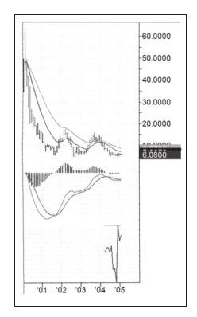

*图4-24 附心理点评的长期走势图（《以交易为生 II：卖出的艺术》原图）。*

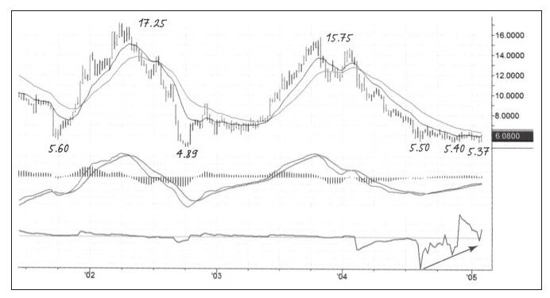

*图4-25 三个明显低点（《以交易为生 II：卖出的艺术》原图）。*

*图4-26 劲道指数顶背离（《以交易为生 II：卖出的艺术》原图）。*

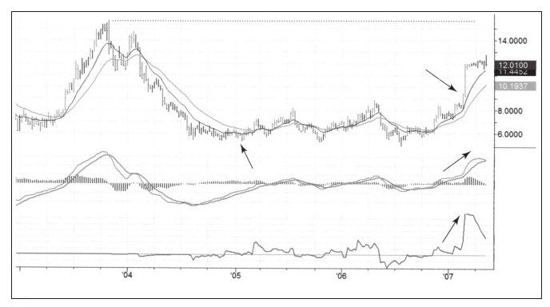

*图4-27 顶部区卖出案例（《以交易为生 II：卖出的艺术》原图）。*

## 三、止盈方法速查表

| 方法 | 适用情形 | 止盈目标 | 具体法则/数字 |
|---|---|---|---|
| 移动平均线卖出 | 熊市结束、超卖后的反弹；牛市第一阶段 | 周线价值区（均线之间/站上均线） | 周线定战略、日线定战术；价值之下买入；EXTR目标3.67~3.96美元，止损3.31美元，止盈3.81美元，损益比约3:1，评分42% A+；黄金577.80美元买入、目标630美元之上，B- |
| 通道技术卖出 | 牛市确立、价格沿价值区震荡上升的波段交易 | 通道上轨之上（超买区） | 价值区买、上轨卖；逢低买入争取30%以上评分；保持平均出场分大于50%；通道随波幅自动变宽，目标价动态变动；CEGE跌幅超95%（"跌落的天使"指跌幅超90%） |
| 反弹跌跌撞撞法则 | 反弹未达目标、疑似动能衰竭 | 创新高失败当日收盘价，或次日开盘不久 | 不预测顶底；最高价是市场最贵的价格；振幅收窄+缩量+创新高失败即卖；三天无新高确认；早卖胜过晚卖 |
| 压力位卖出 | 以月/年计的长线交易，需要大目标 | 历史成交密集区（套牢盘解套区）上沿 | 大多数突破是假突破；支撑压力是铁丝网不是玻璃板；IBM支撑73~78美元（5亿股/约370亿美元）、压力95~100美元；欧元支撑0.85美元一线、压力1.30~1.35；STTSY支撑5.37~5.50美元、目标16美元 |
| 核心头寸 + 短线交易 | 想做长线又难耐波动 | 核心头寸持有到长期目标；短线部分沿通道高抛低吸 | 核心头寸小、从头拿到尾不碰；顺核心方向做较大规模短线；跌回首买区买入、上攻上轨卖出 |

## 四、本章金句（原文原句）

1. "职业交易者经常思考这三个问题，赌徒却从不这样问自己。"
2. "人们都想从市场中赚钱，但都没想过要从市场中赚多少钱。"——克里·劳文
3. "知道顶和底的有两种人，一种是在历史图表上做纸上交易的人，另一种是对交易情况说谎的人。"
4. "对于用真金白银做交易的交易者来说，二鸟在林不如一鸟在手。"
5. "切记，只要有怀疑就立即出场。"
6. "市场能给予的就那么多，如果想要的更多，必然适得其反。"
7. "愿意接受较少的利润的人往往最终能获得更多。"
8. "最高价永远是最贵的那个价格。"
9. "早卖胜过晚卖。"
10. "每开始一次交易，你都应该有两个目标：赚钱和变成更好的交易者。你不一定每次都达到第一个目标，但必须达到第二个目标。"

## 五、对当代交易者的启示

1. **下单之前先写"卖出剧本"**：止盈价、止损价、损益比三者缺一不可。没有目标的交易就是赌博，尤其在量化和短线工具泛滥的今天，纪律性的计划比"盘感"更稀缺。
2. **工具要匹配趋势阶段**：熊市末期用均线做价值回归目标；牛市主升段用通道上轨做超买目标；长线持仓用历史成交密集区做目标。一把尺子量到底必然失效。
3. **接受"不完美的卖点"**：卖在最高点是低概率事件，财富会死于寻找顶底。创新高失败、缩量滞涨、碰到均线或上轨后窄幅震荡，都是可执行的客观卖出信号。
4. **止损和止盈都要远离"显而易见的价格"**：紧邻近期低点的止损会被噪音清洗，紧贴整数关口的预期同理；给关键价位留出缓冲，是对市场噪音的尊重。
5. **分批了结，但别用"看多"破坏规则**：小麦和糖的案例表明，因主观强烈看多而在上轨只平1/3，往往由盈转亏。如果要分批，必须在交易计划中预先写明触发条件，而非临场凭感觉。
6. **建立交易日记并评分追踪**：对入场、出场、总体质量打分，记录想法来源并按来源统计盈亏。月度复盘让交易者用"后见之明"重新评估自己，持续学习比单笔盈亏更重要。
7. **用"知足"和利润管理对抗暴富后的失控**：连续盈利、意外暴利之后最容易放大风险直至回吐；提前确定"多少让自己满足"，并制定利润管理计划。
8. **长线交易要用仓位结构解决心理问题**：小核心仓长期持有 + 较大短线仓沿通道交易，既保留长期目标的敞口，又释放盯盘和震荡带来的精神压力；心态不适时，缩小头寸比硬扛更专业。

## 六、一句话核心判断

**止盈的本质不是预测顶部，而是在入场前就依据趋势阶段选定客观目标（均线、通道上轨或历史压力区），在市场稍露疲态时按计划兑现，以"知足"二字锁住利润、也锁住交易者的冷静与自由。**
