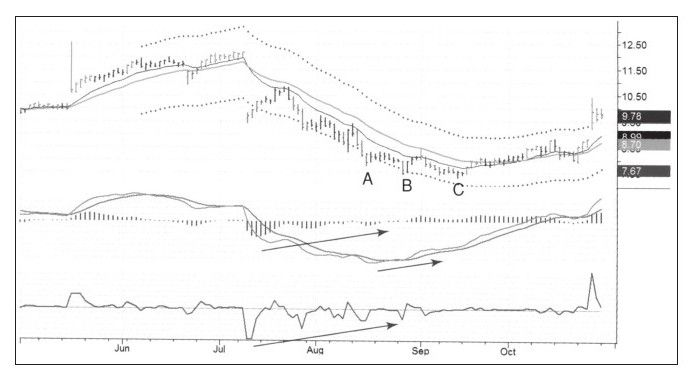
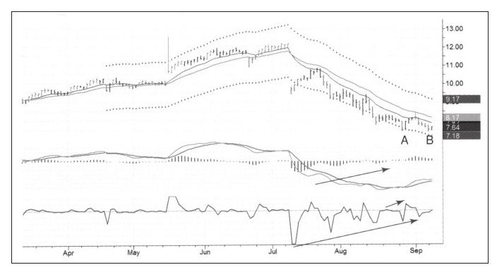
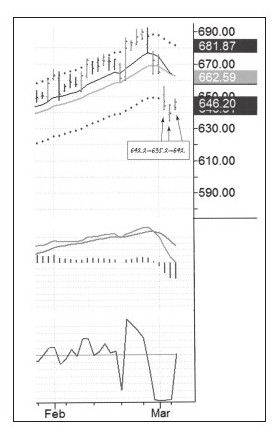
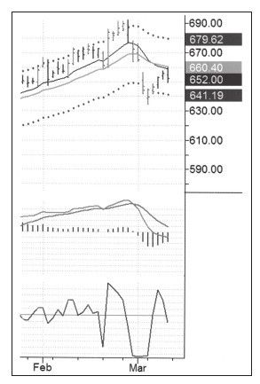
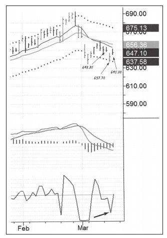
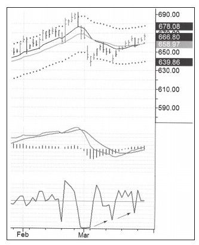
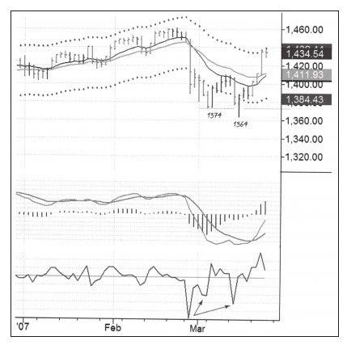
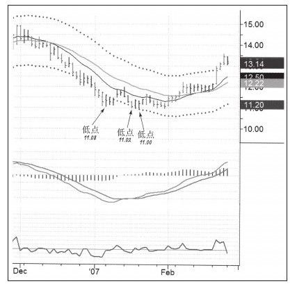
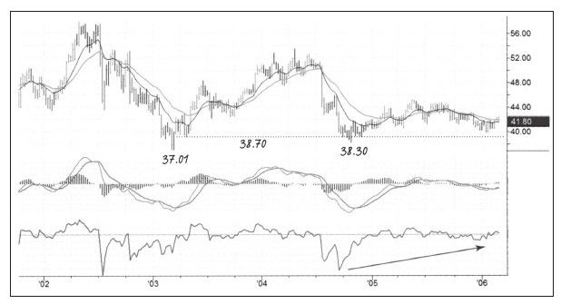
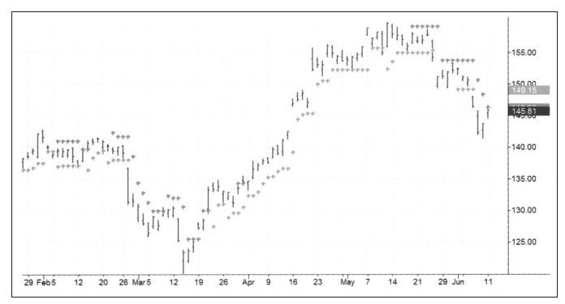

# 《以交易为生II》第5章：止损

> 亚历山大·埃尔德（Alexander Elder）：《以交易为生II：卖出的艺术》（*The New Sell and Sell Short*）第5章"止损"

## 一、章节主旨

本章回答一个交易者入场前必须回答的底线问题：如果买入后股票下跌，你在哪里出场？作者以"结婚与离婚协议"为喻，指出决定卖出价格的最好时机是在买入之前。全章系统阐述了止损的三大目的、止损执行的铁律、指令类型选择（市价/限价）、止损硬度选择（硬/软），并逐一讲解了多种具体止损设置方法：铁三角止损、前低止损、尼克止损法、宽幅止损、移动止损（含抛物线SAR、枝形灯、时间止损）、安全区止损、波幅减少追踪止损。核心立场是：每次交易都必须设止损，止损是交易者仅有的、最好的风控工具。

## 二、核心内容逐节梳理

### （一）止损的基本规则

1. **每次交易都必须设止损**：在确切地知道止损位置之前，不要交易；同时应确立盈利目标以计算损益比，没有目标的交易无异于赌博。
2. **不止损的三重危害**：一次糟糕的交易给账户"凿个洞"，一连串糟糕的交易毁掉账户；持有错误头寸会妨碍展开更好的新交易（如牙疼占用过多注意力）；还会持续带来精神痛苦。
3. **"所有者效应"有害无益**：一旦开始交易，人脑就产生所有者效应，使卖出决策变难——账户里的小亏损会越变越大，甚至让人爆仓，它不像衣橱里的旧夹克那样只占空间。
4. **止损单行道法则**：追踪止损只有在价格对你有利时才启用。做多时止损只能抬高、不能调低；做空相反。"止损是一条单行道，交易者只能收紧它，而绝不能放松它。"股票开始下跌表明决策可能错了，下移止损就是纵容错误。
5. **止损与现实相连**：决定在哪里止损会让人产生风险意识，逼问"潜在利润是否值得去冒险"。
6. **被止损后可以重新入场**：新手往往在一只股票上孤注一掷；有经验的交易者像抓滑溜的鱼，不断试探，被市场淘汰后仍可重新关注、再次入场。
7. **经验损益比**：3:1或更高为佳；作者非常不情愿做损益比小于2:1的交易。
8. **纪律示范**：作者一位做经纪人的朋友，每次下单都在挂电话前要求客户先设好止损，后来成为非常成功的资产管理人，是作者见过最有纪律的经纪人。

### （二）铁三角止损

设立止损的三个目的：①避免情势不利时损失超过预期；②保护浮盈；③控制总资金亏损（与资金管理密切相关）。

风险控制三步骤：

1. 分析并设定止损位，用入场价与止损价之间的距离计算**每股风险损失值**。
2. 运用资金管理规则确定**单次交易的最大损失额度**（账户所能承受的风险值）。
3. 用单次最大风险额除以每股风险值，计算可购入的**最大股票数量**。

原文算例（账户5万美元，2%规则）：

- 计划18美元买入，跌破17美元改变看多观点，止损设在16.89美元 → 每股风险1.11美元（合理估计，未计滑点）。
- 单次最大风险 = 50000 × 2% = 1000美元（实际中不少人希望止损小于1%）；该1000美元必须包括佣金和滑点。
- 最大股数 = 1000 / 1.11 ≈ 小于900股；无人规定必须买满，觉得风险大可买更少。
- 若期望更大、止损放宽到15.89美元 → 每股风险2.11美元 → 最多约470股。
- 超短线把止损设在17.54美元 → 每股风险0.45美元 → 可买约2170股。

要点：交易者真正交易的是资金、买卖的是风险，必须按账户风险设定头寸大小。例如20美元买1000股、止损17美元，比40美元买2000股、止损39美元的风险更高，尽管后者规模更大。

### （三）市价止损与限价止损

- **市价指令**：按市场最新价成交，保证执行但不保证价格，很多成交价是糟糕的价格。
- **限价指令**：以特定价格执行或从不执行，保证价格但不保证执行，可以避免滑点。
- 选择依据：执行和避免滑点哪个对你更重要，二者不能兼得。
- **MIT指令**（"如果到达指定价格，立即以市价成交"）：例，19美元买入1000股，止损单挂17.80美元。平静市况可能17.80成交，偶尔17.81/17.82成交；快速下跌时可能17.75成交（1000股滑点成本50美元，几次滑点可超佣金）；突发大利空可能跳空直接跌到16美元甚至更低。
- **作者的分工原则**：入场和止盈用限价指令（"市场要么以我的价格成交，要么走你的独木桥"，错过入场毫无损失，从不抱怨）；保护性止损用MIT市价指令——错过出场可能遭遇更多损失，"当问题来临时，不要讨价还价，第一时间出局"。
- 结论：止损不是完美的保护盈利、控制损失的方法，但它是我们仅有的、最好的工具。
- 平静市况价格运动平缓，激烈市况价格往往连跳几个价位；是否接受滑点，取决于该笔指令是"进场"还是"逃命"。

### （四）硬止损和软止损

- **硬止损**：以特定指令下到市场中（可由经纪人执行）；优点是不用成天看行情，适合不能在交易时段看盘或不喜欢实时决策的人。
- **软止损**：交易者牢记在脑中的止损价格，价格达到就立即手动下单；需要铁一般的纪律和实时盯盘。
- 法则：**硬止损适合每个人；软止损只适合专家或准专家**。对大多数新手，软止损相当于没有止损（作者以"专家表演，请勿模仿"的广告作警示）。
- 新手既不专业又没有实时决策能力，必须使用硬止损；专家型系统交易者都用硬止损，专家型主观交易者两者皆可能用。
- 资格门槛：交易盈利少于一年者无权使用软止损；盈利超过一年者也宜缓慢适应，不能看盘时继续使用硬止损。

### （五）糟糕的止损位：前低之下一分钱

- 最糟糕、却广为流传的认识：价格只要低于最近最低价就立即止损。问题在于市场常走双底，第二个底可能略低于第一个底；价格略破前低时业余者砍仓、职业者入场。
- 作者的反向做法：股价创新低而指标（如MACD）未创新低形成**底背离**时，等价格轻微涨回前期低点之上再买入——"双底加底背离、第二个底稍低于第一个底"的假突破是最强烈、最可靠的交易信号。
- 机制：跌向重要低点时成交量变小、买单稀少，一个轻微卖单即可打穿前低；止损触发后人们争相砍仓，职业交易者抢购"打折货"，卖盘被接住后股价回到前低之上，留下长下影——"职业交易者的钓鱼线"。
- 原文案例：CPWR低点A 7.46美元 → B点7.44美元 → C点7.32美元，三次洗盘；TINY前低11.02美元，新手止损11.01美元，股价刚好跌到11美元。
- 把止损设在比前期低点低一分钱的位置，很可能丢了筹码。

*图5-1 CPWR日线图（糟糕的止损位）（《以交易为生 II：卖出的艺术》原图）。*

*图5-2 CPWR：止损过紧被正常波动扫出（《以交易为生 II：卖出的艺术》原图）。*

### （六）止损设在前低上：减少滑点

- 作者早年把止损设在比支撑/压力位多/少一个Tick处（一个Tick＝价格变动最小单位，美股通常为1美分），结果总是被打掉，且成交价比止损价差好几个Tick——止损聚集处大家争相卖出，价格猛跌。
- 改进规则：**把止损精确设在前期低点上，而不是低于前低一个Tick**。观察发现，价格往往要么到不了前低、要么直接跌破前低，很少停在前低；前低处成交频繁但价格变动不大，对买入者滑点很少；一旦跌破一个Tick，价格瞬间再跌多个Tick，止损盘滑点巨大。
- 此法大幅改善滑点，作者用了很多年，之后转向更好的方法（尼克止损法）。
- 近止损与远止损的权衡：太近则每股风险小但易遭连续止损；太远则止损次数少但单次亏损大。选择应基于对行情及资金管理规则的综合考虑。

### （七）尼克止损法（Nick's Stop）

由澳大利亚交易者尼克·格罗夫提出，用于上升趋势中价格短暂跌破价值区后买入的紧止损设置。

规则：寻找大多数人设置止损的价格，找出跌破该价格的那根K线，**把止损设在与最低价K线相邻的两根K线的最低价（相邻次低价）中较低的那个价格之下一点**，并避开整数关口。

原文案例：

- **CVS**：下跌最低点30.46美元，相邻两根K线最低价为30.76和30.66美元；取较低者30.66美元，止损设在30.64或30.59美元（整数关口之下一点）。股价几天后涨到止盈目标，从未触及止损。
- **黄金（第一次）**：最低价635.20美元，相邻次低价642.20和642美元；止损设在641.90或641.40美元，避开整数价格。后涨至659.80美元。
- **黄金（第二次）**：强力指标底背离，最低价637.70美元，相邻次低价648.80和645美元；止损设在645美元之下即644.40美元。止损未被打掉。

适用情形：非常适合短期波段交易；试图抓底很危险，紧随性止损相当于告诉市场"要么来打我止损（反正止损不大），要么就给我涨"。

*图5-7 CVS日线图（尼克止损法，目标32.53/止损30.59）（《以交易为生 II：卖出的艺术》原图）。*

*图5-8至5-12 黄金日线追踪止损（一）（《以交易为生 II：卖出的艺术》原图）。*

*图5-8至5-12 黄金日线追踪止损（二）（《以交易为生 II：卖出的艺术》原图）。*

*图5-8至5-12 黄金日线追踪止损（三）（《以交易为生 II：卖出的艺术》原图）。*

*图5-8至5-12 黄金日线追踪止损（四）（《以交易为生 II：卖出的艺术》原图）。*

### （八）使用宽幅止损的时机

- 交易周期决定止损大小：短时间框架止损必须小，长周期框架止损要大；经历时间越长，价格变化越大（3个月变化远大于3小时）。
- 新手应远离日内交易（快速变化的价格会毁了业余者），也不建议直接做长线（交易次数太少无法积累经验）；**波段交易是学习交易的好方法**，一年后资金曲线上升、回撤小，再决定是否扩展时间框架。
- 宽幅止损规则：长线止损只有一个逻辑位置——**改变你对市场根本看法的那个价格**；看多长期走势做多，止损就设在"认为趋势已经反转"的价格水平；止损宽度应大于市场正常回调幅度（大上涨趋势大于小回调）。
- 三重过滤网原则：大时间框架做战略决策，小时间框架做战术选择（月线判断可买，再看周线选买点）。
- KO案例：月线显示40美元强支撑（2001年以来阻挡四次下跌），周线强力指标底背离、价格站上EMA；目标位60美元；近期最低价38.30美元、尼克止损点（次低价）38.75美元，每股风险3美元多一点；账户10万美元、2%规则 → 最大可交易近600股。买入后等待近一年，价格曾跌破买入价但从未到止损，后突破2004年高点。
- 铁律：长期交易止损必须大，但不能大到没法交易；止损越宽可买股数越少，铁三角每条规则都要用上。职业交易者常在长期交易中穿插短期交易。

*图5-3 标普500指数日线图（正常回撤幅度）（《以交易为生 II：卖出的艺术》原图）。*

*图5-4 标普500日线追踪图（宽幅止损）（《以交易为生 II：卖出的艺术》原图）。*

*图5-13 KO月线图（月线定战略）（《以交易为生 II：卖出的艺术》原图）。*

*图5-14 KO战术日线（价差3美元反推近600股）（《以交易为生 II：卖出的艺术》原图）。*

### （九）移动（追踪）止损

- 启用前提：只有账面上有浮盈时才能用；可从一开始就追踪，也可在价格达到初始目标后、判断趋势仍有利时转为追踪持有，直到股价下跌触发最后一次止损。
- 利弊：有利方向运动超过初始目标时可获得更多收益；趋势反转则要回吐部分利润——使用者必须做好放弃一部分利润的准备，更改前要重新计算风险收益。
- 常用技术方法：
  1. K线组合低点：如把止损移到最近三根K线最低价处（绝不逆交易方向移动）。
  2. 周期非常短的移动平均线，以均线值作为追踪止损值。
  3. 枝形灯（吊灯）止损：每创新高就从最高点起算，按基于ATR（真实波幅）的特定距离上移止损，像天花板挂下的枝形灯。
  4. 抛物线止损（SAR）。
  5. 安全区止损。
  6. 回撤比例止损。
  7. 时间止损：一定时间内价格没按预期变化就离场。日内交易10~15分钟无预期变化宜了结；波段交易预计持续数日，一周后仍横盘即说明判断未被确认，安全做法是赶紧出局。
- 学习方法：先写计划、图表测试、纸上交易，效果好再小仓位实盘并做交易记录，先重熟练度再重赚钱。

**抛物线止损（SAR）**：威尔斯·威尔德发明，1976年公布，首个包含时间概念的止损法，每天可能移动止损价，价格创新高/新低时止损移动加速。

- 公式：今日SAR = 前一日SAR + AF ×（EP − 前一日SAR）。
- EP＝当前交易到达过的极点：看多为近期明显低点，看空为近期明显高点。
- AF（加速因子）：交易第一天＝0.02（止损设在近期极值的2%处）；价格每创新高/新低增加0.02；最大值0.2。
- 适用：快速上涨、价格猛涨且无回调的行情中是绝佳追踪工具，可避免持有亏损单希冀反转的犹豫；趋势行情运行好，震荡行情频频失灵；不要在计算机自动交易中使用。

### （十）安全区止损

理念：趋势是信号，回调是噪音；识别并测量市场噪音，把止损设在噪音之外，只要趋势信号延续就持续持仓。

设置规则：

1. 用价格与22天EMA的相对位置定义趋势（简单直接的方法）。
2. 定义噪音：涨势中，今日价格低于前一天低点的部分为噪音；跌势中，今日价格高于前一天高点的部分为噪音。
3. 选定回测期：不能太长但须有实质意义，日线图取最近一个月左右数据即可。
4. 涨势：把回测期所有噪音汇总后除以噪音发生次数，得**噪音均值**；用噪音均值乘以噪音系数（初始值2，也可用大于2的值）；**止损位＝昨日最低价 −（噪音均值×系数）**；今天最低比昨天低就不移动，只允许止损上移。
5. 跌势规则相反：22日EMA显示下跌趋势时，**止损位＝昨日最高价 +（噪音均值×系数）**，止损只下移不上移。
6. 系数通常在2~3之间就非常安全，但应基于所研究市场的数据选择；该法不能取代独立思考，不会让人一劳永逸。
7. 适用：强趋势中追踪表现最佳；无趋势（震荡）行情中趋势追踪方法左右挨耳光——只有在强趋势中才使用追踪止损。

*图5-16 安全区止损（《以交易为生 II：卖出的艺术》原图）。*

### （十一）波幅减少追踪止损法

源于克里·劳文（Kerry Lovvorn）：价格有利就一直持有，一旦从最高/最低点回调就立即出局。

作者的规则与参数：

1. 正常用通道设置目标，通道宽度正常值为**2.7倍标准差**。
2. 价格达到目标价后若想继续追踪，调出第二套更窄的通道，把止损设在**1.7倍标准差**通道处。
3. 只要价格沿正常通道运动就继续持有；**一旦收盘价进入1.7倍标准差通道之内即离场**（通道按100根K线的价格变动标准差计算，波幅加大通道变宽）。
4. 目标位是否转追踪的判据：到达目标且见顶背离 → 不用；见长上影伴巨大成交量等不利运动 → 目标位直接了结；市场运行良好、底部一次比一次高、有足够积极的价格信号 → 使用追踪止损。
5. 使用频率与绩效：作者在2/3的交易中尝试此法（自评用得不算很好，有时刚设5分钟就被扫出）；约一半时间带来比原定目标更多的利润，大的获益极少、主要来自大行情。
6. MMM案例："拥挤游戏"窄幅区间内MACD柱峰值提示向上突破，区间内做多；入场两天后猛涨，到达目标80.63美元且整根K线在上轨之上，立即转1.7倍标准差通道追踪；股价直线上涨数周后回调，5月24日收盘价跌入通道，以87.29美元卖出，利润较原定目标大幅提升。
7. 信息价值：市场平淡时用最初的盈利目标和止损；市场强烈运动时才用追踪止损。此法把交易者从"获利了结还是继续持有"的摇摆中解放出来，让市场决定去留。

*图5-17 MMM日线，波幅减少追踪止损法（《以交易为生 II：卖出的艺术》原图）。*

## 三、止损方法速查表

| 方法 | 适用行情/情形 | 设置规则 | 优缺点 |
| --- | --- | --- | --- |
| 铁三角止损 | 所有交易的仓位与风险核定 | 每股风险→单次最大风险（2%规则）→最大股数＝风险额/每股风险 | 优点：把止损与头寸规模硬绑定；缺点：需严格执行，无捷径 |
| 市价止损（MIT） | 保护性出场，问题来临时 | 到达指定价立即以市价成交 | 保证执行不保证价格，有滑点、可能跳空；但能确保出局 |
| 限价止损 | 入场、止盈指令 | 以特定价格执行或不执行 | 保证价格无滑点；但止损出场时可能不成交、放大损失 |
| 硬止损 | 适合所有人，新手必须用 | 指令实际下到市场/经纪人 | 不用盯盘、纪律外包；灵活性低 |
| 软止损 | 仅专家/准专家（盈利满1年） | 记在脑中，触及即手动下单 | 有自主权、可提前出场；需铁纪律和实时盯盘，新手用＝没止损 |
| 前低止损（精确前低） | 替代"前低之下一Tick"的业余做法 | 止损价精确放在前期低点上 | 大幅减少止损滑点；仍可能被双底假突破洗出 |
| 尼克止损法 | 短期波段、回踩价值区买入 | 止损放在最低K线两根相邻K线次低价中较低者之下一点，避开整数关口 | 止损小、紧随保护账户；抓底时仍有被打掉风险 |
| 宽幅止损 | 长周期交易/投资、波段升级 | 设在趋势看法被推翻的价位，宽度大于正常回调 | 避免被无序震荡洗出；单次风险大、可买股数少 |
| 移动止损（K线/均线/吊灯） | 有浮盈后的趋势延续 | 最近3根K线低点、短周期均线值或高点−ATR距离 | 让利润奔跑；反转时回吐部分利润 |
| 抛物线SAR | 快速猛涨无回调的强趋势 | AF初始0.02，每创新高低+0.02，上限0.2 | 自带加速、强制纪律；震荡市失灵，忌全自动交易 |
| 安全区止损 | 强趋势（22日EMA确认） | 噪音均值×系数（2~3），涨势用昨低减、跌势用昨高加，只顺向移 | 止损在噪音之外、持仓稳；无趋势行情左右挨打 |
| 波幅减少追踪止损 | 达目标后市场仍强烈运动 | 2.7倍标准差通道定目标，收盘价进入1.7倍标准差通道即离场 | 让市场决定去留、捕获大行情；约半数交易效果更好，平淡市不宜 |
| 时间止损 | 价格迟迟不按预期运动 | 日内10~15分钟、波段约一周无进展即出局 | 释放资金与注意力；可能错过迟到的行情 |

## 四、本章金句（原文原句）

1. "如果把买入股票比作结婚，使用止损就像签订离婚协议。"
2. "实际上决定卖出价格的最好时机是在买入之前。"
3. "一次糟糕的交易可能会给你的账户'凿个洞'，一连串糟糕的交易就会毁了你的账户。"
4. "没有止损的交易系统不是完整的交易系统，如果使用不带止损的交易系统，就像赛车不系安全带一样，你可能会赢得一些比赛，但一次严重的事故就会要了你的命。"
5. "在确切地知道止损位置之前，不要交易。"
6. "止损是一条单行道，交易者只能收紧它，而绝不能放松它。"
7. "当问题来临时，不要讨价还价，第一时间出局。"
8. "切记硬止损适合每个人，但软止损只适合专家或准专家。"
9. "止损不是完美的保护盈利、控制损失的方法，但它是我们仅有的、最好的工具。"
10. "只有在强趋势中才使用追踪止损。"

## 五、对当代交易者的启示

1. **先想离婚，再谈结婚**：下单前在冷静状态下写好止损价和盈利目标，算出损益比（追求3:1，拒绝2:1以下），不要把决策权留给被套后情绪失控的自己。
2. **止损必须与仓位联动**：先算每股风险，再用2%（甚至1%）资金规则反推股数；价格止损位只是起点，"买多少"才是账户存亡的真正决定变量。
3. **指令要分场景使用**：入场和止盈可以用限价单省滑点，但保护性止损必须用市价单确保成交——为省小钱而错过出局，是典型的捡芝麻丢西瓜。
4. **远离人群设止损**：前期低点之下、整数关口附近是止损盘密集区，极易被职业资金刻意扫单；把止损放在精确前低或尼克次低价之下并避开整数位，可显著改善成交质量。
5. **止损只能收紧、永不放松**：浮盈后可顺交易方向移动止损保护利润，但任何向下扩大止损的行为都是在为错误找借口。
6. **追踪止损是强趋势专属工具**：震荡市用SAR、安全区等追踪方法会左右挨打；先判断趋势强度（22日EMA、背离、K线位置），再决定是否让利润奔跑。
7. **被洗出局不丢人，死扛才致命**：止损后价格若重新走好可再次入场；用小仓位反复试探，远比在一只股票上孤注一掷更符合概率优势。
8. **时间也是止损维度**：入场后价格长期不按预期运动，说明判断未被市场确认，应释放资金和注意力，不要让"横盘的牙疼"消耗交易状态。

## 六、一句话核心判断

止损不是对行情的悲观，而是交易者在入场前为账户购买的唯一保险：在知道自己错了在哪里认输之前绝不交易，且这份保险单一旦生效，就只能收紧、永远不能放松。
