# 《以交易为生II》第6章：因交易噪音卖出

> 亚历山大·埃尔德（Alexander Elder）著，《以交易为生II：卖出的艺术》第6章。

## 一、章节主旨

本章讨论主观交易者在交易中途改变出场策略的一种情形——"因交易噪音卖出"：入场时预计价格会运动到相应位置，但中途发现市场出现异常（噪音巨大、上涨动力减弱），就该先出场观望，而不必死等计划目标位或止损位。

作者用"开车留意引擎声音"作比喻：加速时引擎噪音巨大、动力减弱，可能只是树枝挂在底盘，也可能是严重故障；不重视这个信号，将来可能酿成车祸。交易同理：不是每次交易都会到达目标位，交易者需要仔细"倾听"市场的声音，当怀疑走势时赶紧出场。

前提与边界：

- 系统交易者与主观交易者"玩法"不同：系统交易者止损坚如磐石，止盈止损都依据系统信号执行，不需要成天看行情，对交易中途改变策略十分不适应。
- 主观交易者虽也有盈利目标和止损，但拥有一个"奢侈的选择"：不喜欢市场表现可以收紧止损甚至立即出局，喜欢市场表现可以继续持有以获取更大收益。
- 以这种方式出场需要大量经验积累；作者明确建议新手在成为更有经验的交易者之前可以跳过本章。

## 二、核心内容逐节梳理

### 2.1 上涨动力减弱

核心原则：股票变得沉闷时获利出局无可厚非，大不了重新买回；只要对行情有所怀疑（股票不再朝于己有利的方向运动），就该先出场。本章使用 MACD 柱评估市场沉闷程度。

图6-1 AAPL 日线图要点：

- A. 突破跳空缺口，新的上涨趋势开始——长期下跌结束于一次向上的决定性跳空缺口，应在缺口之后买入。
- B. 回调到价值区买入——只要价格回调到价值区就买入，只要价格涨过上轨线就卖出。
- C. 顶背离卖出。

关于实时交易的难点：历史走势图中买卖信号清晰，但越接近走势图右侧信号越模糊；实时交易中趋势与反转难以识别，各指标信号往往相互矛盾，但必须在此情况下决策。

顶背离的处理（短期波段交易者）：

1. 看到 MACD 柱与价格发生顶背离，就出场，而不是等待价格到达上轨。
2. 价格最终可能到达目标位也可能不会，有意义的做法是落袋为安，在场外重新评估。
3. 背离之后价格往往跌回价值区，届时可能是重新建立多头的时机。

不喜欢市场运行态势时的两个选择：

- 短线交易者：结束这次交易，利润可能比预期少，但可以寻找下一次机会。
- 长线交易者：不必全部卖出，部分获利了结、持有核心头寸，同时关注市场寻求再买回来的机会——这种方法让你在 1 美元的价格变动中获得超过 1 美元的收益。

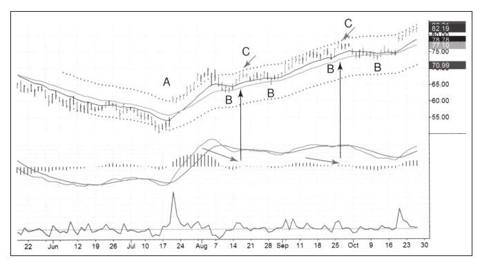

*图6-1 短期交易案例（A/B/C 波浪）（《以交易为生 II：卖出的艺术》原图）。*

### 2.2 案例一：因"交易噪音"卖出的短期交易（IKN）

信息来源：Spike 集团，会员每周收到大量短期交易机会；本次 IKN 由吉姆·劳斯科布尔推荐。计划每股风险 25 美分，潜在盈利 57 美分。

决策过程按时间顺序：

1. 周一下达买入指令，指令价 14.19 美元，与 Spike 建议买入价相同；当天走势强劲，最低价 14.20 美元，指令未成交。
2. 收盘前感觉股票还会走强，研究日线压力支撑后把买入价提高到 14.27 美元，第二天执行。
3. 市场很快给出反馈：第二天股价下跌，买入成交但收盘 14.08 美元，接近全天最低价——追高入场是自主决策的教训。
4. 周五（3月16日）：IKN 跌穿前日低点后展开上涨，到达长期移动平均线之上；因快到周末且价格已高于价值，决定不再等待，以 14.60 美元卖出。

结果与评分：

- 出场评分 69%（有幸在突破上轨的第三天才卖出），是不错的成绩。
- 总交易评分 18%（20% 以上才能获 B 评级，18% 算 B-），当周推荐中获铜牌；在糟糕市况下第三名非常不易。
- 作者自认因自主交易（提高入场价）导致利润低于预期。

作者特意选这个平淡案例的原因：发现合理信号后机械入场，即便市场不如预期，出场价格依然清晰，最终有利润入账——这就是大多数以交易者为生的人的真实交易生活，令人兴奋的交易少之又少。

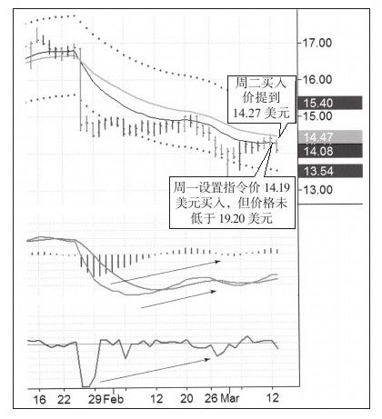

*图6-2 IKN入场（交易计划）（《以交易为生 II：卖出的艺术》原图）。*

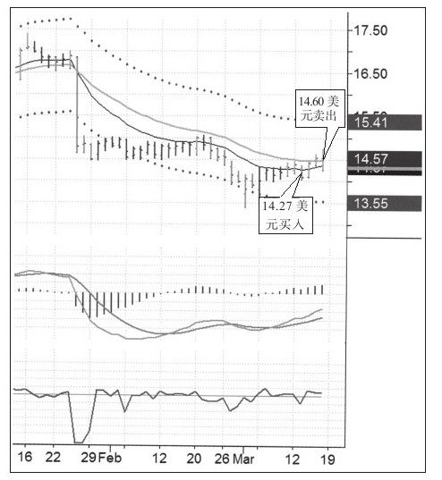

*图6-3 IKN周线图（《以交易为生 II：卖出的艺术》原图）。*

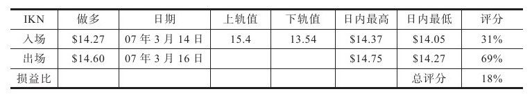

*图6-4 IKN出场（《以交易为生 II：卖出的艺术》原图）。*

### 2.3 案例二：主观长线交易（福特汽车 F）

背景：2007年1月，退休基金管理人杰拉德·德布鲁在福特发布公司历史上最大季度亏损公告后强烈看多，理由是新 CEO 将带领公司走出泥潭。作者负责技术验证。

买入的技术依据：

- 月线图：过去20年最高接近40美元后缓慢下跌，2003年跌到6美元反弹，2006年略微跌破前期低点；作者喜欢"略微跌破前低并伴随大量底背离"的模式。
- 周线图：2006年组合系统底背离，加上强烈买入信号——周线强力指标深幅下跌（尖角下跌）确认大底。尖角下跌表明卖单巨大、大量交易者放弃该股，多头情绪到达"极度厌恶点"；一周"打折促销"后只剩坚定多头和即将上涨的股票。作者注明此信号分析底部很有用，分析顶部则不那么好用。
- 心理确认（脚注）：出租车司机听说作者在买福特（市场全是基本面坏消息），吃惊得差点把车开翻——作者喜欢投资大众抛弃的股票。

计划：大量买入持有几年，目标价 20 美元附近（历史最高价的一半）；不关注短期上涨，等待短期下跌时继续加仓。

实际操作（图6-7、图6-8）：

1. 第一次建仓 7.50 美元，使用计划的 1/5 仓位；股价接近日线下轨、强力指标低于0。
2. 第二次建仓 7.48 美元，同样 1/5 仓位，条件相同。
3. 第二次底后一波上涨，但出现强力指标顶背离、MACD 柱超买——两个信号表明上涨遇到压力。
4. 以 8.07 美元卖出一半，准备价格跌回 7.5 美元支撑时加倍买入。
5. 卖出后股价小涨再快速下跌，但后来拒绝继续下跌；作者据此判断上涨可能性远大于下跌，重新定买入价。
6. 以 7.95 美元买回前次卖出的股票；写作本节时股价已在9美元之上，持续低买高卖做波段。

方法总结：基于基本面看好和强烈技术信号建立长期头寸；基于市场噪音在长期交易中做买卖波段——市场发出轻微卖出信号就卖出，看起来没问题时低位接回，整个过程保持长期核心头寸不变。卖出价越来越高，持有核心头寸还获得分红股，相当于买了便宜股。

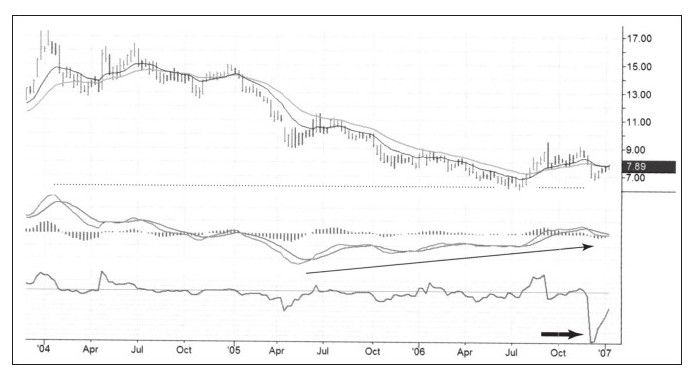

*图6-5 F（福特）月线图（《以交易为生 II：卖出的艺术》原图）。*

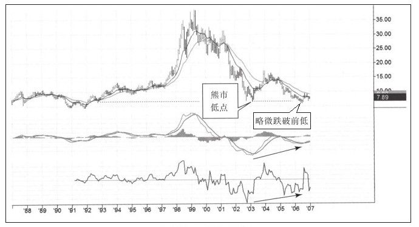

*图6-6 F 主观长线交易（《以交易为生 II：卖出的艺术》原图）。*

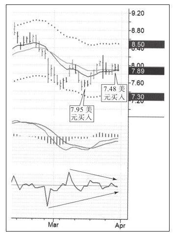

*图6-7 F日线图（三次买入）（《以交易为生 II：卖出的艺术》原图）。*

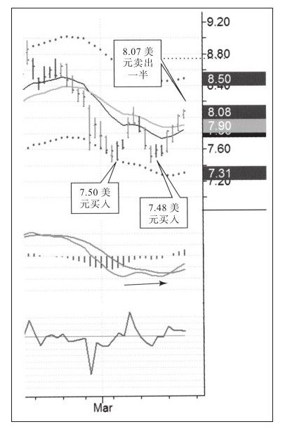

*图6-8 F 后续走势（《以交易为生 II：卖出的艺术》原图）。*

### 2.4 业绩公告发布前卖出

基本面与价格的关系：多数情况下基本面信息已反映在股价中；基本面资金管理者每次买卖都创造出技术分析者可识别的模式。买入至少应知道股票所属行业——买入优势行业股、卖出劣势行业股是好主意。基本面信息的问题是突然爆出而非"缓缓出来"，导致股价暴涨暴跌，业绩公布时尤其如此。

业绩报告很少带来惊喜的两个原因：

1. 行业研究员、预测者众多且专家预测较准；付钱给他们的人在报告发出前就已买入或卖出，价格已反映期望。
2. 报告发布前往往已经泄露。作者认为内幕交易量远超多数人想象，被证交会抓住的只是"贪婪而愚蠢的家伙"和冰山一角；乡村俱乐部里机灵的内幕交易者一生都在做内幕交易。"新闻是为大众准备的，而内幕交易者在新闻爆出之前早已有所准备。"

比利时交易者帕斯卡·威廉的方法：内幕交易与公司经营方式有关联，大合同谈判人多、持续数周，给泄露创造机会；公司不会改变经营管理方式，过去有泄露先例，未来还会泄露。因此他会查看公司过去一年的信息，对比股价在信息发布前是否有异动。

操作规则：

- 如果发现公司有能力做好保密工作，可以继续持有头寸；否则无论多空，都该在公告之前出局。
- 非常相信自己系统的交易者也相当小心谨慎，会在业绩报告发布前了结交易。

CSCO 案例（图6-9、图6-10）：

1. 业绩发布前一天，顶底逐步抬高、走势坚挺，图右侧股价站在上轨之上进入高估区。
2. 业绩公布后股价起初快速下跌，之后完全收复前期高点，但那已是两个月之后。
3. 结论：无论公告盈亏，都应在股价高估区卖出股票。

RIMM 案例（图6-11至图6-13）：

1. 周线图：所有指标进入严重顶背离状态。
2. 日线图确认周线顶背离，做空时机合适；周三面临两难——价格未到盈利目标但似要跌向目标位，又似要反弹到做空当日低点，而收盘后即公布业绩。
3. 结果：公司诚实公布了未提前泄露的报告，一次发布三条利好（工程盈利、下季度工程量增加、按3:1拆股），市场相当吃惊，股价大涨留下巨大缺口，否定顶背离并创出历史新高。
4. 教训：不诚信的存在比多数人想象得广泛，但诚信公司的业绩公告会带来更强有力的冲击；想站在安全那边，最好在业绩报告公布前结束交易。怀疑一旦成立，可能帮你躲过大灾难。

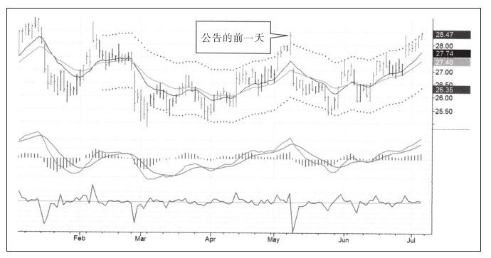

*图6-9 CSCO日线图（公告前一天离场）（《以交易为生 II：卖出的艺术》原图）。*

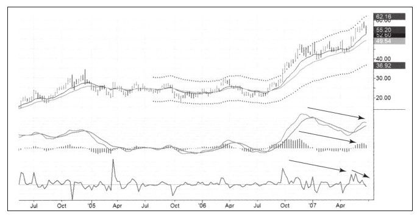

*图6-10 CSCO日线追踪图（《以交易为生 II：卖出的艺术》原图）。*

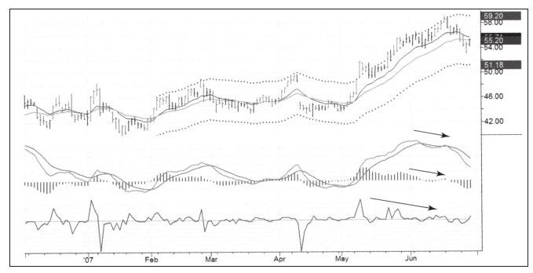

*图6-11 RIMM业绩前见顶信号（《以交易为生 II：卖出的艺术》原图）。*

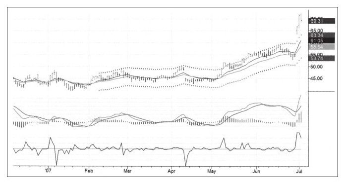

*图6-12 RIMM日线图（《以交易为生 II：卖出的艺术》原图）。*

### 2.5 市场警钟

信号定义：市场走出"月牙形态"之日就是警钟响起之时，这是长期趋势结束的信号。市场狂躁时很难听到警钟，多数人听不到，只有理性的交易者会听到并做出反应。听到钟声需要很多经验，据此离场需要更多勇气和自信；警钟机会非常少，必须眼观六路、耳听八方——这不是新手的任务。

作者亲历的警钟之一：1989年日经指数。

- 飞往亚洲的波音747上，一位约50岁的日本首席空乘说自己经常在已上涨近20年的日本股市进出，股市赚的钱比薪水还多，打算提前退休并在太平洋小岛建别墅；唯一不舒服的是与父母同住、负担轻的办公室女白领赚得比他还多。
- 几个月后日经指数彻底崩跌，头一年蒸发一半市值，而这只是超级熊市的开始。作者错过近顶部做空的机会，此后再不能错过此类心理信号。

警钟的判断逻辑：当一个或一系列事件非常不正常、"好像市场规律被废除一样"时即为警钟；事实上没人能改变市场规律，泡沫只会短暂制造规律失效的假象。让业余交易者持续赚钱的市场不存在；门外汉和迟来者开始赚很多钱时，市场离顶部就很近了。

历史对照——伯纳德·巴鲁克避开1929年大崩盘：擦鞋工向他推荐股票，他意识到最底层的人都开始买股票时，社会上就没人不买股票了，于是开始卖出。

另一个心理信号——交易展览会免费礼物：

- 股市价格高低与主办方免费礼物的质量、数量呈强烈正相关。市场顶部要准备购物袋背礼物；1987年见顶前一个月，芝加哥交易所赠送上好太阳镜，镜框刻着"未来太光明，我们要戴上太阳镜"。熊市底部参加展览可能连一支圆珠笔都收不到。
- 2007年2月24日纽约交易展览会：股市已涨近4年、最近7个月无回调上涨，礼物丰富（滑雪帽、壁球帽、围巾、一叠T恤）；纳斯达克展台把美元卷进印广告的塑胶管派发，可随意再拿。作者当天下午告诉学员股市正在筑顶。

2007年的实际决策与操作：

1. 周一是假日，周二开始大量卖出。
2. 指标整月显示卖出信号，免费礼物如同正在敲响的警钟；上涨已超过所有合理盈利目标，走向疯狂。
3. 卖出所有多单并开始做空：做空股票和股指期货，同时买入一些指数认沽期权。
4. 博览会后股市又涨了一些，但没过多久市场崩跌，做空正当时。

市场结构原理：市场像抽水机一样吸干缺乏准备的大众的钱，注入少数理性交易者账户；因佣金、滑点、监管费等成本，交易是负和游戏——赢家赚的少于输家亏的，所以必然少量赢家、大量输家。业余交易者只能从做多上涨中赚钱，若每个人都从上涨中赚钱就不正常；警钟响起意味着市场偏离正常太多、看多者太多，等待他们的是暴跌。

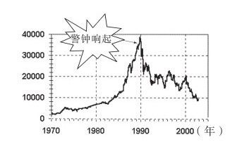

*图6-14 市场警钟（世纪顶）（《以交易为生 II：卖出的艺术》原图）。*

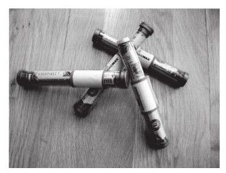

*图6-15 五色记号笔（作者标记工具）（《以交易为生 II：卖出的艺术》原图）。*

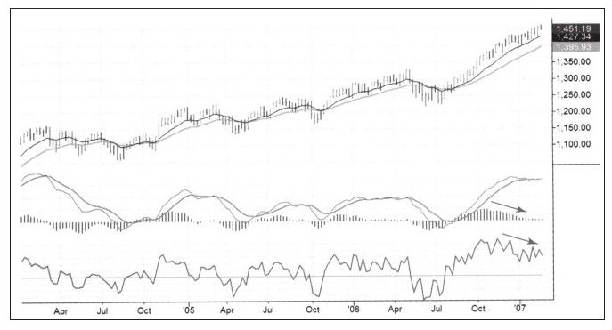

*图6-16 市场警钟案例（一）（《以交易为生 II：卖出的艺术》原图）。*

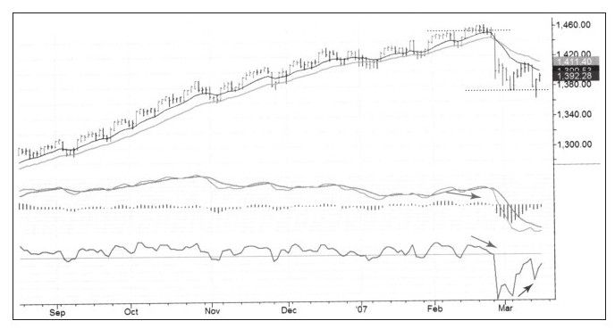

*图6-17 市场警钟案例（二）（《以交易为生 II：卖出的艺术》原图）。*

### 2.6 使用新高新低指标（NH-NL）进行交易

定位：无论交易个股还是股指期货，都应有指标确认市场趋势、警示即将到来的反转；当该指标显示市场即将反转时，要特别留意持仓个股的技术信号。作者认为 NH-NL 是最好的股票市场领先指标。

计算方法：新高（创过去52周新高，多头力量象征）的股票数量减去新低（创过去52周新低，空头力量象征）的股票数量，得出当日 NH-NL 值；把过去5天的日值相加得到当周值。

信号规则：

- 指标为正表示牛市主导，为负则熊市主导。
- 指标与股价同涨同跌，即在确认趋势；价格创新高、指标也创新高，牛市行情可能延续。
- 价格上涨但指标下跌（顶背离），上涨趋势遇到麻烦；同样逻辑适用于下跌趋势（底背离）。

看图方式：分屏模式，左周线、右日线；周线用一条线显示，日线用两条线分别显示新高（绿线）与新低（红线）。

2007年2月案例（图6-18、图6-19）：

1. 标普500周线创出新高，NH-NL 却走出顶背离，竖线标记的位置都是市场重要顶部；日线仅有小规模顶背离，主要卖出信号来自周线。
2. NH-NL 发出卖出信号时市场响起警钟；不同原理的指标显示相同信号，会加强彼此信息含义。
3. 背离后股价暴跌，稍作反弹再创新低；此时日线 NH-NL 出现底背离，表明下跌主导趋势可能结束，应平掉空单、准备再次做多。

局限：在加仓或减仓时机上，NH-NL 不如 MACD 或强力指标精确；但因能帮助识别大势，对交易个股非常有用。

### 2.7 卖出决策树

决策树是一组"在特定条件下该做什么、不该做什么"的规则；严谨专家的决策树很少写在纸上，通常在脑子里甚至骨子里，靠训练、学习和实践形成，且要终生不断发展（引卢·泰勒："如果我每年比上一年聪明1%，在我死的时候我就是个天才。"）。作者以飞行员的飞行手册、葛文德《清单革命》、《黑匣子》中无手册指引仍成功迫降的案例说明：清单与决策树大多数时候有用，但绝不可能完备，必要时仍需交易者主观决断。

系统与主观的关系：市场状况不断变化，所有自动交易系统最终都会自我毁灭，这是业余者使用商业系统亏钱的原因；即便是全自动专家也会像鹰一样盯着系统。交易者应具备的能力是——如系统一样寻找机会、设置止盈止损，必要时自己下决定。

买入决策树回顾（卖出树之前提）：决策从始至终贯穿资金管理；第一个问题是"6%规则是否允许我交易"，下单前最后一个问题是"在2%规则下我能买入多少股"。买得好，卖得才容易好。

卖出决策树必须写入的要点：

1. 先判断短期交易还是长期交易。
   - 短期：止损设在通道或包络线附近；长期：止损设远一些，在重要压力位或支撑位附近。趋势交易者以长期为主，波段交易者以短线为主。
   - 比喻（苏海尔·拉巴尼）：猎大象者因象大而很少开枪，猎兔子者相反，武器和过程大不相同；新手随便拿枪进丛林、不知打象还是打兔，往往打中自己的脚。
   - 必须写下盈利目标、期望收益和预计交易时间；短期交易者紧看交易评分，只要表现能拿 A 评分（通道宽度的30%）就立即出局；长线交易者持有至价格到达盈利目标。
2. 确定在哪里执行止损。
   - 短期交易既要有较近盈利目标，也要有紧随的止损；交易时间越长波动越大，需要更大止损，这是规律。
   - 铁三角限制每次交易总风险：止损越宽，可买股数越少；每股风险增加，股数必须降低。
   - 参考标准：小账户多数时候把单次总风险控制在2%以下；大账户可把单次短线交易总风险控制在0.25%以内、单次长期交易控制在1%以内（绝对金额仍相当大）。
3. 仔细聆听不同类型的"市场噪音"。
   - 交易开始后，若市场变得缓慢不稳、难以理解而不是走向目标，主观交易者可提前离场，不必等真正触及止损；离场时可能赚也可能亏。
   - 短期交易者看日线图与指标：超买、高位走平、MACD 柱顶背离、强力指标顶背离、甚至日线 MACD 柱刚开始下跌，都是出场信号——微小疲软即出场。
   - 长期交易者更能忍受小噪音，甚至不必对日线信号做出反应（反应反而容易丢掉长期头寸），应关注周线图、等待更大的噪音，在周线上寻找信号。
4. 有经验者可在一次交易中结合两种方法：围绕长期核心头寸做大量短期交易，短线交易方向与长期一致。
   - 示例：持有1000股、成本8美元、目标20美元；500股作为核心头寸不动，其余灵活操作。回调到移动平均线后可增至1500股，涨过上轨后降回500股；不断买卖，但长期头寸始终不变。
5. 无论做什么，都把决策和行动记录下来。做好交易记录会提升学习效率，帮助在必经的苦难之路上活下来，并最终获得稳定盈利。

## 三、卖出信号与决策树速查

| 情形/工具 | 卖出或离场信号 | 对应动作 |
|---|---|---|
| 上涨动力减弱 | MACD 柱与价格顶背离；股票不再朝有利方向运动、变得沉闷 | 短线直接出场；长线部分获利了结、保留核心头寸 |
| IKN 式短期交易 | 价格高于价值（长期均线之上）、临近周末、不愿再等 | 立即卖出落袋为安；追价提高入场价是反面教训 |
| 福特式长线交易 | 强力指标顶背离 + MACD 柱超买（轻微卖出信号） | 卖出一半做波段；跌不动且涨概率大时（7.95美元）接回，核心头寸不动 |
| 业绩公告前 | 无法确认公司保密能力；股价已在上轨之外的高估区；内幕/泄露疑点 | 无论多空、无论公告预期盈亏，公告前出局 |
| 市场警钟 | 月牙形态；业余者/门外汉持续赚大钱（空乘、擦鞋童）；展会礼物极度丰盛（派发美元） | 卖出全部多单，做空股票与股指期货，买入指数认沽期权 |
| NH-NL 周线 | 价格创新高而周线 NH-NL 顶背离（主信号） | 市场警钟，卖出/做空；多原理指标共振则信号更强 |
| NH-NL 日线 | 下跌创新低时日线 NH-NL 底背离 | 平掉空单，准备再次做多 |

卖出决策树顺序（速记）：

1. 资金管理先行：6%规则是否允许交易？2%规则下能买多少股？
2. 定性：短期还是长期？（止损位置、盈利目标、持有时间、评分标准随之确定）
3. 定止损：短线紧贴通道；长线放在重要支撑/压力，给足回旋余地；止损宽则减股数。
4. 听噪音：短线看日线，微小疲软即走；长线看周线，等大信号；可核心头寸＋波段操作结合。
5. 做记录：决策与行动全部留痕，用于复盘与持续改进。

## 四、本章金句（原文原句）

1. "如往常一样按照计划展开一次交易，这次交易可能很顺利，但如果听到很大的'噪音'或者看到市场对你不利时就无需坚持，赶紧出局看看发生了什么事。"
2. "股票变得沉闷时获利出局无可厚非，大不了重新买回就是。"
3. "明智的短线波段交易者如果看到MACD柱和价格发生顶背离他就会出场，而不是等待价格到达上轨。"
4. "新闻是为大众准备的，而内幕交易者在新闻爆出之前早已有所准备。"
5. "市场走出月牙形态之日就是市场警钟响起之时，这是长期趋势结束的信号。"
6. "让业余交易者持续赚钱的市场是不存在的，当门外汉和迟来者开始赚很多钱的时候，市场就离顶部很近了。"
7. "如果我每年比上一年聪明1%，在我死的时候我就是个天才。"（卢·泰勒）
8. "无论你做什么，都把决策和行动记录下来。"

## 五、对当代交易者的启示

1. 计划必须为"主观中断"留出接口：买入前就想好什么异常会让你提前出局，把"怀疑"本身制度化——有疑即走，先出局再评估，成本只是一次重新买回。
2. 区分周期再谈止损与噪音：日线级别的 MACD 顶背离对短线是出场令，对长线可能只是噪音；用错周期比对信号更危险，长线交易者应主要在周线图上找信号。
3. 核心头寸＋卫星波段的结构在今天依然有效：用底仓表达长期观点，用部分仓位围绕价值区与上轨低买高卖，既能降低持仓成本，又避免被日常波动洗出局。
4. 事件驱动风险必须事前管理：财报、重大公告本质是不可控的跳空风险，不要用持仓去赌消息；提前查看公告前股价是否已有异动，是识别泄露的实用方法。
5. 重视情绪与跨市场的"非指标信号"：社交媒体上新手晒收益、散户狂热、营销开支与免费礼品泛滥，与擦鞋童、空乘、展会礼物同理，可作为泡沫的旁证。
6. 用广度指标确认指数观点：NH-NL（新高新低）类市场广度指标领先于指数，顶/底背离可警示反转；多个不同原理的工具相互验证，比单一指标重仓押注可靠。
7. 建立并终身维护自己的决策树与交易日志：清单不能覆盖所有情形（黑匣子式极端行情仍需主观决断），但写下来、持续复盘、每年改进1%，是从业余走向严谨交易者的必经之路。

## 六、一句话核心判断

当交易按计划进行却听到市场发出异常"噪音"——上涨动力减弱、指标顶背离、财报临近或市场情绪癫狂——主观交易者应尊重怀疑、提前离场或减仓，并用核心头寸与波段操作相结合的方式在场外等待重新评估的机会。
