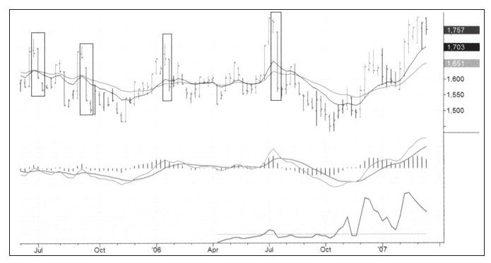
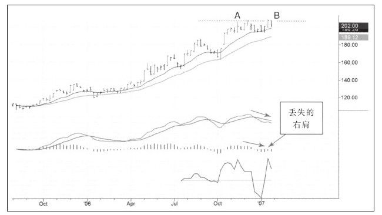
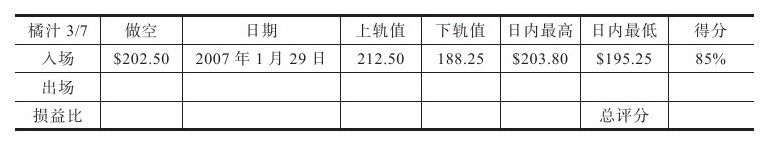
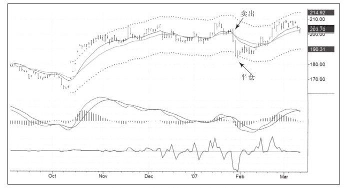
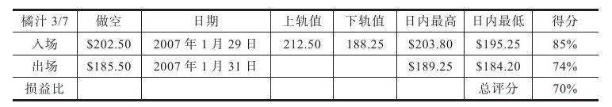
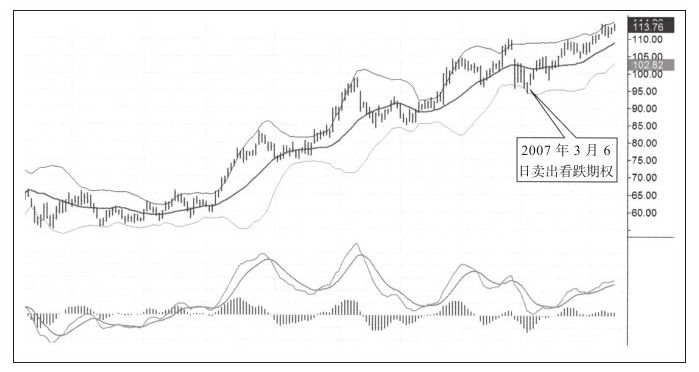
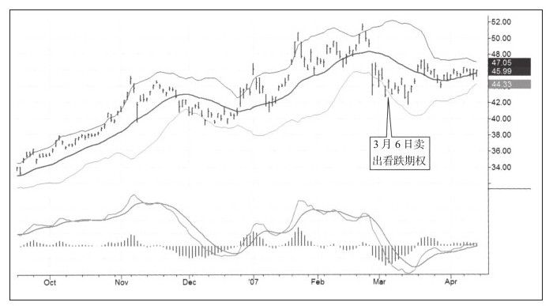
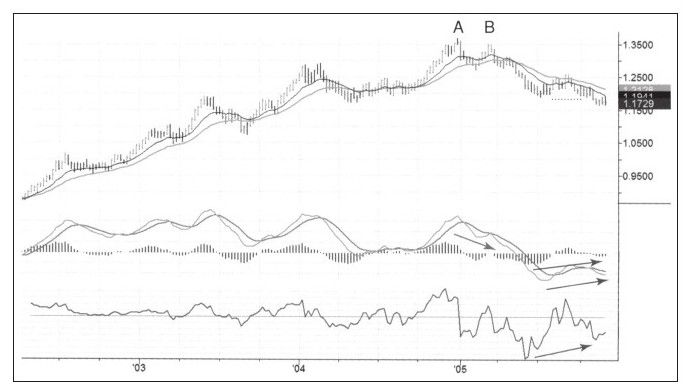
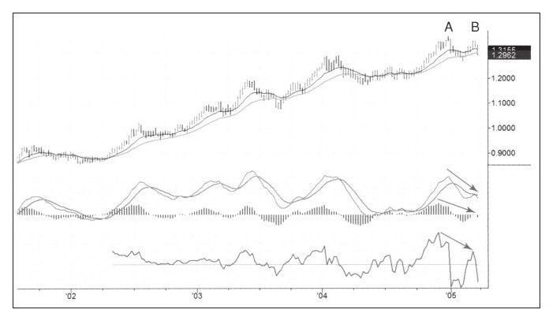

# 《以交易为生II》第8章：做空非权益类产品

> 亚历山大·埃尔德（Alexander Elder）：《以交易为生II：卖出的艺术》（The New Sell and Sell Short）第8章"做空非权益类产品"。

## 一、章节主旨

- 做空股票有诸多限制，但做空期货、期权和外汇完全自由，做空在这些市场上不仅是可选项，更是市场运行不可或缺的组成部分。
- 股票市场做空者不多；而在外汇、期货和期权市场上有大量做空者——期货和外汇市场上做空规模与做多规模一样大，每一张合约都有一张对手合约。
- 股票交易者若学会做空，便能在来回震荡的牛市中取得绝对优势，在熊市中更是如此；作者因此建议读者学习做空。
- 本章不系统讲授衍生品知识，而是分市场（期货、期权、外汇）直接讲解如何做空，并在每节推荐作者认可的好书。
- 核心取向：期货要利用"慢涨快跌"做空获利；期权的利润来自卖出而非买入（存量卖出与裸卖出）；外汇市场陷阱重重，普通人应远离投机商号、转向透明的外汇期货。

## 二、核心内容逐节梳理

### （一）做空期货

**1. 期货合约的本质**

- 买入股票相当于买入既存商业的股份；买入期货合约，除了一份与商品（一车小麦或一捆国库券）对应的合约外什么都没有获得，对手方是承诺未来交割商品的人。
- 每一张多单都对应一张空单，交易双方依据合约缴纳交易保证金。
- 每份合约规定有交收日期，不同交收月份合约售价不同；有专家通过分析不同月份合约之间的价差预测价格反转。

**2. 做空期货的规则优势**

- 没有愚蠢的"证券交易报升规则"：发出卖出期货合约指令时，平多与做空没有区别。
- 没有内幕交易禁令：可以通过商品期货交易委员会（CFTC）的定期持仓报告（COT）追踪内幕交易者的行为。
- 市场上大多数空单由商业头寸或对冲基金头寸构成，他们是真正的内幕交易者：大型农业综合企业会在丰收年提前卖出期货锁定销售价格；几乎所有对冲基金都把期货部作为利润中心，而非仅作风险对冲，意在做空获利。

**3. 价格结构：持有成本与周期性下跌（海尔奈莫斯的观点）**

- 商品流通带来供应成本——储存成本、资金成本、保险——这些都计入期货价格；成本日积月累，可把期货价格推到不可思议的高度。
- 价格成本变动相对较慢：上涨趋势不时被短暂剧烈的下跌打断，价格回到接近现实的水平，然后开始新一轮循环。
- 典型运动形态："缓慢向上、快速崩塌"，如同海浪推沙成丘、退潮时沙丘滑落。
- 若期货基本价值并未随时间改变，总体价格结构必须被周期性下跌打断。
- 市场是平衡的判官：每个正确判断都对应一个错误判断；当前价格反映交易者预期未来均衡的综合判断；开仓即表明交易者要挑战大众形成的均衡、证明市场处在错误之中。
- 投机者应有自知之明，远离不适合自己的游戏；"市场会讲述它自己的故事，你唯一的工作就是仔细倾听"。
- 无论盈亏，参与者都要按交易规模支付佣金、经纪费、清算费；对市场"贡献最大"的人，是持有亏损头寸过久的人，以及交易没有规则、不能始终如一的人。

*图8-1 做空期货案例（一）（《以交易为生 II：卖出的艺术》原图）。*

*图8-2 黄金期货日线图（平静缓涨）（《以交易为生 II：卖出的艺术》原图）。*

**4. 天然的"天花板"与"地板"（埃尔德的观点）**

- 地板是生产成本：价格低于生产成本时，生产者减产、供应下降、价格上升。例外：不顾一切的穷国为获取硬通货、以贬值本币支付国内工人，可能以远低于成本的价格出售，但不会持久。
- 天花板多数是替代品成本：价格合适时一种商品可替代另一种（如谷物太贵则用小麦作饲料），需求被"釜底抽薪"；市场极度兴奋时价格可短暂冲破天花板，但不会停留很久。
- 二者都不是固定不变的；买入或卖出之前，应先弄清价格距天花板和地板哪个更近。价格回归正常的过程，就是精明交易者的赚钱机会。

**5. 适合人群与做空战术**

- 期货适合资金管理能力很强、能执行近乎冷酷纪律的人；新手最好先从慢速移动的股票练起，成为专家且非常有纪律后再考虑期货。
- 期货市场品种不多，周末花一个多小时即可浏览美国主要期货市场，这是相对股票（数千只）的优势。
- 期货下跌往往一蹴而就：可可期货横盘区间1500~1800美元/吨，上涨持续数周至数月，一周即可跌回起点；缓慢上涨让新手误以为安全，突发利空（如飓风）使价格像扎破的气球快速下跌。
- 大众夺路而逃时，职业交易者的空单开始平仓出场，新一轮循环开始。
- 慢涨行情中止损位特别难设，可考虑使用止损反转指令（结束多单时反手做空），作者虽不偏爱此类指令，但认为对缓慢上升行情有意义。
- 实战案例（橘汁期货）：周线图出现创新高失败的假突破（B点价格高于A点却未能站上，跌回震荡区间），同时MACD线顶背离、MACD柱出现"丢失的右肩"；日线图同样显示假突破与顶背离且未与周线信号相悖——"周线图胜过日线图"。周一开盘后做空，两日内价格跌破日线布林下轨即平仓，达到盈利目标后没有理由继续持有。
- 结论：入场有逻辑、出场信号明确，慢涨快跌的期货品种值得关注。

*图8-4 期货做空案例（二，快跌段）（《以交易为生 II：卖出的艺术》原图）。*

*图8-5 橘汁期货日线图（出场，202.50→185.50）（《以交易为生 II：卖出的艺术》原图）。*

*图8-6 橘汁期货评分表（《以交易为生 II：卖出的艺术》原图）。*

**6. 推荐书目**

- 乔治·安吉尔《赢在期货市场》：最好的入门书（作者唯一推荐的入门书）。
- 杜里斯和琼斯《期货游戏》：期货市场小百科，要读最新版。
- 托马斯·海尔奈莫斯《期货交易经济学》：最有深度、最有智慧的高级书籍，对基本原则阐述无人能出其右，已多年不再版，需找二手重印本。
- 埃尔德《走进我的交易室》中有关期货的章节。

### （二）卖出期权

**1. 买卖分界线：赢家是卖出者**

- 期权市场有两类界线分明的人：一边是年复一年亏损的新手和赌徒，另一边是以期权交易为生的专家；分界线就在买入者和卖出者之间——赢家一直都是卖出者。
- 作者从未见过有人依靠买入期权并建立相应权益头寸；买家口中的成功只是昙花一现，偶盈利如同花钱买老虎机，小赚最终亏得更多。
- 期权进入门槛低，比股票更吸引初学者；但期权是消耗性资产，买方必须同时判准趋势和时机（如同让皮球同时穿越三个移动的圆圈）才有意义。
- 新手即便看对股票上涨也可能亏钱：若到达目标价的时间比预期长，期权到期即一文不值；改买长期期权又会发现价格高得离谱。
- 做市商的比喻：期权就是在交易希望，人们可以买入希望或卖出希望；专家每天到交易所寻找需要希望的人，给希望定价，再把希望卖给他们。
- 期权生意的利润来源不在买入，而在卖出：卖出即从买家手中拿到现金；时间吞噬期权价值，卖家购回成本越来越小，期权价值最终可能跌到零，连购回佣金都省下。
- 成功卖家往往提前购回注销（如以1美元卖出、10美分购回），不必冒险赚最后一点钱，风险归零后心态平和地寻找下一个机会。
- 交易期权要远离人多的地方：大多数人是买家，做相反的卖出交易才明智；用时间狙击多数人并把时间转化为金钱。

**2. 两种卖出方式**

- 存量卖出（covered）：以自有的股票为标的创造期权抛向市场。
- 裸卖出（naked）：以账户资本为担保，凭空创造出期权抛向市场。

### （三）存量卖出（备兑卖出）

**1. 持有股票后卖出看涨期权**

- 若持有一只上涨潜力有限的股票，可卖出该股票的看涨期权，立即从买家处收到现金，随后等待三种结果：
  - 股价相对平稳、未达行权价：到期白得期权费，总资本增加。
  - 股价下跌：同样获得期权费，减少股票下跌造成的损失。
  - 股价涨至行权价之上、被行权：既从股票上涨中受益，又获得期权费；可用资金寻找新的交易机会。

**2. 做空股票后卖出看跌期权**

- 在做空一只股票后，可卖出看跌期权保护空头头寸：
  - 股价平稳：获得期权费。
  - 股价上涨：期权费减少股价上涨造成的损失。
  - 股价跌到期权行权价之下、空头头寸被执行：同时获得期权费和股票下跌的利润。

**3. 适用范围**

- 主要作用：对规模较大的股票组合增加收益或减少损失。
- 单只股票上卖出看涨期权费力而收益小；在拥有大量股票的基础上操作才有经济意义，组合越大，使用期权越有意义。
- 大型资产管理者通常持有多种股票组合，并把这些组合放入期权项目中运作。

### （四）裸卖出

**1. 性质与保护**

- 裸卖空是期权交易中最令人紧张、最有前途但也最危险的领域；存量卖空者有股票担保，裸卖空则凭空创造期权。
- 保护裸卖空者的只有：账户现金、卖空技巧，以及完全遵守"截短损失、获取收益"的原则。

**2. 实战要点（迪安·巴菲林博士经验）**

- 只做"无趣"的简单交易：当股票停止下跌时做空看涨期权；在股价不再下跌时卖出看跌期权收取约10%的期权费。
- 最让人高兴的事是卖出到期一文不值的期权；不喜欢存量卖空，因为可能期权赚了钱、股票却亏了钱。
- 卖家如同赌场荷官，赚取自负赌徒的钱；到期日（每月第三周周五）就是"全盘通吃"之时。
- 买方只有一条赚钱的路、两条亏钱的路；卖出期权则有两条甚至三条赚钱的路。卖出时机是股价不再运动之时，随后股价运动越剧烈，市场回报越高。
- 波动放大后期权费更贵，卖出更贵的商品比卖出便宜商品好，价格中蕴含更大利润。
- 案例ATI（2007年3月）：股价触及布林下轨后反弹、MACD止跌；以4.8美元卖出行权价95美元的4月看涨期权（10张共收4800美元），等于以2美元折扣买股；后期权只值5美分，持有到期。
- 案例CHL中国移动：股价44.5美元时以4.8美元卖出6月、行权价45美元的看涨期权，选择该期限是因为赚取10%所需时间可以接受；判断是3个月内股价不会跌破45美元，若跌破则相当于低于现价10%买入正股。其间股价一度跌至41.70美元，期权净损失仅300美元；后涨至45.90美元，期权盈利1500美元——"判断错了还赚钱"。

*图8-7 期权卖出案例（一）（《以交易为生 II：卖出的艺术》原图）。*

*图8-8 卖出看跌期权（44.5 股票、45 行权价卖 4.8）（《以交易为生 II：卖出的艺术》原图）。*

**3. 保证金、门槛与风险认知**

- 买入期权成本很低（约为正股价的10%），但卖出期权需要相当数量的现金：至少10万美元，有些情况需要25万美元和两年经验。
- 经纪公司名义上保护投资人，实则怂恿客户买入大概率亏钱的期权，而不让客户做亏钱概率小的卖出决定。
- 卖出一张看涨期权可能发生的最糟糕的事，是以行权价买入股票——这与普通买卖股票无异；因此只卖出自己乐于以心仪价格买入正股的股票看涨期权。
- 卖出期权时资本并未放进市场，可同时持有债券赚取利息；裸卖空"最糟糕的事情"对有准备的人完全可以接受。
- 这门生意要求努力工作：作者让求教者追踪股票、每日记录股价与期权价格，但没有人能坚持哪怕一个月，都是懒惰所致。

### （五）外汇

**1. 书籍与市场结构**

- 作者认为没有一本文汇外汇书籍值得信心十足地推荐，读者只能自行从汗牛充栋的书籍中筛选。
- 投资者结构呈金字塔：顶层是银行间市场的大资金（单笔以千万美元计）；中层是外汇期货市场的中等资金，面临开盘跳空缺口威胁（外汇几乎24小时交易而期货并非如此）；底层是外汇商号里普通大众的小账户。
- 赌徒、失败者和资金不足的新手一路从散股交易、期权市场输光后，幸存者又涌向外汇市场。

**2. 外汇投机商号（bucket shop）的陷阱**

- 大多数外汇商号是投机商号：客户只收到所谓成交回报，实际没有真实成交，只有入场备案；指令哪里都没去。
- 商号充当客户的对手方，无论客户交易哪个方向都与之对赌；客户赚钱商号就亏钱，信息严重不对称。这种系统在股票市场一个世纪前就已消失，今天仍在外汇市场运行。
- 疯狂的保证金比例最高达400:1（0.2%保证金）；对比股票50%、期货5%——如此杠杆使所有资金管理策略失去意义。
- 除买卖价差外，商号还拿走客户资金的利息：做多交叉汇率时付给客户少于应得的利息，做空时收取多于应付的利息。
- 价差、佣金和客户资金利息"给赌徒的棺材钉上了钉子"；商号深知客户终会因缺乏技巧和资金薄弱而"死亡"，无须把交易单抛向市场分享利润。
- 较明智的商号会监控客户总仓位，净持仓单向过大（如100万美元）时把风险转向银行间市场；有些商号则选择与客户对赌到底。
- 诚实商号因需承担交易执行成本，在与投机商号的低价竞争中劣势明显；各国政府都未能整顿好外汇市场，作者只能告诫："小心谨慎！"
- 投机商号50美元即可开户并给100:1杠杆（可交易5000美元头寸），这是其吸引人的原因，但客户除成交回报和利息支出外一无所获。

**3. 可行选择：外汇期货与做空逻辑**

- 不在银行间市场交易大资金、又不想进投机商号，唯一选择是外汇期货：始于20世纪70年代芝加哥商品交易所（CME），现已遍布多国；电子化交易使其信誉卓著、更加透明。交易外汇期货前必须先学会交易期货。
- 做空外汇是相对过程：买入一种货币即自动做空对应货币，多空犹如硬币正反面，所有外汇交易本质上都是价差交易。
- 以美元账户买入欧元＝做多欧元、做空美元；做空瑞郎＝自动做多美元。
- 交叉货币对可不涉及本币：欧元/澳元＝做多欧元做空澳元，瑞郎/日元＝做多瑞郎做空日元。
- 外汇是全球趋势特征最明显的市场：货币一旦进入主趋势，无论涨跌都可能持续好几年，因为长期币值与政府政策紧密相关（强势政府实施经济刺激政策常带动货币长期走强）；但趋势并非直线，中短期有大量较深回调，提供短线交易机会。
- 欧元案例：周线图上涨4年后出现多重严重顶背离（MACD线、强力指标背离，MACD柱"丢失的右肩"），做空信号清晰；随后向下假突破配合所有指标底背离，又成为最好的平空做多信号。
- 注意：股票市场的某些打法在外汇市场会失效——持仓数日到数周的波段交易在外汇市场更容易遭受双重打击（两面挨耳光）；外汇24小时交易，大量行情发生在交易者睡觉或无法看盘时，本时区图表只是全天交易的一部分。

*图8-9 欧元周线图（主趋势持续数年）（《以交易为生 II：卖出的艺术》原图）。*

*图8-10 外汇案例（远离做对手盘的经纪商）（《以交易为生 II：卖出的艺术》原图）。*

## 三、三类工具对比速查表

| 维度 | 做空期货 | 卖出期权（存量/裸卖出） | 外汇（投机商号 vs 外汇期货） |
|---|---|---|---|
| 做空自由度 | 完全自由，平多与做空无区别，无报升规则 | 完全自由；卖出（而非买入）是利润来源 | 多空一体：买一种货币即做空另一种 |
| 对手/担保 | 每张多单对应一张空单，双方缴纳保证金 | 存量卖出以自有股票担保；裸卖出以账户现金、技巧与纪律担保 | 投机商号直接做客户对手；期货为交易所集中清算 |
| 保证金 | 约5%，杠杆高但仍可做资金管理 | 买方仅需约正股价10%；裸卖需账户至少10万美元（部分需25万+两年经验） | 商号最高400:1（0.2%），资金管理失效；期货保证金与商品期货相当 |
| 核心风险 | 高杠杆、慢涨快跌、突发利空急速崩塌 | 裸卖出理论风险大（看涨期权上涨风险无限）；期权费随波动上升 | 商号不真实成交、利息盘剥、对赌客户；24小时跳空、波段易双重受损 |
| 风险控制 | 弄清价格距天然天花板（替代品成本）/地板（生产成本）的远近；止损反转指令 | 只卖乐于以行权价买入正股的股票期权；提前低价购回注销；截短损失 | 远离投机商号，选择CME等电子化、透明的外汇期货 |
| 价格/走势特征 | 缓慢向上、快速崩塌；下跌一蹴而就 | 时间价值持续衰减，到期可归零；股价不动时是卖出窗口 | 全球趋势性最强，主趋势可持续数年，期间有大幅回调 |
| 适合人群 | 资金管理能力强、纪律近乎冷酷者 | 有资本、有耐心、坚持记录、愿做枯燥功课者 | 能交易期货、理解24小时市场、警惕陷阱者 |
| 作者推荐书 | 《赢在期货市场》《期货游戏》《期货交易经济学》《走进我的交易室》 | 麦克米兰《期权作为战略投资》、南丁伯格《期权波动与价格策略》、弗里登泰格《投资无恐惧》 | 无书可推荐，需自行甄别 |

## 四、本章金句（原文原句）

1. "市场是平衡的判官，对于每个正确的判断来说都有一个错误的判断与之对应。"
2. "市场会讲述它自己的故事，你唯一的工作就是仔细倾听。"
3. "对市场贡献最大的人是那些持有亏损头寸过久的人。"
4. "期权就是在交易希望，人们可以买入希望或卖出希望。我是专家，所以我卖出希望。"
5. "期权生意的利润来源不在买入，而在卖出。"
6. "交易是唯一一门聪明与回报成正比的生意，所以你必须努力工作。"
7. "价差、佣金以及客户资金所产生的利息给赌徒的棺材钉上了钉子。"
8. "在一个透明的系统出现之前，我只有一个词送给你：小心谨慎！"

## 五、对当代交易者的启示（5-7条）

1. 做空是衍生品市场的原生功能而非旁门左道：期货和外汇中多空完全对称，理解做空才能完整理解这些市场，股票交易者掌握做空可在震荡市和熊市中获得结构性优势。
2. 尊重"慢涨快跌"的非对称节奏：期货中上涨靠持有成本缓慢堆积、下跌因泡沫刺破一蹴而就；做空应瞄准长期缓涨后的假突破与顶背离，而不是在下跌已经发生后追空。
3. 交易前先画清"天花板与地板"：用生产成本估底、用替代品成本估顶，判断价格离哪边更近，是任何高杠杆市场中最朴素也最有效的风险定价框架。
4. 期权长期博弈中站在时间一边：买入期权需同时赌对方向与时机，是负和的消耗品游戏；卖出期权（尤其备兑卖出）以时间衰减获利，但裸卖出必须有充足资本、严格止损和"愿意以行权价接货"的心理准备。
5. 警惕任何"经纪商就是你对手方"的市场结构：当代零售外汇/差价合约（CFD）、高杠杆平台与书中投机商号本质相同——超高杠杆、点差与隔夜利息、订单不进市场，识别交易对手利益是否与自己一致，是入金前的第一道尽调。
6. 纪律与记录是唯一的门槛：裸卖空需要资金门槛，更需要每日记录股价与期权价格、坚持枯燥功课的耐心；作者观察到没有人能坚持一个月——能否做"无趣的事"正是专业与赌徒的分界线。
7. 顺应市场特性选择打法：外汇是全球趋势性最强的市场，主趋势以年计，适合顺大势、利用回调布局；股票式短波段在24小时市场中容易两面受损，不应简单移植交易系统。

## 六、一句话核心判断

做空非权益类产品的制胜之道在于：期货中利用"慢涨快跌"与顶背离做空、期权中坚持站在卖出希望的时间一边、外汇中远离对赌客户的投机商号而只做透明的外汇期货——三者共同要求的是充足资本、冷酷纪律与对市场结构陷阱的清醒认知。
